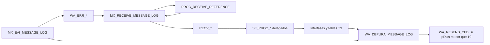

# Documentación detallada: recepción, recuperación y mantenimiento EAI_OWNER

**Fecha de revisión:** 23 de septiembre de 2026.  
**Proyecto:** OraToSQL.  
**Alcance:** los 15 procedimientos solicitados y sus llamadas directas.

## 1. Alcance, fuentes y convenciones

Este documento describe la función, parámetros, lógica completa, reglas relevantes, llamadas a otros procedimientos y tablas input/output de las implementaciones SQL Server del repositorio. Las conclusiones se basan en instrucciones ejecutables; los comentarios anteriores se utilizan como contexto, no como sustituto del código.

El análisis es estático. No se ejecutaron los procedimientos, no se modificaron datos y no se verificó qué versión está instalada en producción. Las tablas indirectas se identifican separadamente cuando pertenecen a una rutina delegada. No se presupone que toda la cadena transitiva de procedimientos, triggers o SQL dinámico quede cubierta por el inventario directo.

### 1.1 Relación Oracle–SQL Server

Los procedimientos independientes conservan el nombre bajo `EAI_OWNER`. Los cinco miembros solicitados del package Oracle se migraron a procedimientos independientes sin el prefijo del package:

| Nombre Oracle solicitado | Objeto SQL Server / archivo revisado |
|---|---|
| `EAI_OWNER.SF_JOB_MANAGE` | [EAI_OWNER.SF_JOB_MANAGE](../MSSQL/T3/EAI_OWNER/Procedures/SF_JOB_MANAGE.SQL) |
| `EAI_OWNER.SF_PROC_CENTRAL_INCOBRABLE` | [EAI_OWNER.SF_PROC_CENTRAL_INCOBRABLE](../MSSQL/T3/EAI_OWNER/Procedures/SF_PROC_CENTRAL_INCOBRABLE.SQL) |
| `EAI_OWNER.WA_DEPURA_MESSAGE_LOG` | [EAI_OWNER.WA_DEPURA_MESSAGE_LOG](../MSSQL/T3/EAI_OWNER/Procedures/WA_DEPURA_MESSAGE_LOG.SQL) |
| `EAI_OWNER.WA_ERR_CUSTOMER_AMPERSAND` | [EAI_OWNER.WA_ERR_CUSTOMER_AMPERSAND](../MSSQL/T3/EAI_OWNER/Procedures/WA_ERR_CUSTOMER_AMPERSAND.SQL) |
| `EAI_OWNER.WA_ERR_INTERCOMPANY` | [EAI_OWNER.WA_ERR_INTERCOMPANY](../MSSQL/T3/EAI_OWNER/Procedures/WA_ERR_INTERCOMPANY.SQL) |
| `EAI_OWNER.WA_ERR_INVOICE_AMPERSAND` | [EAI_OWNER.WA_ERR_INVOICE_AMPERSAND](../MSSQL/T3/EAI_OWNER/Procedures/WA_ERR_INVOICE_AMPERSAND.SQL) |
| `EAI_OWNER.WA_ERR_REPLENISH_AMPERSAND` | [EAI_OWNER.WA_ERR_REPLENISH_AMPERSAND](../MSSQL/T3/EAI_OWNER/Procedures/WA_ERR_REPLENISH_AMPERSAND.SQL) |
| `EAI_OWNER.WA_RUN_STATEMENTS` | [EAI_OWNER.WA_RUN_STATEMENTS](../MSSQL/T3/EAI_OWNER/Procedures/WA_RUN_STATEMENTS.SQL) |
| `EAI_OWNER.Proc_Receive_Reference` | [EAI_OWNER.PROC_RECEIVE_REFERENCE](../MSSQL/T3/EAI_OWNER/Procedures/PROC_RECEIVE_REFERENCE.SQL) |
| `EAI_OWNER.RECV_TO_SEND_V3.Recv_Customer` | [EAI_OWNER.RECV_CUSTOMER](../MSSQL/T3/EAI_OWNER/Package/RECV_CUSTOMER.SQL) |
| `EAI_OWNER.RECV_TO_SEND_V3.Recv_Invoice` | [EAI_OWNER.RECV_INVOICE](../MSSQL/T3/EAI_OWNER/Package/RECV_INVOICE.SQL) |
| `EAI_OWNER.RECV_TO_SEND_V3.Recv_Invoice_Intercompany` | [EAI_OWNER.RECV_INVOICE_INTERCOMPANY](../MSSQL/T3/EAI_OWNER/Package/RECV_INVOICE_INTERCOMPANY.SQL) |
| `EAI_OWNER.RECV_TO_SEND_V3.Recv_Payment` | [EAI_OWNER.RECV_PAYMENT](../MSSQL/T3/EAI_OWNER/Package/RECV_PAYMENT.SQL) |
| `EAI_OWNER.RECV_TO_SEND_V3.Recv_Replenishment` | [EAI_OWNER.RECV_REPLENISHMENT](../MSSQL/T3/EAI_OWNER/Package/RECV_REPLENISHMENT.SQL) |
| `EAI_OWNER.WA_ERR_PRODUCT_AMPERSAND` | [EAI_OWNER.WA_ERR_PRODUCT_AMPERSAND](../MSSQL/T3/EAI_OWNER/Procedures/WA_ERR_PRODUCT_AMPERSAND.SQL) |

La [especificación Oracle](../ORA/T3/EAI_OWNER/Packages/RECV_TO_SEND_V3.SQL) declara esos cinco `RECV_*` sin parámetros. El [README de la conversión](../MSSQL/T3/EAI_OWNER/Package/README.md) explica la publicación independiente. No existe en estos archivos un procedimiento que ejecute automáticamente todos los miembros del package.

### 1.2 Cómo interpretar entradas, salidas y estados

- **Input:** tablas leídas para elegir candidatos, consultar configuración o calcular información.
- **Output:** tablas insertadas, actualizadas o eliminadas. Una misma tabla puede ser input/output.
- **Salida de ejecución:** parámetros `OUTPUT`, conjuntos de resultados o mensajes `PRINT`. Un parámetro llamado `@pOutput` no implica que esté declarado como `OUTPUT`.
- `MX_EAI_MESSAGE_LOG.ROW_ID` identifica la fila de error origen; los scripts de recuperación lo tratan como identificador estable, sustituyendo el `ROWID` físico Oracle.
- `MX_RECEIVE_MESSAGE_LOG.ROW_ID` es un identificador de recepción `VARCHAR(32)`, distinto del anterior. No deben intercambiarse.
- `Processed IS NULL` significa pendiente para los coordinadores, independientemente del texto de `Status`.
- `Reprocess` identifica el error original del que se generó una nueva recepción. No acredita que el documento de negocio ya se haya procesado correctamente.
- `PI Issue` se asigna a mensajes de una instancia no autorizada y se acompaña de fecha `Processed`.

Salvo el conjunto final de métricas de incobrables y posibles resultados del SQL dinámico/delegados, los resultados son cambios persistentes y mensajes diagnósticos. Ninguno de los 15 declara parámetros formales de salida.

### 1.3 Vista del flujo



El diagrama representa dependencias de datos, no una secuencia automática garantizada. En particular, los mensajes reinsertados necesitan cumplir los filtros de cada consumidor.

## 2. EAI_OWNER.SF_JOB_MANAGE

### 2.1 Función

Suspende o reactiva en conjunto cinco jobs de entrada T3: Invoice, Intercompany, Delivery, Payment y Customer. Resuelve sus números históricos Oracle desde configuración y delega la modificación de SQL Server Agent a `JOB_NEXT_RUN`.

No procesa documentos, no ejecuta los jobs inmediatamente y no detiene una ejecución ya iniciada: modifica su habilitación y programación a través de la dependencia.

### 2.2 Parámetros

| Parámetro | Tipo | Dirección | Predeterminado | Regla |
|---|---|---|---|---|
| `@sAction` | `VARCHAR(20)` | Entrada | Sin valor predeterminado; debe suministrarse | Solo el texto exacto `Suspend` suspende. Cualquier otro valor, incluso `NULL`, reactiva. |

La condición exige `DATALENGTH(@sAction) = 7` y comparación `COLLATE Latin1_General_100_BIN2 = 'Suspend'`. Por tanto, valores como `suspend`, `Suspend ` o una cadena vacía no suspenden.

### 2.3 Lógica completa

1. Consulta `GETCONV('CFG Settings', clave)` para estas cinco claves: `T3In-Job Invoice`, `T3In-Job Intercompany`, `T3In-Job Delivery`, `T3In-Job Payment`, `T3In-Job Customer`.
2. Convierte cada valor a `INT` mediante `TRY_CONVERT`.
3. Si alguno es nulo/no numérico, lanza `51020` antes de modificar jobs.
4. Para suspensión fija la fecha `4000-01-01 00:00:00`. Para cualquier otra acción toma la hora actual más 30 segundos.
5. Abre una transacción y llama a `JOB_NEXT_RUN` cinco veces, en el orden Invoice → Intercompany → Delivery → Payment → Customer, con la misma fecha.
6. Confirma el conjunto al terminar. Ante error, revierte la transacción activa y relanza mediante `THROW`.

### 2.4 Reglas importantes

- Los valores de configuración son números históricos `DBMS_JOB`, no nombres ni GUID de SQL Agent.
- No valida que los cinco números sean distintos; una configuración repetida puede actualizar el mismo job varias veces.
- La fecha del año 4000 es una señal de suspensión para `JOB_NEXT_RUN`.
- Reactivar configura una fecha/hora base; no equivale a `sp_start_job` ni cambia la frecuencia recurrente del schedule.
- No crea mapeos ni jobs faltantes. Requiere mapeo activo, job, schedule y wrapper de `msdb` disponibles.
- No genera `ProcessID`, bitácora de proceso ni registro propio de error.
- No protege una transacción externa con savepoint. Su `ROLLBACK` ante error puede revertir también trabajo previo del llamador. Los `BEGIN/COMMIT` anidados de la dependencia participan en la misma transacción SQL Server.

### 2.5 Llamadas a otros procedimientos y funciones

| Objeto | Tipo / frecuencia | Parámetros y efecto |
|---|---|---|
| `EAI_OWNER.GETCONV` | Función, cinco consultas | Obtiene la configuración desde `EAI_OWNER.MX_HashTable`. |
| `EAI_OWNER.JOB_NEXT_RUN` | SP directo, cinco llamadas | `@pJOB = número configurado`, `@pNextRun = fecha calculada`. |
| `msdb.dbo.T3_JOB_NEXT_RUN` | SP indirecto desde `JOB_NEXT_RUN` | Recibe job, schedule, habilitación y fecha/hora; valida la asociación y permisos del mecanismo. |
| `msdb.dbo.sp_update_job` y `msdb.dbo.sp_update_schedule` | SP de sistema indirectos | Modifican los metadatos de SQL Server Agent mediante el wrapper. |

La definición revisada de [JOB_NEXT_RUN](../MSSQL/T3/EAI_OWNER/Procedures/JOB_NEXT_RUN.SQL) consulta `EAI_OWNER.Job_Oracle_SQLAgent_Map`, no una tabla de mapeo de otro esquema. Genera errores por mapeo ausente/incompleto o fallo del wrapper y registra usuario/fecha del cambio en el mapeo.

### 2.6 Tablas input y output

| Tabla | Acceso | Directo/indirecto | Uso |
|---|---|---|---|
| `EAI_OWNER.MX_HashTable` | Lectura | Indirecto, `GETCONV` | Cinco configuraciones de job. |
| `EAI_OWNER.Job_Oracle_SQLAgent_Map` | Lectura y `UPDATE` | Indirecto, `JOB_NEXT_RUN` | Número Oracle → job/schedule activo; `Last_Update_Date`, `Last_Update_User`. |
| `msdb.dbo.sysjobs` | Lectura y modificación por API | Indirecto, wrapper | Identificación, propietario y habilitación del job. |
| `msdb.dbo.sysschedules` | Lectura y modificación por API | Indirecto, wrapper | Schedule y fecha/hora base. |
| `msdb.dbo.sysjobschedules` | Lectura | Indirecto, wrapper | Asociación y exclusividad del schedule. |

El procedimiento no contiene DML directo sobre tablas; todos sus efectos persistentes se realizan mediante llamadas. El wrapper no se confunde con los comandos de instalación que crean usuarios/roles en su archivo fuente.

## 3. EAI_OWNER.SF_PROC_CENTRAL_INCOBRABLE

### 3.1 Función

Identifica compensaciones centrales de incobrables en `TMP_ACCOUNT_HEADER`, agrupa por documento/fecha de compensación, evita volver a procesar grupos ya registrados y evalúa cada referencia como factura o nota de crédito. Cuando se habilita la inserción y existe saldo suficiente, genera pago/asignación en T3.

También registra grupos procesados, marca duplicados, descarta movimientos con saldo insuficiente, registra exceso de importe y produce métricas de ejecución. El proceso de auditoría es `888`.

### 3.2 Parámetros y salidas

| Parámetro | Tipo | Dirección | Predeterminado | Función |
|---|---|---|---|---|
| `@nDays` | `INT` | Entrada | `28` | Días hacia atrás para el límite inferior de `Created`, contado desde medianoche del día actual. |
| `@sClearingDocument` | `VARCHAR(30)` | Entrada | `'EMPTY'` | Filtro opcional por documento de compensación. `NULL`, vacío/espacios o `EMPTY` normalizado eliminan el filtro. |
| `@nInsert` | `INT` | Entrada | `0` | Si es mayor que cero, inserta movimientos T3 y marca los candidatos aceptados como procesados. |
| `@pOutput` | `INT` | Entrada | `0` | Mayor que cero: trazas generales. Mayor que uno: detalle por movimiento. No es parámetro de salida. |

Rechaza `@nDays IS NULL` o negativo con error `51700`, antes del `TRY` principal. Un valor `NULL` en `@nInsert` o `@pOutput` no cumple las condiciones `> 0`.

Siempre que termina correctamente devuelve una fila con `Documents_Found`, `Records_Evaluated`, `Valid_Candidates`, `Insert_Mode` y `Output_Level`. `Valid_Candidates` no equivale a filas efectivamente insertadas: también aumenta con inserción deshabilitada.

### 3.3 Lógica completa

#### A. Formación de grupos

Captura una hora base `@Now`; calcula `@FromDate = fecha actual - @nDays` y `@Cutoff = hora base - 2 horas`. Materializa `#Groups` antes de abrir la transacción, con:

- `Created > @FromDate` y `Created < @Cutoff`, ambos límites estrictos.
- `ClearingDocNumber LIKE '11%'`.
- Documento y fecha de compensación no nulos.
- Documento igual al filtro cuando este está informado.
- Agrupación por `ClearingDocNumber, ClearingDate` y `COUNT(IdocNumber)`.

El conteo omite IDocs nulos. `Documents_Found` es el total de grupos encontrados, incluidos los ya conocidos. No filtra por `Status` en la selección de grupos.

#### B. Control de grupos y validaciones

1. Abre transacción, genera PID, llama `Log_Start(888)` e inserta auditoría.
2. Actualiza `TMP_INCO_HEADER.Last_Updated` de grupos existentes.
3. Marca `ProcessGroup = 1` solo para grupos que no existen en `TMP_INCO_HEADER`, utilizando `UPDLOCK, HOLDLOCK` en la comprobación.
4. Valida únicamente grupos nuevos: documento de hasta 10 caracteres (`51716`), no más de 999999 IDocs contados (`51717`) y fecha convertible con estilo 112 `YYYYMMDD` (`51718`).
5. Inserta sus cabeceras con fecha de creación y cantidad de registros.

Un grupo existente no vuelve a evaluar sus movimientos, aunque existan nuevas filas o una ejecución anterior se haya realizado con `@nInsert = 0`.

#### C. Marcado de duplicados

Para grupos nuevos, agrupa por compensación, fecha y `ReferenceDocNumber`, excluyendo referencias nulas. Calcula `COUNT(IdocNumber)` y orden descendente por IDoc.

Cuando hay más de un IDoc contado, marca `Status = 'Duplicated'` y `Processed = @Now` para el IDoc mayor. No conserva necesariamente el mayor: precisamente ese es el que marca para excluirlo del trabajo. Tampoco elimina todas las repeticiones si hay más de dos. Si varias filas tienen el mismo IDoc elegido, el enlace de actualización puede marcar más de una.

La búsqueda de duplicados usa todas las filas del grupo, sin repetir el filtro de `Created`; no debe confundirse con el filtro temporal posterior de `#WorkItems`.

#### D. Lote de movimientos

Materializa `#WorkItems` para grupos nuevos con la misma ventana de fechas y `Status IS NULL OR Status <> 'Duplicated'`. Exige cliente existente en `T3.MOV_CLIENTE` por `CustomerNumber`; duplicados en ese catálogo pueden multiplicar candidatos.

Recorre un cursor ordenado por fecha de compensación, documento, IDoc y `WorkId`. Para cada fila:

- Convierte `ClearingDate` a fecha de asignación.
- Genera `Pago_ID = CONCAT('11', IdocNumber)`.
- Toma referencia e importe `AmountDocCurrency`.
- Incrementa `Records_Evaluated`.

#### E. Evaluación como factura

Si el importe es estrictamente menor que `500000`, llama primero a `SF_GET_INVOICE_DATA` con la referencia y cinco salidas: documento, cliente, importe, pendiente y pagado.

Si el importe de factura devuelto es positivo:

- Con pendiente mayor o igual al monto del movimiento, incrementa candidatos válidos.
- Si además `@nInsert > 0`, consulta cliente/centro/distribuidor y crea `T3.PAGO` con `Rep_ID = 'CENTRAL'`, `Tipo_Pago = 'PAYMENT'`, `Metodo_Pago = 'I'`, fecha e importe de asignación.
- Crea `T3.ASIGNACION_PAGO` con `Pago_ID = Asignacion_ID` y `Factura = documento resuelto`.
- Marca `TMP_ACCOUNT_HEADER` como `Processed` por IDoc, únicamente donde el estado anterior es nulo.
- Si el pendiente no alcanza, marca `Discarded` y fecha, también solo sobre estado nulo. Este descarte ocurre incluso con `@nInsert = 0`.

Si encontró una factura con importe positivo pero saldo insuficiente, no intenta la rama de nota de crédito.

#### F. Evaluación como nota de crédito

Solo cuando el importe de factura es cero, nulo o no positivo, llama a `SF_GET_CREDIT_DATA` con el mismo contrato de cinco salidas.

Si la nota tiene importe positivo y pendiente suficiente, incrementa candidatos y, con inserción activa, crea solo `T3.ASIGNACION_PAGO`: `Factura = 'INCOBRABLE'`, `Nota_Credito = nota resuelta`, `Rep_ID = 'CENTRAL'`. No crea fila en `T3.PAGO` para esta rama.

Marca `Processed` en el IDoc con estado nulo. Si hay nota positiva pero saldo insuficiente, marca `Discarded`. Si ninguna búsqueda devuelve importe positivo, no cambia el estado de la fila por esta decisión, aunque la cabecera de grupo puede terminar marcada como procesada.

#### G. Importe fuera de condición

Si no se cumple `monto < 500000`, marca `Max Amount exceeded` y fecha en filas con estado nulo. El importe exacto 500000 entra aquí. Un importe nulo también entra al `ELSE`, aunque el texto del estado mencione exceso. No existe una validación explícita de monto mayor que cero: cero y valores negativos pasan a la evaluación de saldo.

#### H. Cierre

Marca `TMP_INCO_HEADER.Processed` de todos los grupos nuevos; cierra componente y auditoría. `Proceso_1 = grupos encontrados`, `Proceso_2 = candidatos válidos`, `Proceso_3 = Proceso_4 = 0`.

Con trazas activas, inserta el contenido de `#Trace` en `TRACE_EAI_OWNER` con `Object_Type = 'SF_PROC_CENTRAL_INCOBRABLE_OPTIMIZADO'`, aunque el nombre declarado del SP no tiene ese sufijo. Confirma y devuelve las métricas.

### 3.4 Reglas importantes

- **`@nInsert = 0` no es una simulación sin escrituras.** Crea/marca grupos, actualiza cabeceras existentes, marca duplicados, descartes y exceso, y escribe auditoría/trazas. Puede impedir una ejecución posterior del mismo grupo con inserción habilitada.
- `Status <> 'Duplicated'` admite estados como `Processed`, `Sent` o `Discarded` al materializar el detalle de un grupo nuevo. La actualización posterior de estado, en cambio, se limita a nulos.
- `COUNT` de grupos, candidatos y registros evaluados tienen significados diferentes; un candidato de factura inserta dos filas T3 y uno de crédito una sola.
- `TOP (1)` de `MOV_CLIENTE` no tiene orden; ante duplicados no hay una selección de negocio estable.
- Los SP auxiliares calculan saldos consultando `CFDI_Cobranza`; el procedimiento principal no mantiene una resta acumulada local entre referencias repetidas. El saldo de una iteración posterior depende de los efectos visibles de toda la cadena de datos, no solo de los insertados en `ASIGNACION_PAGO`.
- Las variables receptoras de importes son `DECIMAL(15,2)`, mientras los auxiliares declaran `DECIMAL(18,3)` de salida; puede haber redondeo al recibir el resultado. El monto entrante utiliza cuatro decimales.
- La generación de `Pago_ID` usa variable `VARCHAR(20)` y no agrega protección explícita contra colisiones ni referencias largas.
- La transacción cubre el trabajo principal. Validación inicial y materialización de grupos están fuera del `TRY`/transacción y sus errores no pasan por el log interno.

### 3.5 Llamadas

| SP directo | Condición | Parámetros / propósito |
|---|---|---|
| `EAI_OWNER.Log_Start` | Una vez al iniciar el trabajo transaccional | `888`. |
| `EAI_OWNER.SF_GET_INVOICE_DATA` | Movimiento menor al límite | Referencia; devuelve documento, cliente, importe, pendiente y pagado. |
| `EAI_OWNER.SF_GET_CREDIT_DATA` | La búsqueda de factura no devolvió importe positivo | La misma referencia y cinco salidas equivalentes. |

`SF_GET_INVOICE_DATA` busca factura inmediata, preventa y nota de débito; calcula importe/cobranza y puede sustituir monto por el fiscal según configuración RFC. `SF_GET_CREDIT_DATA` busca nota comercial, suma importes y ajuste de IVA, y descuenta cobranza por nota. Ambos registran errores y devuelven salidas nulas/cero sin relanzar normalmente; por ello un fallo del auxiliar puede parecer al principal un documento no encontrado.

La secuencia `EAI_OWNER.ProcessID` genera PID. `SF_GET_CREDIT_DATA` llama indirectamente a la función `EAI_OWNER.FN_GET_TAX_ISSUE`.

### 3.6 Tablas input/output directas

| Tabla | Operaciones | Uso |
|---|---|---|
| `EAI_OWNER.TMP_ACCOUNT_HEADER` | Lectura, `UPDATE` | Grupos, IDocs, referencias, montos y estados `Duplicated`, `Processed`, `Discarded`, `Max Amount exceeded`. |
| `EAI_OWNER.TMP_INCO_HEADER` | Lectura, `INSERT`, `UPDATE` | Evita reprocesar grupos; guarda creación, registros, última revisión y procesamiento. |
| `T3.MOV_CLIENTE` | Lectura | Elegibilidad del cliente y datos para movimientos T3. |
| `T3.PAGO` | `INSERT` | Pago de la rama factura. |
| `T3.ASIGNACION_PAGO` | `INSERT` | Asignación a factura o nota incobrable. |
| `T3.RF_PROCESOS_LOG` | `INSERT`, `UPDATE` | Inicio/fin y contadores de proceso 888. |
| `EAI_OWNER.MX_COMPONENTS` | `UPDATE` directo/por `Log_Start` | Estado del componente. |
| `EAI_OWNER.TRACE_EAI_OWNER` | `INSERT` | Trazas del principal y, de forma indirecta, del auxiliar de factura. |
| `EAI_OWNER.MX_EAI_MESSAGE_LOG` | `INSERT` en error | Error principal y errores de auxiliares. |
| `#Groups`, `#WorkItems`, `#Trace` | Creación, lectura/escritura temporal | Grupos, lote y trazas intermedias. No son salidas persistentes. |

Inputs indirectos verificados en los auxiliares: `T3.Factura_General`, `T3.Factura_Detalle`, `T3.Preventa_General`, `T3.Preventa_Detalle`, `T3.Registro_Fiscal`, `T3.Tipo_Documento`, `T3.CFDI_Documentos`, `T3.CFDI_Cobranza`, `T3.DEBIT_NOTE_IFC`, `EAI_OWNER.MX_HashTable` y `T3.NDC_ISSUE_IVA` mediante la función de IVA; además de `MOV_CLIENTE` ya listado.

### 3.7 Errores

Libera el cursor si existe, revierte cualquier transacción activa, registra el error con cola `SF_PROC_CENTRAL_INCO_OPT`, origen `T-SQL` y `JOB_PID = NULL`, y relanza. El valor nulo de PID en el log es literal, aunque se haya generado un PID. El rollback no utiliza savepoint para proteger trabajo previo de una transacción externa.

## 4. EAI_OWNER.WA_DEPURA_MESSAGE_LOG

### 4.1 Función

Elimina mensajes de error recientes que cumplen reglas específicas de depuración: documentos ya localizados, casos bancarios BK y determinadas incidencias de clientes/facturas. Abarca el log EAI y dos bitácoras T3. También puede preparar CFDI para reenvío mediante una llamada adicional.

No es una política general de retención por antigüedad: selecciona registros creados **después** de una fecha de corte. Algunas reglas borran por tipo/texto, sin comprobar un estado final de éxito del documento.

### 4.2 Parámetros

| Parámetro | Tipo | Dirección | Predeterminado | Uso |
|---|---|---|---|---|
| `@pDias` | `INT` | Entrada | `4` | Corte principal a medianoche de hoy menos días. Si es menor que 10 también llama a reenvío CFDI. |
| `@pOutput` | `INT` | Entrada | `1` | Mayor que cero imprime inicio, fin y conteos por bloque; no inhibe borrados. |

No valida negativos ni nulos. Con `@pDias = NULL`, las reglas basadas en ese corte no seleccionan filas y no llama al reenvío, pero el bloque de documentos prompt usa sus propios siete días y aún puede eliminar registros.

### 4.3 Lógica completa por bloque

Abre auditoría `828`, calcula corte principal y una segunda fecha `ahora - 7 días` con hora incluida. Para cada una de las ocho reglas sobre `MX_EAI_MESSAGE_LOG`, materializa `ROW_ID` candidatos en `@MessageLogRows` y después borra únicamente esas claves. Las otras dos reglas borran directamente en tablas T3. Acumula todas las filas borradas en `Proceso_4`.

| Orden / bloque | Tabla eliminada | Condición funcional y relaciones |
|---|---|---|
| 1. `ErrReceivePayment` | `EAI_OWNER.MX_EAI_MESSAGE_LOG` | Recientes, dirección `Receive`, cola `Payment`, estado distinto de `Processed`; toma los dos caracteres previos a `</DocumentType>` en los primeros 2000 caracteres y elimina si son `BK`. |
| 2. `ErrTaOPaymentInbound` | Misma | Cola `TaO Payment Inbound`, reciente, no `Processed`. Busca grupos `TMP_ACCOUNT_HEADER` con estado `Sent` y más de un IDoc por referencia/compensación/día. Traduce referencia con `Preventa_General.Referencia` cuando existe; une error → `MX_SEND_MESSAGE_LOG.Row_ID` → referencia de factura del envío. |
| 3. `ErrInsertingT3` | Misma | Dirección `Inserting`, cola `Invoice`, reciente y no `Processed`; `ELog.ID = Factura_General.Row_ID`, con factura cuya `Fecha_Trn` también supera el corte. El `LEFT JOIN` al log de envío no impone existencia. |
| 4. `ErrBankDeposit_I` | Misma | Cola `PROC_CENTRAL_PAYMENT`, reciente, no `Processed`; existe cabecera BK reciente con compensación igual a `Reference`, o recepción con `Row_ID = Reference` cuyo XML indica BK. |
| 5. `ErrT3RF_Error_Log` | `T3.RF_Error_Log` | Error reciente y evidencia fiscal acorde con la rutina; detalle debajo. |
| 6. `ErrT3Bitacora_Error` | `T3.Bitacora_Error` | Error reciente y alguno de ocho criterios textuales/de existencia; detalle debajo. |
| 7. `ErrIntercompany` | `EAI_OWNER.MX_EAI_MESSAGE_LOG` | Colas `Invoice-Intercompany` o `SF_PROC_PREINVOICE_INTER`, recientes y no `Processed`; documento igual a `Otros_General.Factura`. Primero usa `Reference`; si es nula, extrae `DocumentNumber` del mensaje. |
| 8. `ErrInvoiceAmpersand` | Misma | Cola `Invoice`, reciente y no `Processed`; `DocumentNumber` extraído del mensaje coincide con `Entrega` en preventa o factura general. No exige un código ORA ni el carácter `&`. |
| 9. `ErrDeliveryRepl` | Misma | Cola `VanReplenishment`, reciente, `Reference = tmp_Document_Header.ReferenceID`. No filtra estado ni dirección. |
| 10. `ErrPromptDocuments` | Misma | Colas `REP_INVOICE`, `SEND_INVOICE`, `REP_CREDIT_NOTE`, `SEND_CREDIT_NOTE`; `ELog.ID = Factura_General.Row_ID`, ID no nulo y ambas fechas dentro de los siete días móviles. No utiliza `@pDias` ni filtra estado. |

#### Detalle del bloque fiscal 5

- `Rutina = 'PROC_CFDI_INSERTAR_IFC'`: exige `Registro_Fiscal.Factura = Referencia`.
- Rutinas `GENERAR_MX06`, `GENERAR_AGR`, `PROC_CFDI_GENERAR_REMISION`, `PROC_CFDI_GENERAR_OTROS`, `PROC_V40_GENERAR_MX06`, `PROC_CFDI_GENERAR_MX06`: exige `CFDI_Documentos.Nota_Venta = Referencia`.
- `Rutina = 'Proc_T3_CFD_Complemento'`: exige `RF_Complemento.Factura = Referencia`.

La existencia de la fila es suficiente: no comprueba UUID, estado confirmado ni fecha de procesamiento en estas relaciones.

#### Detalle del bloque de bitácora 6

| Patrón del mensaje | Evidencia / extracción |
|---|---|
| `EL CLIENTE: PC-00-%` | Se elimina directamente por patrón, sin consultar catálogo. |
| `<Proc_T3_Pagos> El Cliente SAP no existe en Historia_Cliente_SAP en Interfase de pagos Cliente_Sap%` | Extrae cliente a partir de posición 102 y hasta antes de `Pago_ID`; exige existencia en `Historia_Cliente_SAP`. |
| `<Proc_T3_Factura> El Cliente SAP es Nulo en la interfase de Facturas Distribuidor%` | Localiza el tercer `=` y extrae 20 caracteres desde dos posiciones después; exige factura y procesamiento en año actual. |
| `<proc_ifc_carga_facturas> No se localizo registro vigente del cliente%` | Extrae factura entre `Para la factura` y `de fecha`, con los desplazamientos fijos del código; exige factura procesada en año actual. |
| `<proc_ifc_carga_facturas> La factura <%` | Extrae factura desde posición 39 hasta antes de `del cliente V3`; exige procesamiento en año actual. |
| `LA FACTURA%`, con `NO TIENE VALORES IGUALES EN HEADER Y DETALLE` o `NO TIENE DETALLE` | Reemplaza espacios dobles por simples una vez y obtiene el tercer token; exige factura procesada en año actual. |
| `EL CLIENTE%tiene distribuidor diferente%` | Obtiene tercer token como `Cliente_V3`; exige `Mov_Cliente` procesado en año actual. |
| `<proc_ifc_carga_clientes> No se Encontro Cliente_Agrupado Distribuidor%` | Extrae distribuidor, área y canal a partir de marcadores; exige coincidencia en `Cliente_Agrupado`. |

Para el control del año, una fecha de proceso nula se reemplaza por la fecha actual más 366 días, que normalmente impide satisfacer el año actual. Las extracciones son textuales, sensibles a cambios del formato y longitudes del mensaje.

#### Extracción de documentos y llamada final

Los bloques 7 y 8 examinan solo los primeros 3900 caracteres y usan `CHARINDEX`/`SUBSTRING` entre `<DocumentNumber>` y `</DocumentNumber>`, sin parsear como XML. La fórmula inicia en `posición inicial + 16` y calcula longitud `posición final - posición inicial - 16`. La etiqueta de apertura tiene 16 caracteres. Un contenido demasiado corto o con marcadores inconsistentes puede provocar error; no todos los cálculos verifican que la longitud resultante sea no negativa.

Si `@pDias < 10`, ejecuta `WA_RESEND_CFDI(@pDias, @pOutput)`. Finalmente establece componente 828 en estado 1 y cierra auditoría, con contadores 1–3 en cero y total eliminado en 4.

### 4.4 Reglas importantes

- Un estado nulo no satisface `Status <> 'Processed'`; esas filas quedan fuera de los bloques que usan la condición.
- No todos los bloques exigen `Error`. Algunos borran cualquier estado permitido por sus filtros.
- No archiva los registros antes de eliminarlos.
- La materialización por `ROW_ID` identifica la fila exacta, pero no crea por sí misma una transacción global o bloqueo de toda la operación.
- No abre transacción propia y usa `XACT_ABORT OFF`; en ejecución independiente los borrados anteriores persisten si falla un bloque posterior.
- El contador incluye errores borrados de las tres tablas; no incluye CFDI modificados por el reenvío.
- Una llamada con `@pDias >= 10` omite el reenvío, pero mantiene la depuración de siete días del bloque 10.

### 4.5 Llamadas y efectos indirectos

| SP directo | Condición | Efecto |
|---|---|---|
| `EAI_OWNER.Log_Start` | Inicio | Componente `828`. |
| `EAI_OWNER.WA_RESEND_CFDI` | `@pDias < 10` | Prepara CFDI para reenvío y registra auditoría específica. |

El [reenvío](../MSSQL/T3/EAI_OWNER/Procedures/WA_RESEND_CFDI.SQL) selecciona comprobantes liberados desde el corte, con fecha de envío y un `ID_Envio` no nulo/no vacío de hasta cuatro caracteres. Limpia `Fecha_Envio`, `ID_Envio` y `Status` por `Nota_Venta`, afectando todas las filas con esa nota, e inserta una fila de `WA_Logging` por candidato. No envía el CFDI mediante una API. Registra sus errores sin relanzarlos, por lo que el depurador puede cerrar normalmente aunque el reenvío haya registrado una falla.

### 4.6 Tablas input/output

| Tabla | Acceso directo | Uso |
|---|---|---|
| `EAI_OWNER.MX_EAI_MESSAGE_LOG` | Lectura, `DELETE`, `INSERT` de error | Ocho reglas de depuración; log del propio proceso. |
| `T3.RF_Error_Log` | Lectura y `DELETE` | Incidencias fiscales resueltas por existencia de documento. |
| `T3.Bitacora_Error` | Lectura y `DELETE` | Incidencias textuales de clientes/facturas. |
| `EAI_OWNER.tmp_Account_Header` | Lectura | Envíos repetidos y cabeceras BK. |
| `EAI_OWNER.MX_SEND_MESSAGE_LOG` | Lectura | Relación entre error y factura enviada. |
| `EAI_OWNER.MX_RECEIVE_MESSAGE_LOG` | Lectura | XML de pagos BK por fila de recepción. |
| `EAI_OWNER.tmp_Document_Header` | Lectura | Evidencia de recepción de reposición. |
| `T3.Preventa_General` | Lectura | Referencia → factura y entrega procesada. |
| `T3.Factura_General` | Lectura | Factura, entrega, Row_ID y fechas. |
| `T3.Registro_Fiscal` | Lectura | Existencia de documento fiscal. |
| `T3.CFDI_Documentos` | Lectura directa; `UPDATE` indirecto | Existencia fiscal y preparación de reenvío. |
| `T3.RF_Complemento` | Lectura | Existencia de complemento. |
| `T3.Historia_Cliente_SAP` | Lectura | Cliente que ya existe en historia. |
| `T3.Mov_Cliente` | Lectura | Cliente/distribuidor con proceso en año actual. |
| `T3.Cliente_Agrupado` | Lectura | Distribuidor, área y canal. |
| `T3.RF_PROCESOS_LOG` | `INSERT`, `UPDATE` | Auditoría 828. |
| `EAI_OWNER.MX_COMPONENTS` | `UPDATE` | Inicio y fin. |
| `EAI_OWNER.WA_Logging` | `INSERT` indirecto | Intentos de preparación de reenvío. |
| `@MessageLogRows` | Tabla variable de trabajo | Claves a eliminar; no persiste. |

### 4.7 Errores

Registra etapa en `Reference`, dirección `Depura ERR_MSG_LOG`, cola `WA_DEPURA_MESSAGE_LOG`, origen `WA`, código `SQL-` y PID; relanza con `THROW`. No hace rollback en su `CATCH` porque no abrió transacción propia. Un log fallido puede impedir la propagación del error original.

## 5. EAI_OWNER.WA_ERR_CUSTOMER_AMPERSAND

### 5.1 Función

Recupera mensajes de clientes en error, sustituye ampersands del texto, valida el resultado como XML y crea nuevas filas de recepción. Marca cada error original como `Reprocess`. No crea ni actualiza directamente el cliente T3.

### 5.2 Parámetros

| Parámetro | Tipo | Dirección | Predeterminado | Uso |
|---|---|---|---|---|
| `@pDias` | `INT` | Entrada | `0` | Candidatos con `Created > medianoche de hoy - días`. |

No valida nulos ni negativos. Cero selecciona los creados después de la medianoche actual; `NULL` genera corte nulo y ninguna coincidencia. El `DATEADD` del corte está antes del `TRY`.

### 5.3 Lógica completa

1. Abre transacción con `XACT_ABORT ON`.
2. Selecciona `MX_EAI_MESSAGE_LOG` con cola `Customer`, estado `Error` y fecha mayor al corte. No exige dirección `Receive` ni mensaje ORA-31011.
3. Usa `UPDLOCK, HOLDLOCK` y materializa `#CustomersToReprocess` con `Source_ROW_ID`, nuevo GUID sin guiones, cola y XML convertido.
4. Obtiene XML de los primeros **3900 caracteres** de `Message`, convertido a `VARCHAR(MAX)`, reemplazando cada `&` por `-amp-` y usando `CAST(... AS XML)` estricto.
5. Conserva el mínimo `Source_ROW_ID` como referencia diagnóstica; no identifica necesariamente la fila que causó el fallo de conversión, pues esa asignación ocurre después de materializar.
6. Inserta en recepción solo `Row_ID`, `Created`, `Queue_Name`, `XML_Content`.
7. Guarda el número insertado, actualiza los errores materializados de `Error` a `Reprocess`, imprime `Customers -> n` y confirma.

### 5.4 Reglas importantes

- La sustitución no es un escape XML estándar: modifica el contenido de negocio y también secuencias ya escapadas como `&amp;`.
- Un mensaje mayor que 3900 caracteres se corta; si el corte rompe la estructura, el `CAST` falla. Una sola conversión fallida puede impedir todo el lote materializado.
- No hay verificación adicional de que el error haya sido causado por `&`.
- No copia `Reference`, `DocNum`, `Processed` ni `Status` a la nueva recepción. Con el DDL revisado esas columnas quedan nulas, salvo efectos externos no incluidos en el SP.
- El error original se identifica por su `ROW_ID`, no por el GUID recién creado.
- No llama al coordinador `RECV_CUSTOMER` ni extrae por sí mismo la referencia del nuevo XML.

### 5.5 Llamadas

No realiza llamadas `EXEC` a otros stored procedures, no utiliza secuencia de PID ni `Log_Start`. `NEWID`, `REPLACE`, `SUBSTRING` y `CAST` son funciones SQL internas.

### 5.6 Tablas input/output

| Tabla | Operaciones | Uso |
|---|---|---|
| `EAI_OWNER.MX_EAI_MESSAGE_LOG` | Lectura, `UPDATE`, `INSERT` en error | Origen, marca `Reprocess` y diagnóstico. |
| `EAI_OWNER.MX_RECEIVE_MESSAGE_LOG` | `INSERT` | Nueva recepción con GUID de 32 caracteres y XML saneado. |
| `#CustomersToReprocess` | Materialización temporal y lectura | Conserva correspondencia entre origen y nueva recepción. |

### 5.7 Errores y transacción

Revierte la transacción activa y después inserta diagnóstico con dirección `WA Customer`, cola `WA_ERR_CUSTOMER`, origen `TSQL`, código `SQL-` y referencia mínima calculada. Termina con `RETURN`, sin relanzar normalmente. No actualiza `MX_COMPONENTS` ni `RF_PROCESOS_LOG`.

El rollback no distingue una transacción propia de una externa. La ausencia de excepción al llamador no es prueba de que el lote haya sido recuperado; debe revisarse el log. Si la escritura del propio log falla, esa nueva excepción sí puede propagarse.

## 6. EAI_OWNER.WA_ERR_INTERCOMPANY

### 6.1 Función

Recupera mensajes de facturas intercompany rechazados con error XML ORA-31011. Reconstruye y sanea el texto, lo valida como XML y lo reinserta en recepción; registra el lote como proceso `829`.

### 6.2 Parámetros

| Parámetro | Tipo | Dirección | Predeterminado | Uso |
|---|---|---|---|---|
| `@pDias` | `INT` | Entrada | `0` | Selección desde medianoche de hoy menos días, con comparación estricta `Created > corte`. |

No valida nulos ni negativos. El corte se calcula antes del `TRY`; nulo no selecciona filas, pero la apertura/cierre normal de auditoría todavía puede ejecutarse.

### 6.3 Lógica completa

1. Abre transacción, toma PID, llama `Log_Start(829)` e inserta auditoría.
2. Materializa `#SourceMessages` con bloqueo `UPDLOCK, HOLDLOCK`, seleccionando cola `Invoice-Intercompany`, estado `Error`, mensaje de error `LIKE '%-ORA-31011%'` y fecha posterior al corte. No filtra `Direction`.
3. Asigna un GUID de 32 caracteres sin guiones a cada nueva recepción y conserva la clave de error original.
4. Genera los números del 1 al 39 con una CTE recursiva; divide `Message` en segmentos de 3900 caracteres.
5. En cada segmento reemplaza `&` por `y`, elimina `<(>` y elimina `<)>`.
6. Concatena segmentos en orden con `STRING_AGG` y convierte a XML estricto. Guarda el resultado en `#ReprocessedMessages`.
7. Inserta las cuatro columnas de recepción, cuenta insertados, marca errores originales como `Reprocess` e imprime `Documentos -> n`.
8. Cierra componente y auditoría: `Proceso_4 = mensajes insertados`, contadores 1–3 en cero. Confirma.

### 6.4 Reglas importantes

- Procesa como máximo **152100 caracteres de origen**: 39 × 3900. El comentario de compatibilidad explica que el Oracle calculaba un bloque 40 pero no lo concatenaba.
- Las sustituciones se hacen por segmento. Una secuencia `<(>` o `<)>` partida entre dos bloques no coincide como secuencia completa dentro de cada bloque y puede sobrevivir a la limpieza.
- Cambia el texto, no solo los caracteres inválidos de XML. Un `&` válido como parte de una entidad también se reemplaza.
- Un `CAST` fallido detiene el lote y revierte la transacción. No hay captura de error individual por mensaje.
- No completa referencias, números de IDoc ni estado del nuevo registro; no invoca el procesamiento intercompany de negocio.
- La marca `Reprocess` solo se aplica a errores materializados y todavía en `Error`.

### 6.5 Llamadas

Único SP directo: `EAI_OWNER.Log_Start`, con componente `829`. Usa la secuencia `EAI_OWNER.ProcessID`; no llama a `RECV_INVOICE_INTERCOMPANY` ni a `SF_PROC_PREINVOICE_INTER`.

### 6.6 Tablas input/output

| Tabla | Operaciones | Uso |
|---|---|---|
| `EAI_OWNER.MX_EAI_MESSAGE_LOG` | Lectura, `UPDATE`, `INSERT` de error | Mensaje original, selección ORA-31011 y marca de reproceso. |
| `EAI_OWNER.MX_RECEIVE_MESSAGE_LOG` | `INSERT` | Nuevo XML saneado con GUID independiente. |
| `T3.RF_PROCESOS_LOG` | `INSERT`, `UPDATE` | Auditoría del proceso 829. |
| `EAI_OWNER.MX_COMPONENTS` | `UPDATE` directo/indirecto | Inicio y fin. |
| `#SourceMessages`, `#ReprocessedMessages` | Tablas temporales | Lote bloqueado y XML reconstruido. |

### 6.7 Errores

Con `XACT_ABORT ON`, revierte cualquier transacción activa y registra diagnóstico con cola `WA_ERR_INTERCOMPANY`, dirección `Job Logging`, origen `TSQL`, PID y código `SQL-`; la referencia es nula. Finaliza con `RETURN`, sin relanzar normalmente. La auditoría inicial puede haberse revertido junto con la carga.

## 7. EAI_OWNER.WA_ERR_INVOICE_AMPERSAND

### 7.1 Función

Completa referencias de errores de factura, recupera XML de la cola `Invoice`, crea nuevas recepciones y luego llama al saneamiento de pagos. Conserva dos fases confirmadas por separado y registra auditoría `830`.

### 7.2 Parámetros

| Parámetro | Tipo | Dirección | Predeterminado | Uso real |
|---|---|---|---|---|
| `@pDias` | `INT` | Entrada | `0` | Controla la corrección inicial de referencias y se pasa al reproceso de pagos; **no controla la ventana de reinserción de facturas**. |

No valida nulos ni negativos. Con nulo, la primera fase no encuentra filas por fecha, pero la segunda conserva su filtro fijo de un día.

### 7.3 Lógica completa

#### Fase 1: referencias y auditoría

Abre transacción, genera PID y llama `LOG_START(830)`. Inserta auditoría. Actualiza errores con cola `Invoice`, dirección `Receive`, código textual ORA-31011, fecha mayor a medianoche de hoy menos `@pDias` y `Parent_Row_ID IS NULL`:

| Campo | Extracción del texto `Message` |
|---|---|
| `Reference` | `SUBSTRING(..., 399, 10)` |
| `Parent_Row_ID` | `SUBSTRING(..., 236, 16)` |

No exige `Status = 'Error'` para esta actualización. Usa posiciones fijas, no nodos XML. Confirma la transacción, de modo que estas referencias pueden persistir aunque falle la fase siguiente.

#### Fase 2: recuperación de facturas

Abre una nueva transacción. Materializa `@InvoiceErrors` desde cola `Invoice`, dirección `Receive`, estado `Error`, ORA-31011 y `Created > medianoche de ayer`, usando un día fijo independientemente de `@pDias`.

Con `UPDLOCK, HOLDLOCK`, obtiene la clave de error y la referencia; convierte a XML los primeros **159900 caracteres** del mensaje después de reemplazar todos los `&` por `y`. Esa longitud corresponde a 41 bloques Oracle de 3900.

Genera el nuevo `Row_ID` como `YYYYMMDDHHMMSS` más consecutivo de cinco caracteres con ceros a la izquierda. Si el consecutivo excede cinco caracteres se conserva su prefijo de cinco, según la expresión `LEFT`. El total habitual es de 19 caracteres, aunque la variable permita 32.

Inserta nuevas recepciones con las cuatro columnas básicas, marca los errores materializados como `Reprocess`, cuenta/ imprime documentos y confirma. La referencia diagnóstica es la del último candidato según el consecutivo asignado; no representa necesariamente la fila exacta que falló.

#### Fase 3: recuperación de pagos y cierre

Ejecuta `WA_ERR_PAYMENT_AMPERSAND @pDias = @pDias`. Después marca componente 830 en estado 1 y cierra `RF_PROCESOS_LOG`, con `Proceso_4` igual al número de facturas reinsertadas. No suma pagos al contador del proceso 830.

### 7.4 Reglas importantes

- Las ventanas de referencias, facturas y pagos pueden ser distintas. Pasar muchos días no amplía el lote de facturas a reinsertar.
- Los IDs basados en hora al segundo y consecutivo no ofrecen la misma independencia que un GUID. Reejecuciones en el mismo segundo o truncamiento de consecutivos pueden generar coincidencias.
- `UPDLOCK/HOLDLOCK` protege candidatos dentro de cada transacción, no evita por sí mismo colisiones del identificador de recepción entre lotes distintos.
- Solo se copian cuatro columnas; `Reference`, `DocNum`, `Status` y `Processed` no se asignan en la nueva recepción.
- `XACT_ABORT OFF` y el manejo de excepción permiten conservar trabajo parcial cuando la transacción permanece confirmable.
- El reproceso de pagos registra normalmente su propio error sin relanzarlo; la factura puede cerrar auditoría aunque haya fallado esa rutina secundaria.

### 7.5 Llamadas

| SP directo | Parámetros | Función |
|---|---|---|
| `EAI_OWNER.LOG_START` | `@nComponent = 830` | Marca inicio. |
| `EAI_OWNER.WA_ERR_PAYMENT_AMPERSAND` | `@pDias` recibido | Recupera pagos con error XML. |

El auxiliar de pagos selecciona `Payment`, `Receive`, `Error`, ORA-31011 y corte de días. Sanea los primeros 19500 caracteres con `& → y`; extrae tipo de documento del prefijo de 2000 caracteres y reinserta/marca solo tipos `ZV` o `CR`. La conversión XML ocurre al materializar candidatos antes de filtrar los tipos para inserción, por lo que un XML inválido de otro tipo puede hacer fallar ese lote auxiliar. No llama a `RECV_PAYMENT`.

### 7.6 Tablas input/output

| Tabla | Operaciones | Uso |
|---|---|---|
| `EAI_OWNER.MX_EAI_MESSAGE_LOG` | Lectura, `UPDATE`, `INSERT` de error | Referencias/parent, XML, estado y diagnóstico. También la modifica el auxiliar de pagos. |
| `EAI_OWNER.MX_RECEIVE_MESSAGE_LOG` | `INSERT` directo e indirecto | Facturas corregidas y pagos ZV/CR. |
| `T3.RF_PROCESOS_LOG` | `INSERT`, `UPDATE` | Auditoría 830 y facturas insertadas. |
| `EAI_OWNER.MX_COMPONENTS` | `UPDATE` directo/indirecto | Inicio y fin. |
| `@InvoiceErrors` | Tabla variable | Candidatos, XML, referencia e ID nuevo. |

### 7.7 Errores

Si la transacción está condenada, ejecuta rollback. Inserta error con cola `WA_ERR_INVOICE_AMPERSAND`, origen `T-SQL`, PID y código `SQL-`. Si la transacción sigue confirmable, ejecuta `COMMIT` después del log; por tanto, no hay garantía de reversión completa de la fase fallida. Termina con `RETURN`, sin relanzar normalmente. Las fases ya confirmadas permanecen en una ejecución independiente.

## 8. EAI_OWNER.WA_ERR_REPLENISH_AMPERSAND

### 8.1 Función

Recupera mensajes de reposición `VanReplenishment` afectados por ORA-31011, completa identificadores de esos errores y además repara referencias de cuatro colas adicionales. Registra proceso `838`; no crea entregas ni remisiones directamente.

### 8.2 Parámetros

| Parámetro | Tipo | Dirección | Predeterminado | Uso |
|---|---|---|---|---|
| `@pDias` | `INT` | Entrada | `0` | Corte a medianoche de hoy menos días, común a sus bloques de selección/corrección. |

No tiene validación específica de nulos/negativos. Con nulo, las comparaciones temporales no seleccionan filas.

### 8.3 Lógica completa

#### Fase 1: reposición

1. Captura fecha de proceso, abre transacción, toma PID, inicia componente 838 e inserta auditoría.
2. Completa `Reference` con posición 409/longitud 10 y `Parent_Row_ID` con posición 245/longitud 16 en errores `VanReplenishment`, dirección `Receive`, ORA-31011, fecha posterior al corte y parent nulo. No filtra estado en esta corrección.
3. Materializa candidatos de la misma cola/dirección/fecha/error, ahora con `Status = 'Error'`, usando `UPDLOCK, HOLDLOCK`.
4. Sanea `& → y` en los primeros **97500 caracteres** (25 × 3900) y aplica `CAST AS XML`.
5. Genera recepción con `YYYYMMDDHHMMSS` más consecutivo de seis posiciones; si excede seis, trunca por la derecha conservando el prefijo.
6. Inserta las cuatro columnas básicas en recepción, marca errores originales `Reprocess`, cuenta y confirma.

#### Fase 2: referencias de otras colas

Abre otra transacción y actualiza errores posteriores al mismo corte, con ORA-31011 y parent nulo:

| Cola | `Reference`: inicio/longitud | `Parent_Row_ID`: inicio/longitud |
|---|---|---|
| `Product` | 408 / 8 | 237 / 16 |
| `Customer` | 399 / 10 | 238 / 16 |
| `Invoice-Intercompany` | 362 / 10 | 248 / 16 |
| `Payment` | 504 / 10 | 236 / 16 |

Estas cuatro actualizaciones **no filtran dirección ni estado**, y no reinsertan mensajes de esas colas. Confirma la segunda transacción.

#### Fase 3: cierre

Abre una tercera transacción, establece estado 1 para el componente y completa la auditoría. `Proceso_4` contiene solo reposiciones reinsertadas; los otros contadores son cero. Confirma.

### 8.4 Reglas importantes

- La extracción posicional asume un formato estable del mensaje. Espacios, encabezados o cambios en XML pueden producir referencias incorrectas sin que `SUBSTRING` valide su significado.
- Un `Parent_Row_ID` no nulo impide corregir referencias, incluso si ya contiene un valor incorrecto.
- Las correcciones adicionales no llaman a los otros `WA_ERR_*`; solo alteran metadatos del log de error.
- Las tres fases son independientes en ejecución sin transacción externa; un fallo posterior no revierte las fases ya confirmadas.
- Los nuevos IDs son de 20 caracteres habituales. Existen los mismos límites de concurrencia/consecutivo que en recuperación de facturas.
- No completa metadatos adicionales en recepción ni ejecuta `RECV_REPLENISHMENT`.

### 8.5 Llamadas

Único SP directo: `EAI_OWNER.LOG_START @nComponent = 838`. Utiliza `EAI_OWNER.ProcessID`. No tiene otras llamadas de negocio.

### 8.6 Tablas input/output

| Tabla | Operaciones | Uso |
|---|---|---|
| `EAI_OWNER.MX_EAI_MESSAGE_LOG` | Lectura, `UPDATE`, `INSERT` de error | Reposición y corrección de referencias de otras cuatro colas. |
| `EAI_OWNER.MX_RECEIVE_MESSAGE_LOG` | `INSERT` | Reposición saneada. |
| `T3.RF_PROCESOS_LOG` | `INSERT`, `UPDATE` | Auditoría 838. |
| `EAI_OWNER.MX_COMPONENTS` | `UPDATE` directo/indirecto | Inicio/fin. |
| `@ReplenishmentErrors` | Tabla variable | Clave origen, XML e identificador nuevo. |

### 8.7 Errores

Usa `XACT_ABORT OFF`. En el `CATCH`, imprime conteo y última clave origen; revierte una transacción condenada o confirma una confirmable **antes** de insertar el error. Registra cola `WA_ERR_REPLENISH_AMPERSAND`, origen `T-SQL`, PID y referencia al error origen. Retorna sin relanzar normalmente. Puede conservar trabajo parcial.

## 9. EAI_OWNER.WA_RUN_STATEMENTS

### 9.1 Función

Ejecuta una secuencia de instrucciones SQL configuradas en `EAI_OWNER.WA_STATEMENTS`, comenzando en un nivel mínimo. Registra el número de filas afectadas por cada paso en `WA_LOGS` y auditoría general del proceso `831`.

La lógica de negocio concreta depende del contenido de la tabla de configuración. El procedimiento es un ejecutor de instrucciones; su código no contiene una lista cerrada de tablas de negocio a modificar.

### 9.2 Parámetros

| Parámetro | Tipo | Dirección | Predeterminado | Uso |
|---|---|---|---|---|
| `@pLevel` | `INT` | Entrada | `0` | Ejecuta filas con `Execution_Step >= ISNULL(@pLevel, 0)`. |

Nulo equivale a cero. No ejecuta exclusivamente un paso igual al parámetro: ejecuta todos los pasos posteriores. No descarta niveles negativos ni valida que existan pasos.

### 9.3 Lógica completa

1. Genera PID, llama `Log_Start(831)` e inserta inicio de auditoría.
2. Abre cursor `LOCAL FAST_FORWARD` sobre `WA_STATEMENTS`, filtrado por nivel y ordenado por `Execution_Step`.
3. Construye referencia `Step-` más paso de cuatro caracteres: rellena con ceros o conserva los primeros cuatro si la representación excede ese tamaño.
4. Copia `Execution_Statement` a variable `VARCHAR(2000)` y luego `NVARCHAR(2000)`.
5. Si el texto es nulo o satisface la comparación con cadena vacía, lanza `50001` antes de abrir la transacción del paso. Las comparaciones de cadenas SQL también pueden considerar iguales cadenas formadas por espacios.
6. Abre transacción del paso y agrega al texto un salto de línea y `;SET @RowsOut = @@ROWCOUNT;`.
7. Ejecuta `sys.sp_executesql`, declarando `@RowsOut INT OUTPUT`, para capturar filas afectadas dentro del mismo lote dinámico.
8. Inserta fecha, paso y filas en `WA_LOGS`; confirma y avanza al siguiente paso.
9. Al terminar, libera cursor y cierra componente/auditoría. Los cuatro contadores de `RF_PROCESOS_LOG` quedan en cero: el detalle está en `WA_LOGS`.

### 9.4 Reglas importantes

- Cada paso confirmado persiste aunque falle uno posterior, cuando no hay transacción externa.
- Si un paso falla, no continúa con los siguientes. El `CATCH` interno revierte el paso y relanza al `CATCH` externo, que registra y termina.
- Pasos con el mismo `Execution_Step` no tienen orden secundario. La referencia diagnóstica de cuatro caracteres también puede ser igual para niveles diferentes.
- `Execution_Records` refleja el `@@ROWCOUNT` de la última instrucción ejecutada antes de la asignación agregada, no necesariamente la suma de todas las operaciones del texto configurado.
- El salto de línea evita que un comentario final `--` oculte la asignación, pero no convierte cualquier lote arbitrario en una instrucción segura o válida.
- No convierte SQL Oracle a T-SQL. El contenido configurado debe ser ejecutable por SQL Server.
- La variable de captura limita el texto a 2000 caracteres; no se valida su longitud original antes de copiarlo.
- Las instrucciones dinámicas pueden llamar SP, emitir resultados, cambiar datos o manejar transacciones. Por ello, los efectos y el comportamiento transaccional completos no se deducen solo del ejecutor.
- Si se invoca dentro de una transacción externa, los commits anidados no confirman independientemente cada paso; el rollback puede afectar la transacción completa del llamador. La descripción de “por paso” presupone ejecución independiente y sentencias que no alteren ese contrato.

### 9.5 Llamadas

| Objeto | Tipo | Parámetros / efecto |
|---|---|---|
| `EAI_OWNER.Log_Start` | SP directo | Componente 831. |
| `sys.sp_executesql` | SP de sistema directo por paso | Lote configurado y `@RowsOut` de salida. |
| SP que aparezcan dentro de `Execution_Statement` | Llamadas dinámicas | Solo identificables al revisar los valores reales de `WA_STATEMENTS`. |
| `EAI_OWNER.ProcessID` | Secuencia | PID de auditoría. |

### 9.6 Tablas input/output

| Tabla | Operaciones | Uso |
|---|---|---|
| `EAI_OWNER.WA_STATEMENTS` | Lectura | Orden y texto SQL de cada paso. |
| `EAI_OWNER.WA_LOGS` | `INSERT` | Paso confirmado, fecha y filas afectadas. |
| `T3.RF_PROCESOS_LOG` | `INSERT`, `UPDATE` | Auditoría 831; contadores generales en cero. |
| `EAI_OWNER.MX_COMPONENTS` | `UPDATE` directo/indirecto | Estado del proceso. |
| `EAI_OWNER.MX_EAI_MESSAGE_LOG` | `INSERT` en error | Paso fallido y mensaje. |
| Tablas referenciadas en `Execution_Statement` | Dinámico: lectura y/o escritura | Universo variable; no puede cerrarse el inventario sin el contenido configurado en el ambiente. |

### 9.7 Errores

Usa `XACT_ABORT OFF`. Libera cursor, revierte cualquier transacción activa y registra cola `WA_RUN_STATEMENTS`, origen `TSQL`, referencia `Step-...`, PID y código `SQL-`. Finaliza con `RETURN`, sin relanzar normalmente. No ejecuta el cierre de éxito cuando entra al `CATCH`.

## 10. EAI_OWNER.PROC_RECEIVE_REFERENCE

### 10.1 Función

Completa `Reference` de mensajes recibidos a partir de campos del XML, según cola. Para clientes normales o de crédito, descarta el mensaje si no encuentra el número requerido. Prepara metadatos para procesos posteriores; no genera facturas, pagos, clientes ni entregas.

### 10.2 Parámetros

| Parámetro | Tipo | Dirección | Predeterminado | Uso |
|---|---|---|---|---|
| `@sQUEUE_NAME` | `VARCHAR(100)` | Entrada | `'All'` | Selector funcional de uno o todos los bloques. |
| `@nLog` | `INT` | Entrada | `0` | Mayor que cero imprime tiempos y conteos. |

Selectores admitidos en el código: `Product`, `Price Master`, `Customer`, `Customer Credit`, `Invoice`, `Invoice-Intercompany`, `Order`, `Replenishment`, `All`. `Order` y `Replenishment` son selectores distintos de los nombres almacenados de sus colas. Un selector no reconocido o nulo no ejecuta bloques, pero puede abrir/cerrar auditoría normalmente. La sensibilidad a mayúsculas depende de la collation aplicable, sin forzado binario aquí.

### 10.3 Criterios comunes

Todos los bloques parten de `EAI_OWNER.MX_RECEIVE_MESSAGE_LOG` con:

- `DocNum LIKE '000%'`.
- `Reference IS NULL`.
- Cola correspondiente.

No filtran `Created`, `Status` ni `Processed`. Pueden completar referencias de registros antiguos o ya procesados si cumplen esos criterios. Las referencias no nulas, incluso vacías o incorrectas, no se recalculan.

### 10.4 Lógica de extracción

Abre una transacción, obtiene PID, llama `Log_Start(852)` e inserta auditoría. Ejecuta los bloques en el orden de la tabla siguiente:

| Selector | `Queue_Name` de la fila | Ruta del XML / regla |
|---|---|---|
| `Product` | `Product` | `/Product/Message/GeneralData/MaterialNumber/text()` |
| `Price Master` | `Price Master` | `/PriceMaster/Message/PriceHeader/MaterialNumber/text()` |
| `Customer` | `Customer` | `/Customer/Message/GeneralData/V3CustomerNumber/text()`; requiere raíz `/Customer`. |
| `Customer Credit` | `Customer Credit` **o** `Customer` | `/CustomerCredit/Message/PartnerData/V3CustomerNumber/text()`; requiere raíz `/CustomerCredit`. |
| `Invoice` | `Invoice` | `/Invoice/Message/InvoiceHeader/DocumentNumber/text()` |
| `Invoice-Intercompany` | `Invoice-Intercompany` | `/InvoiceIntercompany/Message/InvoiceHeader/DocumentNumber/text()` |
| `Order` | `OrderAcknowledge` | `/OrderAcknowledge/Message/ReferenceData/DocumentNumber/text()` |
| `Replenishment` | `VanReplenishment` | Nodos `/VanReplenishment/Message/DeliveryHeader/DeliveryLineItem/DeliveryLineReference`, seleccionando `PurchaseOrderNumber` según `Qualifier`. |

Para las rutas simples toma la primera coincidencia `[1]`, convierte a `VARCHAR(50)`, aplica `LTRIM/RTRIM` y transforma vacío en nulo con `NULLIF`. No declara namespaces XML.

#### Clientes normales y de crédito

Materializa la correspondencia entre `Row_ID` y número de cliente en una tabla variable. Actualiza `Reference`. Si el número extraído es nulo, asigna `Processed = GETDATE()`, `Status = 'Discard'` y `Reference = 'NULL'` como **texto literal**, no valor SQL nulo.

La protección por raíz evita tratar un XML `CustomerCredit` almacenado en cola `Customer` como cliente normal. El bloque de crédito admite ambas convenciones de cola, diferencia explícita documentada en la conversión.

#### Reposición

Materializa las filas y usa `OUTER APPLY` sobre los nodos de referencia. Acepta `Qualifier IN ('001','999')`, con prioridad `001` sobre `999` mediante `ORDER BY`. Selecciona `TOP (1)`; entre varios nodos del mismo qualifier no existe criterio secundario.

Extrae `PurchaseOrderNumber` como `VARCHAR(500)`, lo normaliza y solo actualiza filas con valor no nulo. Si el primer nodo priorizado tiene número vacío, no busca automáticamente otro número válido. El DDL revisado tiene `Reference VARCHAR(50)`: una referencia larga puede producir un error de asignación; el SP no define una reducción explícita a 50 antes del `UPDATE`.

#### Contadores y cierre

Suma en `Proceso_4` los conteos de cada bloque. En rutas simples son filas alcanzadas por el `UPDATE`, aunque la referencia quede nula. En clientes/reposición cuenta candidatos materializados, incluso los descartados o sin número de reposición utilizable. Los contadores 1–3 quedan en cero.

Cierra componente 852 y auditoría, e inicia el `COMMIT` final de la transacción.

### 10.5 Reglas importantes

- No asigna `DocNum`; lo utiliza como requisito. Una recepción recién insertada por un `WA_ERR_*` con `DocNum = NULL` no entra por sí sola a este procedimiento.
- Una referencia vacía en rutas simples puede quedar nula y volver a ser candidata en cada ejecución.
- En clientes sin referencia cambia el estado y fecha, por lo que ya no serán pendientes para los `RECV_*` que filtran `Processed IS NULL`.
- `All` ejecuta ocho bloques, incluyendo crédito, pero no un bloque Payment.
- Las tablas variables de clientes/crédito/reposición exigen `Row_ID` no nulo y clave primaria; filas duplicadas o nulas en recepción pueden hacer fallar su materialización.
- Con XML que utilice un namespace no contemplado, las rutas sin namespace pueden no encontrar los datos. No hay una extracción alternativa por nombre local.

### 10.6 Llamadas

Único SP directo: `EAI_OWNER.Log_Start`, con proceso `852`. Usa secuencia `EAI_OWNER.ProcessID`. Los métodos `.value()`, `.exist()` y `.nodes()` son consultas XML, no llamadas a otros SP.

### 10.7 Tablas input/output

| Tabla | Operaciones | Uso |
|---|---|---|
| `EAI_OWNER.MX_RECEIVE_MESSAGE_LOG` | Lectura y `UPDATE` | XML y filtros; referencia, descarte y fecha de procesamiento. |
| `T3.RF_PROCESOS_LOG` | `INSERT`, `UPDATE` | Auditoría 852. |
| `EAI_OWNER.MX_COMPONENTS` | `UPDATE` directo/indirecto | Inicio/fin. |
| `EAI_OWNER.MX_EAI_MESSAGE_LOG` | `INSERT` en error | Cola `PROC_RECEIVE_REFERENCE`, origen `XML`, PID y código `SQL-`. |
| `@CustomerRows`, `@CreditRows`, `@ReplenishmentRows` | Tablas variables | Correspondencia para actualizaciones por lote. |

### 10.8 Errores

Usa `XACT_ABORT ON`; ante fallo revierte cualquier transacción activa, registra y relanza con `THROW`. El log utiliza la columna `ID` y una variable `@v_ID` que permanece nula, por lo que no identifica una fila o cola concreta del bloque fallido. No hay savepoint para preservar una transacción externa.

## 11. EAI_OWNER.RECV_TO_SEND_V3.Recv_Customer

### 11.1 Función y nombre migrado

En SQL Server se publica como `EAI_OWNER.RECV_CUSTOMER`. Coordina la recepción de mensajes de clientes pendientes, valida la instancia emisora y habilitación de Salesforce y llama al procesador de cliente por cada fila aceptada. El componente es `401`.

La transformación del cliente está delegada a `SF_PROC_CUSTOMER`; el coordinador no contiene el mapeo completo de campos del XML hacia `MOV_CLIENTE`.

### 11.2 Parámetros y salidas

**No recibe parámetros** y no declara parámetros `OUTPUT`. La configuración operativa se lee de tablas. La salida directa es la actualización de estados/auditoría y los efectos de los SP delegados; no construye un reporte mediante `SELECT` final.

### 11.3 Lógica completa

1. Llama `LOG_START(401)`.
2. Lee `GETCONV('CFG Settings', 'SalesForceOn')` una vez para la corrida.
3. Obtiene `EAI_OWNER.ProcessID` e inserta auditoría.
4. Materializa `@Records` con `Row_ID`, consecutivo y nombre de instancia. Selecciona cola `Customer`, `Created > medianoche de hoy`, `Reference IS NOT NULL`, `Reference NOT LIKE 'A0A%'` y `Processed IS NULL`.
5. Ordena por `Created, Row_ID` y extrae instancia desde `(/*/Header/Sender/System/SystemName/text())[1]`, como `VARCHAR(300)`.
6. Recorre los candidatos con `WHILE`, incrementando el conteo antes de decidir si procesa.
7. Llama a `FN_CHECK_INSTANCE(InstanceName)`. Si devuelve `YES` y `UPPER(SalesForceOn) = 'YES'`, ejecuta `SF_PROC_CUSTOMER` con fila, consecutivo y PID.
8. Si la instancia no es válida, establece `Status = 'PI Issue'` y `Processed = SYSDATETIME()` por `Row_ID`.
9. Al terminar, marca componente 401 en estado 1 y cierra auditoría con `Proceso_4 = candidatos recorridos`; los otros tres contadores quedan en cero.

### 11.4 Matriz de decisiones y reglas

| Instancia permitida | `SalesForceOn` | Resultado directo |
|---|---|---|
| Sí | `YES` después de `UPPER` | Llama al procesador de cliente. |
| Sí | Otro valor o nulo | No llama ni marca el mensaje: permanece pendiente. |
| No, vacía, nula o no configurada | Cualquier valor | Marca `PI Issue` y fecha de procesamiento. |

- El filtro por referencia no excluye el texto literal `'NULL'` ni una cadena vacía no nula. El requisito literal es no nulo y no empezar por `A0A`.
- No revisa `Status = 'Ready'` ni exige `DocNum`. Un mensaje con estado de error pero `Processed` nulo puede ser candidato.
- Solo incluye mensajes del día actual; pendientes de días anteriores quedan fuera de esta rutina.
- El lote se materializa una vez; mensajes recibidos después no se incorporan. No se vuelve a comprobar `Processed` antes de cada llamada.
- No existe bloqueo explícito para reclamar el lote ni control de ejecución previa como el de pagos. Dos ejecuciones pueden seleccionar las mismas filas.
- El contador no representa clientes creados ni procesados exitosamente: incluye instancia rechazada y mensajes omitidos por configuración.
- `FN_CHECK_INSTANCE` consulta `MX_HashTable` con `Type = 'CFG Settings'` y `Source LIKE 'Instance%'`, comparando `Target` y nombre de instancia después de trim. Devuelve `NO` para entrada nula/vacía; la comparación depende de la collation.
- `GETCONV` devuelve el valor original si no encuentra equivalencia. Si falta `SalesForceOn`, el texto devuelto no será `YES` y se omite la delegación para instancias válidas.

### 11.5 Llamadas

| Objeto | Tipo / frecuencia | Contrato |
|---|---|---|
| `EAI_OWNER.LOG_START` | SP directo, una vez | `@nComponent = 401`. |
| `EAI_OWNER.SF_PROC_CUSTOMER` | SP directo por mensaje permitido | `@sROW_ID = Row_ID`, `@nROWNUM = Item`, `@nPID = PID`. |
| `EAI_OWNER.GETCONV` | Función | Configuración `SalesForceOn`. |
| `EAI_OWNER.FN_CHECK_INSTANCE` | Función por candidato | Autoriza instancia. |
| `EAI_OWNER.ProcessID` | Secuencia | PID. |

El [delegado de cliente](../MSSQL/T3/EAI_OWNER/Procedures/SF_PROC_CUSTOMER.SQL) contiene inserción/actualización de `T3.MOV_CLIENTE`, cambio del estado de recepción y llamada a `EAI_OWNER.SF_PROC_CUSTOMER_MAIL`. Esa llamada es **indirecta** respecto de `RECV_CUSTOMER`; no implica que el coordinador envíe correos por sí mismo.

### 11.6 Tablas input/output

| Tabla | Acceso | Uso |
|---|---|---|
| `EAI_OWNER.MX_RECEIVE_MESSAGE_LOG` | Lectura y `UPDATE` directo; modificaciones adicionales delegadas | Lote, XML de instancia, estado `PI Issue` y estado del procesamiento de cliente. |
| `EAI_OWNER.MX_HashTable` | Lectura indirecta por funciones | Bandera Salesforce e instancias autorizadas. |
| `EAI_OWNER.MX_COMPONENTS` | `UPDATE` directo/por `LOG_START` | Estado 2 al iniciar y 1 al completar. |
| `T3.RF_PROCESOS_LOG` | `INSERT`, `UPDATE` | PID, componente y total recorrido. |
| `EAI_OWNER.MX_EAI_MESSAGE_LOG` | `INSERT` directo/por delegado | Error general o error de un cliente. |
| `T3.MOV_CLIENTE` | Lectura, `INSERT`, `UPDATE` indirectos | Datos maestros del cliente mediante `SF_PROC_CUSTOMER`. |
| `@Records` | Tabla variable | Lote de recepción; no persiste. |

Las tablas internas de `SF_PROC_CUSTOMER_MAIL` y dependencias más profundas no forman parte del inventario directo del coordinador.

### 11.7 Errores y transacciones

Usa `XACT_ABORT OFF` y no abre transacción global. Un error que sale del delegado lleva al `CATCH` general, detiene las iteraciones restantes y registra cola `RECV_CUSTOMER`, origen `T-SQL`, código `MSSQL-`, PID y referencia nula. No relanza. Si el delegado captura su propio error y retorna normalmente, el coordinador continúa con la siguiente fila.

La ejecución no revierte automáticamente los clientes ya procesados. Un cierre de componente correcto confirma que terminó el recorrido, no que todos los clientes fueron aceptados.

## 12. EAI_OWNER.RECV_TO_SEND_V3.Recv_Invoice

### 12.1 Función y nombre migrado

Publicado como `EAI_OWNER.RECV_INVOICE`. Coordina mensajes `Invoice` pendientes y los entrega a `SF_PROC_PREINVOICE_IFC` para transformar el XML, preparar interfases y encaminar el documento. Componente `405`.

### 12.2 Parámetros

**No recibe parámetros.** No expone `OUTPUT` ni un resultado tabular propio. La ventana de cinco días está fija en el código.

### 12.3 Lógica completa

1. Llama `LOG_START(405)`, toma PID y consulta `SalesForceOn`.
2. Inserta auditoría.
3. Materializa filas de `MX_RECEIVE_MESSAGE_LOG` con cola `Invoice`, `Created > medianoche de hoy - 5 días` y `Processed IS NULL`.
4. Extrae nombre de instancia desde la ruta común de encabezado XML. Asigna orden `Created, Row_ID` y número de fila.
5. Por cada mensaje incrementa el contador y valida `FN_CHECK_INSTANCE`.
6. Si la instancia está autorizada y la bandera normalizada es `YES`, llama a `SF_PROC_PREINVOICE_IFC(@sRow_ID, @nRowNum, @nOutput = 0, @nPID)`.
7. Si la instancia está rechazada, marca `PI Issue` y fecha de procesamiento.
8. Cierra componente 405 y auditoría; `Proceso_4` cuenta recorridos y 1–3 quedan en cero.

### 12.4 Reglas importantes

- Cinco días se miden desde medianoche, no como las últimas 120 horas exactas. La comparación es estricta `>` y no impone fecha máxima.
- No exige referencia ni `DocNum` informado, ni un estado específico distinto de la fecha de procesamiento nula.
- Con instancia válida y Salesforce deshabilitado, mantiene pendiente el mensaje.
- `@nOutput = 0` reduce la salida diagnóstica del delegado; no es un modo de simulación ni inhibe la carga.
- La rutina no contiene una validación de importe, sociedad, tipo de factura o duplicidad de documento: esas decisiones están delegadas.
- Materializar el lote no es un control de exclusión entre dos sesiones ni aísla automáticamente los errores de cada documento.
- El mensaje puede quedar en un estado distinto de éxito decidido por el delegado y aun así contarse en `Proceso_4`.

### 12.5 Llamadas

| Objeto | Tipo | Parámetros / uso |
|---|---|---|
| `EAI_OWNER.LOG_START` | SP directo | `405`. |
| `EAI_OWNER.SF_PROC_PREINVOICE_IFC` | SP directo por mensaje autorizado | `@sRow_ID = Row_ID`, `@nRowNum = Item`, `@nOutput = 0`, `@nPID = PID`. |
| `EAI_OWNER.GETCONV` | Función | `'CFG Settings', 'SalesForceOn'`. |
| `EAI_OWNER.FN_CHECK_INSTANCE` | Función | Nombre del sistema emisor. |
| `EAI_OWNER.ProcessID` | Secuencia | Identificador de ejecución. |

El [procesador IFC](../MSSQL/T3/EAI_OWNER/Procedures/SF_PROC_PREINVOICE_IFC.SQL) prepara cabecera/detalle/condiciones y contiene rutas hacia `EAI_OWNER.DEBITNOTE_TO_IFC`, `EAI_OWNER.INVOICE_TO_PREVENTA` y `EAI_OWNER.INVOICE_TO_FACTURA`. Son llamadas indirectas y condicionales; no se ejecutan todas para cada factura.

### 12.6 Tablas input/output

| Tabla | Acceso | Uso |
|---|---|---|
| `EAI_OWNER.MX_RECEIVE_MESSAGE_LOG` | Lectura y `UPDATE` directo/indirecto | Candidatos, XML, rechazo de instancia y resultado del delegado. |
| `EAI_OWNER.MX_HashTable` | Lectura indirecta | Instancia y configuración Salesforce. |
| `EAI_OWNER.MX_COMPONENTS` | `UPDATE` | Estado 405. |
| `T3.RF_PROCESOS_LOG` | `INSERT`, `UPDATE` | Auditoría y mensajes recorridos. |
| `EAI_OWNER.MX_EAI_MESSAGE_LOG` | `INSERT` directo/indirecto | Errores del coordinador y del procesamiento. |
| `EAI_OWNER.TMP_DOCUMENT_HEADER` | Escritura/lectura indirecta | Cabecera de interfase por el delegado. |
| `EAI_OWNER.TMP_DOCUMENT_DETAIL` | Escritura indirecta | Detalle de interfase por el delegado. |
| `EAI_OWNER.TMP_DOCUMENT_CONDITIONS` | Escritura indirecta | Condiciones del documento. |
| `EAI_OWNER.TRACE_EAI_OWNER` | `INSERT` indirecto condicionado | Diagnósticos del procesador. |
| `@Records` | Tabla variable | Lote fijo. |

Los destinos finales de factura, preventa o nota de débito pertenecen a las rutas posteriores y no son escrituras directas de `RECV_INVOICE`. El inventario anterior de interfases no pretende cubrir todos los catálogos consultados por sus delegados.

### 12.7 Errores

Sin transacción global; `XACT_ABORT OFF`. Registra errores que llegan al coordinador en cola `RECV_INVOICE`, origen `T-SQL`, código `MSSQL-`, sin relanzar. Detiene el resto del lote si entra al `CATCH`. Los errores absorbidos por el delegado no disparan esa captura general y requieren revisar su propio log.

## 13. EAI_OWNER.RECV_TO_SEND_V3.Recv_Invoice_Intercompany

### 13.1 Función y nombre migrado

Publicado como `EAI_OWNER.RECV_INVOICE_INTERCOMPANY`. Coordina mensajes `Invoice-Intercompany` pendientes y, al terminar el recorrido, ejecuta el proceso general T3 de otros documentos. Componente `409`.

### 13.2 Parámetros

**No recibe parámetros**, ni tiene parámetros `OUTPUT`. La ventana, el procesador y el paso final están fijados en el código.

### 13.3 Lógica completa

1. Inicia componente 409, lee `SalesForceOn`, genera PID y abre auditoría.
2. Materializa mensajes con cola `Invoice-Intercompany`, creados después de medianoche de hoy menos cinco días y `Processed IS NULL`.
3. Ordena por creación/Row_ID, extrae instancia del XML y asigna el consecutivo.
4. Recorre filas; si la instancia devuelve `YES` y la bandera Salesforce normalizada es `YES`, llama `SF_PROC_PREINVOICE_INTER` con fila, consecutivo, salida diagnóstica cero y PID.
5. Para instancia no autorizada actualiza `PI Issue` y fecha. Para instancia válida con bandera deshabilitada deja pendiente.
6. Cierra primero el componente y `RF_PROCESOS_LOG`, con el conteo de recorridos en `Proceso_4`.
7. Establece referencia diagnóstica de instancia en `T3`.
8. Verifica `OBJECT_ID('[T3].[PROC_T3_OT_GENERAL]', 'P')`. Si no existe, genera error `50021`.
9. Ejecuta `T3.PROC_T3_OT_GENERAL` **sin parámetros**.

### 13.4 Reglas importantes

- El paso T3 ocurre después de cerrar la auditoría del coordinador. Si falla, puede quedar componente en estado 1 y auditoría con fin, junto con un error posterior registrado con referencia `T3`.
- Se ejecuta el paso T3 aunque el lote esté vacío o Salesforce esté deshabilitado, siempre que el recorrido haya terminado sin saltar al `CATCH`.
- El proceso general no recibe una lista de los documentos del lote; puede procesar otros documentos pendientes según sus propios filtros.
- No hay filtro directo de sociedad, clase, referencia o importe en el coordinador. El delegado decide el destino según el contenido.
- No hay transacción global ni bloqueo de reclamación de candidatos.

### 13.5 Llamadas y pasos indirectos

| SP directo | Condición | Parámetros |
|---|---|---|
| `EAI_OWNER.LOG_START` | Inicio | Componente 409. |
| `EAI_OWNER.SF_PROC_PREINVOICE_INTER` | Instancia autorizada y Salesforce activo | `@sRow_ID`, `@nRowNum`, `@nOutput = 0`, `@nPID`. |
| `T3.PROC_T3_OT_GENERAL` | Después del cierre normal y validación de existencia | Sin parámetros. |

Funciones directas: `EAI_OWNER.GETCONV` para bandera y `EAI_OWNER.FN_CHECK_INSTANCE` para autorización. Secuencia: `EAI_OWNER.ProcessID`.

El [delegado intercompany](../MSSQL/T3/EAI_OWNER/Procedures/SF_PROC_PREINVOICE_INTER.SQL) prepara interfases y contiene rutas a `EAI_OWNER.INVOICE_TO_PREVENTA` para clases `C020/C021/C022` y `EAI_OWNER.INVOICE_TO_OTROS` para otras operaciones procesables de sociedad con prefijo `MX`. Esas reglas pertenecen al delegado, no al selector del coordinador.

El [proceso general T3](../MSSQL/T3/T3/Procedures/PROC_T3_OT_GENERAL.sql) consulta otros documentos recientes sin fecha de proceso, compara total de cabecera y detalle y exige diferencia absoluta menor de `0.10` para generar. Contiene un marcado especial con fecha `2999-12-31` para documentos que cumplen su regla MX10/RFC. Llama `WA_ERR_INVOICE_PAYMETHOD 4` y `PROC_V40_GENERAR_OTROS @factura` **sin calificar esquema en esas instrucciones internas**; su resolución depende del contexto SQL Server. Después marca la fecha de proceso de los documentos generados. Estas llamadas son indirectas respecto del coordinador.

### 13.6 Tablas input/output

| Tabla | Acceso | Uso |
|---|---|---|
| `EAI_OWNER.MX_RECEIVE_MESSAGE_LOG` | Lectura y `UPDATE` directo/indirecto | Lote, instancia y resultado. |
| `EAI_OWNER.MX_HashTable` | Lectura indirecta | Configuración/instancias. |
| `EAI_OWNER.MX_COMPONENTS` | `UPDATE` | Estado del componente 409. |
| `T3.RF_PROCESOS_LOG` | `INSERT`, `UPDATE` | Cierre antes del paso T3. |
| `EAI_OWNER.MX_EAI_MESSAGE_LOG` | `INSERT` directo/indirecto | Errores de recorrido y de etapa T3. |
| `EAI_OWNER.TMP_DOCUMENT_HEADER` | Lectura/escritura indirecta | Cabecera de interfase. |
| `EAI_OWNER.TMP_DOCUMENT_DETAIL` | Escritura indirecta | Partidas. |
| `EAI_OWNER.TMP_DOCUMENT_CONDITIONS` | Escritura indirecta | Condiciones de cabecera. |
| `EAI_OWNER.TMP_DOCUMENT_PARTNERS` | Escritura indirecta | Interlocutores. |
| `EAI_OWNER.TMP_DOCUMENT_DETAIL_COND` | Escritura indirecta | Condiciones por partida. |
| `T3.OTROS_GENERAL` | Lectura y `UPDATE` indirectos | Selección y fecha de proceso en `PROC_T3_OT_GENERAL`; otras escrituras pertenecen al encaminamiento previo. |
| `T3.OTROS_DETALLE` | Lectura indirecta | Validación del total. |
| `T3.MATERIAL` | Lectura indirecta | Existencia de material para regla especial del paso T3. |
| `@Records` | Tabla variable | Lote del coordinador. |

No se afirma un inventario transitivo completo de las rutinas de generación CFDI llamadas por T3.

### 13.7 Errores

Registra cola `RECV_INVOICE_INTERCOMPANY`, origen `T-SQL`, código `MSSQL-` y PID. `Reference` contiene la última respuesta de instancia o `T3` en el paso posterior. No relanza normalmente. `XACT_ABORT OFF`; no revierte como unidad los documentos ya procesados.

## 14. EAI_OWNER.RECV_TO_SEND_V3.Recv_Payment

### 14.1 Función y nombre migrado

Publicado como `EAI_OWNER.RECV_PAYMENT`. Coordina mensajes pendientes de pago central, ordenándolos por `DocNum` y validando un control previo de ejecución del componente `408`. Delega la transformación del XML a `SF_PROC_CENTRAL_PAYMENT`.

### 14.2 Parámetros

**No recibe parámetros.** No tiene `OUTPUT` ni resultado tabular propio. La ventana fija es de veinte días desde medianoche.

### 14.3 Lógica completa

#### Control previo

1. Busca el mayor PID de `RF_PROCESOS_LOG` para proceso 408.
2. Une esa fila a `MX_COMPONENTS` para obtener inicio, fin y estado.
3. Si no hay coincidencia, lanza `50020` con mensaje de ausencia de ejecución previa; el `CATCH` general lo registra y normalmente no lo relanza.
4. Lee `SalesForceOn`.
5. Continúa únicamente si la ejecución previa tiene `Fin` no nulo y el componente tiene `Status = 1`.

Si existe fila previa pero no cumple esas condiciones, finaliza sin abrir nuevo PID, sin procesar mensajes y sin generar un log de error por esa decisión.

#### Lote y procesamiento

Inicia componente 408, genera PID y abre auditoría. Materializa mensajes de cola `Payment`, con `Created > medianoche de hoy - 20 días` y `Processed IS NULL`.

Asigna orden por `DocNum, Created, Row_ID` y extrae la instancia del encabezado XML. Por cada candidato incrementa contador, valida instancia y, con Salesforce activo, llama `SF_PROC_CENTRAL_PAYMENT(@sRow_ID, @nRowNum, @nOutput = 0, @nPID)`.

Instancia inválida produce `PI Issue` y fecha; instancia válida con bandera deshabilitada deja pendiente. Cierra componente y auditoría con `Proceso_4 = recorridos`, resto cero.

### 14.4 Reglas importantes

- La rutina no arranca desde un historial vacío: requiere un estado inicial coherente de auditoría/componente.
- El control usa `MAX(PID)`, no el máximo de fecha de inicio.
- Aunque captura el último inicio, no lo utiliza para calcular timeout ni recuperar una ejecución atascada.
- Leer disponibilidad y luego marcar inicio no se realiza como una reclamación atómica con bloqueo. Dos sesiones podrían superar la comprobación al mismo tiempo.
- Un fallo anterior que deje `Fin` nulo o estado distinto de uno puede impedir nuevas ejecuciones hasta que el control se resuelva externamente.
- No filtra por tipo de documento de pago, referencia o `Status`; esas decisiones pertenecen al procesador delegado.
- El orden de `DocNum` sigue el tipo/orden de la columna, no una conversión explícita a número.
- El contador incluye candidatos rechazados por instancia y omitidos por bandera; no representa pagos registrados en T3.

### 14.5 Llamadas

| Objeto | Tipo | Uso |
|---|---|---|
| `EAI_OWNER.LOG_START` | SP directo condicionado a disponibilidad | Componente 408. |
| `EAI_OWNER.SF_PROC_CENTRAL_PAYMENT` | SP directo por mensaje permitido | Fila, consecutivo, diagnóstico cero y PID. |
| `EAI_OWNER.GETCONV` | Función | `SalesForceOn`. |
| `EAI_OWNER.FN_CHECK_INSTANCE` | Función por candidato | Instancia emisora. |
| `EAI_OWNER.ProcessID` | Secuencia | Solo cuando inicia una nueva ejecución permitida. |

El [procesador de pago](../MSSQL/T3/EAI_OWNER/Procedures/SF_PROC_CENTRAL_PAYMENT.SQL) carga `tmp_Account_Header`, elimina datos previos de cabecera/detalle según su lógica y actualiza recepción. Contiene una rama que llama a `SF_PROC_PREINVOICE_IFC @sRow_ID` cuando el tipo de mensaje evaluado tiene longitud mayor que cinco y se alcanza esa alternativa. Por ello, un procesamiento originado en Payment puede entrar indirectamente a una ruta de nota de débito/factura.

### 14.6 Tablas input/output

| Tabla | Acceso | Uso |
|---|---|---|
| `T3.RF_PROCESOS_LOG` | Lectura, `INSERT`, `UPDATE` | Último PID, control previo y nueva auditoría. |
| `EAI_OWNER.MX_COMPONENTS` | Lectura y `UPDATE` | Disponibilidad 408, inicio y fin. |
| `EAI_OWNER.MX_RECEIVE_MESSAGE_LOG` | Lectura y `UPDATE` directo/indirecto | Mensajes, instancia, rechazo o resultado del delegado. |
| `EAI_OWNER.MX_HashTable` | Lectura indirecta | Bandera y catálogo de instancias. |
| `EAI_OWNER.MX_EAI_MESSAGE_LOG` | `INSERT` directo/indirecto | Error del coordinador o de transformación. |
| `EAI_OWNER.tmp_Account_Header` | `DELETE`, `INSERT` indirectos | Cabecera de pago por el delegado. |
| `EAI_OWNER.tmp_Account_Detail` | `DELETE` indirecto | Limpieza de detalle previo; no se atribuye un `INSERT` inexistente en el delegado revisado. |
| `EAI_OWNER.Trace_EAI_Owner` | `INSERT` indirecto condicionado | Diagnósticos. |
| `@Records` | Tabla variable | Lote ordenado. |

La rama indirecta a `SF_PROC_PREINVOICE_IFC` agrega las interfases y rutas descritas en la sección de `RECV_INVOICE`; no son escrituras directas de este coordinador.

### 14.7 Errores

Sin transacción propia; `XACT_ABORT OFF`. Registra cola `RECV_PAYMENT`, origen `XML`, código `MSSQL-`, columna `ID = NULL` y PID, que puede ser nulo si falla antes de iniciar el lote. No relanza normalmente. No tiene un bloque final de recuperación de disponibilidad si falla después de marcar inicio.

## 15. EAI_OWNER.RECV_TO_SEND_V3.Recv_Replenishment

### 15.1 Función y nombre migrado

Publicado como `EAI_OWNER.RECV_REPLENISHMENT`. Coordina mensajes de reposición de vehículo de la cola `VanReplenishment`, valida el emisor y habilitación de Salesforce y los entrega al procesador `SF_PROC_REPLENISHMENT`. Componente `407`.

### 15.2 Parámetros

**No recibe parámetros.** No declara salidas formales ni un reporte final. El periodo fijo es de cinco días desde medianoche.

### 15.3 Lógica completa

1. Inicia componente 407 mediante `LOG_START`.
2. Lee `SalesForceOn`, genera PID e inserta auditoría.
3. Materializa mensajes con cola `VanReplenishment`, creados después de medianoche de hoy menos cinco días y pendientes (`Processed IS NULL`).
4. Ordena por creación y Row_ID, numera y extrae `SystemName` del XML.
5. Por cada fila incrementa recorridos y valida `FN_CHECK_INSTANCE`.
6. Si autorizada y bandera `YES`, llama `SF_PROC_REPLENISHMENT` con fila, consecutivo, `@nOutput = 0` y PID.
7. Si la instancia es rechazada, marca `PI Issue` y fecha; con instancia válida y Salesforce deshabilitado deja el mensaje pendiente.
8. Cierra componente/auditoría con `Proceso_4` igual al total recorrido y los otros contadores en cero.

### 15.4 Reglas importantes

- La cola almacenada es `VanReplenishment`, aunque el nombre de la rutina y el selector de referencias utilizan `Replenishment`.
- No exige `Reference` ni `DocNum` informado, ni un valor determinado de `Status`.
- No calcula cantidades, descuentos ni movimientos de inventario en el coordinador; esos campos pertenecen al delegado y sus rutas.
- No reclama el lote con bloqueos de exclusión y no tiene control previo de ejecución como pagos.
- Una llamada por documento no asegura por sí sola que un fallo esté aislado: si la excepción sale del delegado, se detiene el bucle del coordinador.
- La auditoría cuenta mensajes recorridos, no entregas, remisiones ni partidas creadas.

### 15.5 Llamadas

| Objeto | Tipo | Parámetros / uso |
|---|---|---|
| `EAI_OWNER.LOG_START` | SP directo | Componente 407. |
| `EAI_OWNER.SF_PROC_REPLENISHMENT` | SP directo por mensaje permitido | `@sRow_ID`, `@nRowNum`, `@nOutput = 0`, `@nPID`. |
| `EAI_OWNER.GETCONV` | Función | Configuración `SalesForceOn`. |
| `EAI_OWNER.FN_CHECK_INSTANCE` | Función | Validación del emisor. |
| `EAI_OWNER.ProcessID` | Secuencia | Identificador de ejecución. |

El [delegado de reposición](../MSSQL/T3/EAI_OWNER/Procedures/SF_PROC_REPLENISHMENT.SQL) contiene estas llamadas indirectas relevantes:

- `EAI_OWNER.PROC_REPLENISHMENT_SUBDEPOT @sReferenceID` para operaciones procesables.
- `EAI_OWNER.INVOICE_TO_ENTREGA @sInvoiceID = referencia, @nOutput, @sBillingDoc = 'NOBILL'` para operaciones procesables.
- `T3.DELIVERY_IDOC_TO_REMISION referencia, 1, 0` cuando corresponde OBD o la ruta de tipo `Transportation`.

No todas las rutas se ejecutan para cada recepción. Sus efectos finales pertenecen a las dependencias, no al cuerpo del coordinador.

### 15.6 Tablas input/output

| Tabla | Acceso | Uso |
|---|---|---|
| `EAI_OWNER.MX_RECEIVE_MESSAGE_LOG` | Lectura y `UPDATE` directo/indirecto | Lote y resultado de validación/procesamiento. |
| `EAI_OWNER.MX_HashTable` | Lectura indirecta | Instancias y habilitación Salesforce. |
| `EAI_OWNER.MX_COMPONENTS` | `UPDATE` | Estado 407. |
| `T3.RF_PROCESOS_LOG` | `INSERT`, `UPDATE` | Auditoría y recorridos. |
| `EAI_OWNER.MX_EAI_MESSAGE_LOG` | `INSERT` directo/indirecto | Diagnóstico general o por mensaje. |
| `EAI_OWNER.TMP_DOCUMENT_HEADER` | `DELETE`, `INSERT`, `UPDATE` indirectos | Cabecera de reposición. |
| `EAI_OWNER.TMP_DOCUMENT_DETAIL` | `DELETE`, `INSERT` indirectos | Partidas de reposición. |
| `EAI_OWNER.TMP_DOCUMENT_CONDITIONS` | `DELETE` indirecto | Limpieza de condiciones anteriores en el delegado. |
| `EAI_OWNER.TMP_DOCUMENT_PARTNERS` | `DELETE`, `INSERT` indirectos | Interlocutores. |
| `EAI_OWNER.Trace_EAI_Owner` | `INSERT` indirecto | Diagnósticos condicionados y algunas trazas de rutas específicas. |
| `@Records` | Tabla variable | Lote materializado. |

El inventario indirecto anterior cubre escrituras visibles del primer delegado. No enumera todos los destinos finales de entrega/remisión ni los catálogos internos de sus dependencias.

### 15.7 Errores

`XACT_ABORT OFF`, sin transacción global del coordinador. Registra cola `RECV_REPLENISHMENT`, origen `XML`, columna `ID = NULL`, código `MSSQL-` y PID; no relanza normalmente. El cierre de éxito no ocurre si entra a su `CATCH`, y los mensajes anteriores pueden haberse procesado ya.

## 16. EAI_OWNER.WA_ERR_PRODUCT_AMPERSAND

### 16.1 Función

Recupera mensajes `Product` en error por ORA-31011, reemplaza ampersands, valida XML y crea nuevas recepciones. Marca el error original como `Reprocess` y registra componente `839`. No actualiza directamente el catálogo de materiales.

### 16.2 Parámetros

| Parámetro | Tipo | Dirección | Predeterminado | Uso |
|---|---|---|---|---|
| `@pDias` | `INT` | Entrada | `0` | Selección con `Created > medianoche de hoy - días`. |

No rechaza nulos ni negativos. El corte se calcula dentro del `TRY` y de la transacción.

### 16.3 Lógica completa

1. Abre transacción con `XACT_ABORT OFF`, captura fecha y calcula corte.
2. Genera PID, llama `LOG_START(839)` e inserta auditoría.
3. Materializa `@ProductErrors` desde cola `Product`, estado `Error`, mensaje `LIKE '%-ORA-31011%'` y fecha mayor al corte, con `UPDLOCK, HOLDLOCK`.
4. No aplica filtro de dirección: el `Direction = 'Receive'` está expresamente omitido en el código.
5. Toma los primeros **89700 caracteres**, sustituye `&` por `y` y convierte con `CAST AS XML`. Corresponde a 23 segmentos de 3900; el comentario documenta que el origen calculaba un segmento 24 que no concatenaba.
6. Genera `Row_ID = YYYYMMDDHHMMSS + consecutivo de nueve caracteres`. El consecutivo largo conserva solo sus primeros nueve caracteres; longitud normal total 23.
7. Inserta `Row_ID`, `Created`, `Queue_Name`, `XML_Content` en recepción; guarda conteo.
8. Marca únicamente los errores materializados y todavía en estado `Error` como `Reprocess`.
9. Imprime documentos, cierra componente/auditoría con contador 4 e inicia el `COMMIT` final.

### 16.4 Reglas importantes

- El saneamiento no distingue ampersands inválidos de entidades XML válidas; puede cambiar contenido de negocio.
- Un mensaje más largo puede quedar truncado y no convertirse a XML válido.
- No completa referencia, IDoc, estado ni fecha de procesamiento en la nueva recepción.
- El identificador basado en segundo/consecutivo no es una clave universalmente única entre ejecuciones.
- No llama al procesamiento de productos ni a un coordinador posterior.
- Con error y transacción todavía confirmable puede conservar cambios; no promete atomicidad de recuperación completa.

### 16.5 Llamadas

Único SP directo: `EAI_OWNER.LOG_START @nComponent = 839`. Secuencia: `EAI_OWNER.ProcessID`. No invoca otros SP de producto.

### 16.6 Tablas input/output

| Tabla | Operaciones | Uso |
|---|---|---|
| `EAI_OWNER.MX_EAI_MESSAGE_LOG` | Lectura, `UPDATE`, `INSERT` de error | Mensajes de origen y marca de reproceso. |
| `EAI_OWNER.MX_RECEIVE_MESSAGE_LOG` | `INSERT` | Nuevo XML de producto. |
| `T3.RF_PROCESOS_LOG` | `INSERT`, `UPDATE` | Auditoría 839, `Proceso_4 = insertados`; resto cero. |
| `EAI_OWNER.MX_COMPONENTS` | `UPDATE` directo/indirecto | Inicio y fin del componente. |
| `@ProductErrors` | Tabla variable | Clave origen, XML y Row_ID de recepción. |

### 16.7 Errores

Revierte solo si la transacción está condenada. Inserta log con cola `WA_ERR_PRODUCT` (sin `_AMPERSAND`), origen `T-SQL`, referencia nula, PID y código `SQL-`; si la transacción es confirmable ejecuta `COMMIT` después del log. Retorna sin relanzar normalmente.

## 17. Reglas transversales y dependencias operativas

### 17.1 Comparación de recuperación de XML

| Rutina | Cola | Filtro `Direction = Receive` para reinserción | Exige ORA-31011 | Límite de caracteres de origen | Sustitución | Nuevo Row_ID |
|---|---|---|---|---:|---|---|
| `WA_ERR_CUSTOMER_AMPERSAND` | Customer | No | No | 3900 | `& → -amp-` | GUID sin guiones: 32 caracteres. |
| `WA_ERR_INTERCOMPANY` | Invoice-Intercompany | No | Sí | 152100 | `& → y`, elimina `<(>` y `<)>`, por segmento | GUID sin guiones: 32 caracteres. |
| `WA_ERR_INVOICE_AMPERSAND` | Invoice | Sí | Sí | 159900 | `& → y` | Fecha/hora de 14 caracteres + consecutivo de 5. |
| `WA_ERR_REPLENISH_AMPERSAND` | VanReplenishment | Sí | Sí | 97500 | `& → y` | Fecha/hora + consecutivo de 6. |
| `WA_ERR_PRODUCT_AMPERSAND` | Product | No | Sí | 89700 | `& → y` | Fecha/hora + consecutivo de 9. |
| `WA_ERR_PAYMENT_AMPERSAND` — dependencia de factura | Payment | Sí | Sí | 19500 | `& → y` | Fecha/hora + consecutivo de 8. |

Todos exigen `Status = 'Error'` en los candidatos de reinserción; los filtros de los bloques que solo corrigen referencias pueden ser más amplios. El patrón exacto del error es `LIKE '%-ORA-31011%'`, que incluye un guion antes de ORA. Un mensaje que no contenga esa secuencia no satisface la condición aunque se refiera a un error XML equivalente.

Las longitudes anteriores se aplican antes de la sustitución. En clientes, reemplazar un carácter por cinco puede aumentar el texto resultante. Todos convierten el mensaje original a `VARCHAR(MAX)` antes de transformar y usan `CAST AS XML`, no un mecanismo de reparación estructural ni validación de negocio. No convierten de forma selectiva solo el ampersand que ocasionó el error.

### 17.2 Paso de mensajes recuperados a los coordinadores

El [DDL de recepción](../MSSQL/T3/EAI_OWNER/Tables/MX_RECEIVE_MESSAGE_LOG.SQL) define `Reference`, `Processed`, `Status` y `DocNum` como columnas anulables, sin defaults visibles en ese archivo. Los recuperadores revisados solo insertan Row_ID, creación, cola y XML.

De esa combinación se desprende una condición operativa concreta:

- `PROC_RECEIVE_REFERENCE` requiere `DocNum LIKE '000%'`; una fila reinsertada con DocNum nulo no cumple el filtro.
- `RECV_CUSTOMER` requiere referencia informada; una nueva recepción de cliente con referencia nula no se selecciona.
- Los coordinadores de factura, intercompany, pago y reposición no exigen esos dos campos para seleccionar el lote, aunque sus delegados sí pueden aplicar validaciones adicionales.

Por tanto, no debe afirmarse que llamar a un recuperador y luego a `PROC_RECEIVE_REFERENCE` basta para completar automáticamente el flujo de clientes. Se necesita comprobar qué otro proceso, trigger o mecanismo del ambiente llena los metadatos. El análisis no atribuye una solución automática que no está en los cuerpos revisados.

### 17.3 Comparación de los cinco coordinadores

| Coordinador | Componente | Cola | Corte de creación | Filtros adicionales | Orden | Delegado |
|---|---:|---|---|---|---|---|
| `RECV_CUSTOMER` | 401 | Customer | Medianoche de hoy | Referencia no nula, no `A0A%`, pendiente | Created, Row_ID | `SF_PROC_CUSTOMER` |
| `RECV_INVOICE` | 405 | Invoice | Medianoche de hoy − 5 días | Pendiente | Created, Row_ID | `SF_PROC_PREINVOICE_IFC` |
| `RECV_INVOICE_INTERCOMPANY` | 409 | Invoice-Intercompany | Medianoche de hoy − 5 días | Pendiente | Created, Row_ID | `SF_PROC_PREINVOICE_INTER`; después `T3.PROC_T3_OT_GENERAL` |
| `RECV_PAYMENT` | 408 | Payment | Medianoche de hoy − 20 días | Pendiente y control de ejecución previa | DocNum, Created, Row_ID | `SF_PROC_CENTRAL_PAYMENT` |
| `RECV_REPLENISHMENT` | 407 | VanReplenishment | Medianoche de hoy − 5 días | Pendiente | Created, Row_ID | `SF_PROC_REPLENISHMENT` |

En la tabla, “pendiente” significa exactamente `Processed IS NULL`; no se exige un estado textual específico. Todos usan comparación de creación `>` y no un límite superior. Un Row_ID repetido puede hacer que las actualizaciones por igualdad afecten varias filas o que el mismo documento se delegue repetidamente. La materialización en `@Records` no valida unicidad del Row_ID del origen.

Las consultas XML de instancia no declaran namespaces. Aunque el primer nivel sea `/*`, los hijos `Header/Sender/System/SystemName` se buscan sin namespace explícito. Un encabezado que no coincida puede producir valor ausente y terminar rechazado por `FN_CHECK_INSTANCE`.

### 17.4 Auditoría común

La definición revisada de `EAI_OWNER.LOG_START(@nComponent INT)` únicamente ejecuta:

```sql
UPDATE EAI_OWNER.MX_COMPONENTS
SET Status = 2, Last_Run = GETDATE()
WHERE Component = @nComponent;
```

No crea componentes faltantes, no abre un registro en `RF_PROCESOS_LOG` y no funciona como un mutex. Cada llamador crea/cierra su propia fila de auditoría cuando corresponde. `EAI_OWNER.ProcessID` es una secuencia, no una tabla y no asegura exclusión entre ejecuciones.

| Proceso | Número | Contador principal |
|---|---:|---|
| Central incobrable | 888 | P1: grupos; P2: candidatos válidos. |
| Depura log | 828 | P4: total eliminado de las tres tablas de error. |
| Error customer | Sin componente propio | Solo conteo impreso. |
| Error intercompany | 829 | P4: recepciones insertadas. |
| Error invoice | 830 | P4: facturas insertadas, sin pagos del auxiliar. |
| Error replenishment | 838 | P4: reposiciones insertadas. |
| Run statements | 831 | Contadores generales en cero; detalle por paso en `WA_LOGS`. |
| Receive reference | 852 | P4: filas/candidatos de los bloques, no solo referencias exitosas. |
| Recv customer/invoice/intercompany/payment/replenishment | 401/405/409/408/407 | P4: mensajes recorridos. |
| Error product | 839 | P4: recepciones insertadas. |
| Job manage | Sin componente propio | Modificación de jobs y marca de mapeo por dependencia. |

### 17.5 Transacciones y propagación de errores

La tabla siguiente describe ejecución independiente y errores capturados normalmente. Fallos del propio registro de error pueden propagarse aunque no haya `THROW` al final del `CATCH`.

| Rutina | Modelo transaccional | Manejo de error habitual | ¿Relanza al llamador? |
|---|---|---|---|
| `SF_JOB_MANAGE` | Grupo de cinco cambios en transacción | Rollback; sin log propio | Sí |
| `SF_PROC_CENTRAL_INCOBRABLE` | Trabajo principal en transacción; selección inicial fuera | Rollback y log | Sí |
| `WA_DEPURA_MESSAGE_LOG` | Sin transacción global propia | Conserva borrados previos, registra | Sí |
| `WA_ERR_CUSTOMER_AMPERSAND` | Una transacción | Rollback y log | No |
| `WA_ERR_INTERCOMPANY` | Una transacción | Rollback y log | No |
| `WA_ERR_INVOICE_AMPERSAND` | Dos fases confirmadas y llamada a pagos | Rollback si condenada; commit si confirmable | No |
| `WA_ERR_REPLENISH_AMPERSAND` | Tres fases | Rollback si condenada; commit si confirmable | No |
| `WA_RUN_STATEMENTS` | Una transacción por paso | Revierte paso activo; conserva anteriores | No |
| `PROC_RECEIVE_REFERENCE` | Una transacción | Rollback y log | Sí |
| Cinco `RECV_*` | Sin transacción global del coordinador | Registra error y detiene el bucle si la excepción llega al coordinador | No |
| `WA_ERR_PRODUCT_AMPERSAND` | Una transacción | Rollback si condenada; commit si confirmable | No |

Ninguna de las rutinas transaccionales anteriores implementa el patrón de savepoint/propiedad de transacción utilizado en otros SP del proyecto. Los `ROLLBACK TRANSACTION` sin savepoint pueden revertir trabajo de un llamador con transacción externa. Los `COMMIT` anidados no confirman físicamente una transacción externa todavía abierta. Por ello, la separación de fases no debe trasladarse sin matices a una llamada contenida en otra transacción.

Un error absorbido por un coordinador o recuperador puede permitir que el ejecutor externo interprete terminación sin excepción. Los estados, fechas de fin y logs deben interpretarse junto con el contrato de cada rutina, especialmente en intercompany, que cierra antes del paso T3.

### 17.6 Dependencias variables o condicionadas

| Caso | Información que puede variar en el ambiente |
|---|---|
| Gestión de jobs | Configuración de los cinco números, mapeo activo, permisos y asociación exclusiva job/schedule. |
| `WA_RUN_STATEMENTS` | Instrucciones, SP invocados, tablas leídas/escritas y resultados emitidos. |
| Coordinadores `RECV_*` | `SalesForceOn`, instancias autorizadas y ramas de los procesadores según XML. |
| Mensajes recuperados | Triggers o procesos que completen DocNum/Reference fuera de los cuerpos revisados. |
| Procesadores delegados | Catálogos, tablas finales y llamadas de niveles posteriores al primer delegado. |

En `SF_JOB_MANAGE`, el [wrapper de msdb revisado](../MSSQL/T3/EAI_OWNER/Jobs/B_SECURITY_CREATE_MSDB_T3_JOB_NEXT_RUN.SQL) restringe la administración a las parejas job/schedule de los jobs 216, 229, 236, 550 y 648, exige asociación exclusiva del schedule y propietario técnico `T3_SQLAGENT_OWNER`. Cambiar solo los números de `MX_HashTable` no amplía esa lista permitida.

## 18. Invocaciones identificadas en los scripts de jobs

Las siguientes llamadas existen en el [script de creación/actualización de jobs](../MSSQL/T3/EAI_OWNER/Jobs/01_CREATE_OR_UPDATE_JOBS.SQL). Son evidencia del repositorio, no de habilitación o ejecución actual en un servidor. No se ejecutaron durante esta revisión.

| Número Oracle del job | Llamada SQL Server configurada |
|---:|---|
| 750 | `EXEC EAI_OWNER.SF_JOB_MANAGE N'Resume';` |
| 889 | `EXEC EAI_OWNER.SF_PROC_CENTRAL_INCOBRABLE 5, NULL, 1, 11;` |
| 103 | `EXEC EAI_OWNER.WA_DEPURA_MESSAGE_LOG 2, 0;` |
| 649 | `EXEC EAI_OWNER.WA_ERR_CUSTOMER_AMPERSAND 2;` |
| 42 | `EXEC EAI_OWNER.WA_ERR_INTERCOMPANY 2;` |
| 227 | `EXEC EAI_OWNER.WA_ERR_INVOICE_AMPERSAND 1;` |
| 769 | `EXEC EAI_OWNER.WA_ERR_REPLENISH_AMPERSAND 2;` |
| 688 | `EXEC EAI_OWNER.WA_RUN_STATEMENTS 0;` |
| 208 | `EXEC EAI_OWNER.PROC_RECEIVE_REFERENCE;` |
| 648 | `EXEC EAI_OWNER.RECV_CUSTOMER;` |
| 550 | `EXEC EAI_OWNER.RECV_INVOICE;` |
| 229 | `EXEC EAI_OWNER.RECV_INVOICE_INTERCOMPANY;` |
| 236 | `EXEC EAI_OWNER.RECV_PAYMENT;` |
| 216 | `EXEC EAI_OWNER.RECV_REPLENISHMENT;` |
| 869 | `EXEC EAI_OWNER.WA_ERR_PRODUCT_AMPERSAND 1;` |

La llamada de incobrables usa inserción activa (`1`) y salida detallada (`11`, que satisface tanto `> 0` como `> 1`; no es una etapa 11). La de depuración con dos días también habilita la llamada a preparación de reenvío porque `2 < 10`, aunque `@pOutput = 0` suprima impresiones.

## 19. Referencias técnicas y límites de verificación

### 19.1 Fuentes auxiliares revisadas

- [LOG_START](../MSSQL/T3/EAI_OWNER/Procedures/LOG_START.SQL): estado/fecha del componente.
- [GETCONV](../MSSQL/T3/EAI_OWNER/Functions/GETCONV.SQL): equivalencias en `MX_HashTable`, con retorno original si no hay coincidencia y `TOP (1)` sin orden para duplicados.
- [FN_CHECK_INSTANCE](../MSSQL/T3/EAI_OWNER/Functions/FN_CHECK_INSTANCE.SQL): autorización exacta del emisor después de trim.
- [JOB_NEXT_RUN](../MSSQL/T3/EAI_OWNER/Procedures/JOB_NEXT_RUN.SQL) y [wrapper de msdb](../MSSQL/T3/EAI_OWNER/Jobs/B_SECURITY_CREATE_MSDB_T3_JOB_NEXT_RUN.SQL).
- [SF_GET_INVOICE_DATA](../MSSQL/T3/EAI_OWNER/Procedures/SF_GET_INVOICE_DATA.SQL) y [SF_GET_CREDIT_DATA](../MSSQL/T3/EAI_OWNER/Procedures/SF_GET_CREDIT_DATA.SQL): búsqueda y saldo de documentos para incobrables.
- [WA_RESEND_CFDI](../MSSQL/T3/EAI_OWNER/Procedures/WA_RESEND_CFDI.SQL): efecto indirecto de depuración.
- [WA_ERR_PAYMENT_AMPERSAND](../MSSQL/T3/EAI_OWNER/Procedures/WA_ERR_PAYMENT_AMPERSAND.SQL): efecto indirecto de recuperación de facturas.
- [MX_RECEIVE_MESSAGE_LOG](../MSSQL/T3/EAI_OWNER/Tables/MX_RECEIVE_MESSAGE_LOG.SQL): columnas y tamaños de recepción.
- [Decisión de ROW_ID del log de errores](MESSAGE_LOG_ROW_ID.md).

### 19.2 Fuentes Oracle de referencia

Los diez SP independientes tienen archivos homónimos bajo `ORA/T3/EAI_OWNER/Procedures`. Los cinco coordinadores provienen de la [especificación](../ORA/T3/EAI_OWNER/Packages/RECV_TO_SEND_V3.SQL) y el [body de RECV_TO_SEND_V3](../ORA/T3/EAI_OWNER/Packages/RECV_TO_SEND_V3_BODY.SQL). Esta documentación identifica la relación de origen/destino; no certifica equivalencia exhaustiva de cada resultado entre los dos motores.

### 19.3 Verificación del documento

Se contrastaron firmas, parámetros predeterminados, filtros de candidatos, fórmulas y transformaciones, llamadas directas, DML de tablas, contadores y bloques de error de los 15 cuerpos SQL Server. Se identificaron por separado los efectos indirectos revisados y las dependencias dinámicas cuyo inventario depende de datos del ambiente.

No se ejecutaron jobs, reparaciones XML, borrados, movimientos contables ni instrucciones de `WA_STATEMENTS`. No se probaron volúmenes, permisos ni planes de ejecución. Las observaciones de truncamiento, colisiones, concurrencia y continuidad entre procesos son consecuencias posibles de las condiciones del código y de los DDL revisados; no afirman que esos incidentes ya ocurran en producción.
