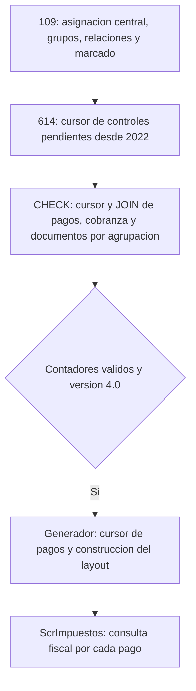

# Performance de T3.PROC_CFDI_PROCESA_PAGO_AGR

Revision estatica inicial del 03/11/2026, incluyendo liberador, CHECK y generador
llamados. Las prioridades de esa revision son hipotesis; los resultados recibidos
posteriormente de T3QA se analizan en los documentos enlazados a continuacion.
No se modificaron SP, datos, indices, estadisticas ni configuracion del motor.

Actualizacion con evidencia recibida: [resultado 01](Resultados_01/ANALISIS_RESULTADO_01.md).
La corrida cacheada del 29/10 concentra 99.22 % del tiempo en el UPDATE inicial.
Ese acceso pasa a ser la prioridad; las hipotesis sobre los hijos quedan para
mediciones con carga representativa. La version instalada del CHECK muestra
agregados distintos del cursor del archivo local y debe obtenerse antes de cambiarla.

Actualizacion con [plan completo recibido](Resultados_05/ANALISIS_RESULTADO_05.md):
el nodo 16 hace Table Scan de CFDI_COBRANZA, con 56.1 millones de filas estimadas
a leer para obtener unas 15,466 tras filtrar. Esto complementa las 1,314,995
lecturas fisicas y el predominio de Buffer IO del resultado 04.
La primera mejora propuesta es un indice sobre (ASIGNACION_CENTRAL, FECHA_PROCESO)
INCLUDE (ASIGNACION_ID, FACTURA), sin modificar el SP. El DDL revisable esta en
06_INDICE_UPDATE_COBRANZA.sql, @Aplicar=0 por defecto; la medicion posterior de
solo lectura esta en 07_VALIDAR_MEJORA_UPDATE.sql. El 63 % del XML es costo estimado.

Actualizacion con [resultado 07](Resultados_07/ANALISIS_RESULTADO_07.md):
el indice ya existe activo en T3QA con las claves y cobertura propuestas.
La cache muestra aun la corrida del 29/10 y no hay filas de runtime de Query
Store en la ventana consultada del 02 al 03/11. Falta una medicion posterior;
UsaIndicePropuesto=0 pertenece al plan anterior. La revision local no ha
ejecutado SP ni DDL en T3QA; el indice aparece instalado en la evidencia del usuario.

## Conclusion de la revision

El agrupador principal ya trabaja por conjuntos. Las oportunidades concretas
son reducir las lecturas de pendientes, facilitar los cruces por compensacion,
factura y agrupacion, y reducir consultas repetidas en sus hijos. No conviene
reescribir el procedimiento completo antes de identificar la etapa dominante.

La bitacora del 109 se cierra antes de llamar al 614. Su duracion no representa
la duracion completa del EXEC que ve el usuario. La cache del padre incluye
sus llamadas; no sumar su tiempo a los tiempos inclusivos de los hijos.

## Prioridades concretas

| Prioridad | Hallazgo verificable en codigo | Cambio que vale la pena medir | Condicion para decidir |
|---|---|---|---|
| Alta | CFDI_COBRANZA se consulta en UPDATE inicial, agrupacion, detalle y marcado. | Indice de pendientes por Fecha_Proceso, filtrado por Fecha_Envio IS NULL. | Pocos pendientes frente al historico y lecturas altas en esas sentencias. El detalle sin corte de fecha tiene otro acceso. |
| Alta | UPDATE inicial enlaza SUBSTRING(Asignacion_ID,3,10) con ClearingDocNumber/FiscalYear. | Indice (ClearingDocNumber,FiscalYear) INCLUDE(Assignment) en TMP_ACCOUNT_HEADER; acceso por fecha/asignacion pendiente en cobranza. | Confirmar indice real, conversiones y cardinalidad. El IXDOC local comienza por AccntDocNumber, otra columna. |
| Alta | El 614 recorre todos sus controles pendientes, no solo los grupos nuevos. | Indice del control pendiente y claves de acceso a AGRUPACION_PAGO, COBRANZA y DOCUMENTOS. | Comparar tiempo de 109 y 614; no saltar la liberacion cuando no hubo grupos nuevos. |
| Alta si pesa el hijo | CHECK usa cursor solo para incrementar tres contadores y eventualmente marcar Contado. | Sustituir el recorrido por agregados sobre el MISMO INNER JOIN. | Conservar multiplicidad, NULL, longitudes de UUID y condicion exacta de Contado; probar equivalencia antes de instalar. |
| Alta si se repiten facturas | ScrImpuestos del generador se abre por cada fila de pago. | Precalcular agregados fiscales por factura distinta del alcance y reutilizarlos por pago. | Medir repeticion, volumen fiscal y lecturas. Mantener las formulas y redondeos por pago. |
| Media | El JOIN al detalle evalua CAST, CASE e ISNULL en seis claves. | Normalizar una vez en una temporal y evaluar indices temporales con volumen real. | Preservar la seleccion historica del detalle y los NULL/centinelas; el coste de tempdb puede superar el ahorro. |
| Media | #Grupos no tiene indice y despues se cruza por Agrupacion en el marcado. | Probar un indice no unico por Agrupacion si hay muchos grupos. | Comparar plan/lecturas contra costo de crearlo; con pocos grupos puede no ayudar. |
| Media | El generador llama varias funciones escalares por fila y concatena texto repetidamente. | Medir las funciones/configuraciones repetidas y el armado del layout. | Revisar compatibilidad y plan efectivo. is_inlineable=1 no garantiza inlining. |

El SUBSTRING esta sobre la columna de cobranza: eso limita su busqueda directa
por esa expresion en un indice ordinario de Asignacion_ID. No impide por si
solo un seek en ClearingDocNumber del otro lado ni significa que todo el JOIN
deba ser un scan. Del mismo modo, no se afirma que CAST(Fecha_Pago AS date)
siempre fuerce scan: comprobar el plan, sus predicados y conversiones reales.

## 1. Indices primero, cuando el inventario y las mediciones lo justifiquen

El archivo 03 devuelve ocho candidatos COMO TEXTO. No los crea. En el mismo
resultado muestra indices actuales cuyo prefijo de columnas coincide, aunque
se llamen distinto. Hay que comparar filtro, INCLUDE, orden efectivo, estado,
unicidad y uso; tener un prefijo no demuestra equivalencia completa.

La cobertura propuesta de CFDI_COBRANZA incluye varias columnas. Puede evitar
lookups/lecturas del heap, pero aumenta almacenamiento y mantenimiento de
Asignacion_Central y Fecha_Envio. No crear ambas variantes de cobranza ni los
otros candidatos en bloque sin comprobar el coste de lectura y escritura.

La columna Fecha_Envio se incluye en el candidato filtrado IS NULL. Es una
consideracion documentada para que ese indice pueda ser utilizado en consultas
de ese tipo. [Microsoft: indice filtrado con IS NULL](https://learn.microsoft.com/en-us/troubleshoot/sql/database-engine/performance/filtered-index-with-column-is-null).

El indice pendiente por Fecha_Proceso favorece la agrupacion reciente y marcado;
no resuelve por completo el INSERT del detalle que no tiene corte por esa fecha.
El UPDATE inicial tampoco tiene Fecha_Envio IS NULL. Si ese UPDATE domina,
evaluar su propio acceso por Fecha_Proceso/Asignacion_Central, sin asumir que
el indice filtrado de Fecha_Envio lo cubrira.

Comprobar primero los indices existentes en Factura de REGISTRO_FISCAL y
REGISTRO_FISCAL_DETALLE. El listado Oracle de PK no demuestra que falten indices
en SQL Server: ya se reportaron indices migrados con nombres de PK.

## 2. Reducir trabajo repetido en el CHECK

El [CHECK](../../T3/Procedures/PROC_CFDI_LIBERA_PAGO_CHECK.sql:33) obtiene filas
del INNER JOIN AGRUPACION_PAGO -> COBRANZA -> CFDI_DOCUMENTOS y recorre el cursor
solo para contar registros, UUID y condicion PUE. Es candidato a un SELECT
con COUNT/SUM condicionales, seguido de su UPDATE actual cuando corresponda.

Una sustitucion debe mantener:

- Todas las filas del JOIN, incluyendo multiplicidad por documentos/asignaciones.
  COUNT(DISTINCT Asignacion_ID) cambiaria su resultado.
- UUID contado cuando LEN(ISNULL(UUID_Venta,'NULL'))>20. No es validacion de UUID.
- Contado solo si UUIDs>0 y UUIDs=nContado. El fuente no exige nContado=pRecords;
  no cambiarlo a "todos los pagos PUE" durante una optimizacion.
- Las conversiones a date, NULL, tipos de contadores y salidas -1, asi como la
  gestion de errores observables para el llamador.

No se implemento un reemplazo en esta etapa; hace falta medirlo y comparar
salidas/efectos con fixtures y datos representativos.

## 3. Agregados fiscales por factura

En el [generador](../../T3/Procedures/PROC_V20_GENERAR_PAGO_AGR.sql:422),
ScrImpuestos se abre dentro del bucle de pagos. Sus SUM leen Registro_Fiscal,
Registro_Fiscal_Detalle y CFDI_USOCFDI_CLIENTE para @sFacturaPagada. Cuando una
factura participa en mas de un pago, se repite la lectura/agregacion.

Puede prepararse un resumen por factura distinta y reutilizarlo manteniendo
los calculos de factor, IVA, IEPS y redondeos en cada pago. No sustituir los
pagos por una suma global ni eliminar registros repetidos sin determinar su
significado. La relacion Cliente_SAP con Uso tambien puede multiplicar las
filas: la version optimizada debe conservar o resolver explicitamente esa regla.

Ejemplo de volumen, no de mejora medida: 5,000 filas de pago de 1,000 facturas
pueden disparar 5,000 agregaciones fiscales. Resumir por factura reduciria ese
trabajo especifico, pero no implica que el SP completo sea cinco veces mas rapido.
Reutilizar datos tambien establece una fotografia temporal distinta de volver
a consultar el catalogo; probar el comportamiento con escritores concurrentes.

## 4. Relecturas y temporales del agrupador

Referencias del fuente principal:

- [UPDATE de asignacion central](../../T3/Procedures/PROC_CFDI_PROCESA_PAGO_AGR.sql:79).
- [Resumen #Grupos](../../T3/Procedures/PROC_CFDI_PROCESA_PAGO_AGR.sql:133).
- [INSERT del detalle](../../T3/Procedures/PROC_CFDI_PROCESA_PAGO_AGR.sql:219).
- [UPDATE de marcado](../../T3/Procedures/PROC_CFDI_PROCESA_PAGO_AGR.sql:265).
- [EXEC al liberador](../../T3/Procedures/PROC_CFDI_PROCESA_PAGO_AGR.sql:307).

Una temporal de pendientes podria evitar relecturas y normalizaciones repetidas.
Sin embargo, materializar solo los recientes y usarla para todo cambiaria las
cobranzas antiguas que entran al detalle. Tampoco se puede cambiar el marcado
por Asignacion_ID a una identidad de fila distinta sin probar equivalencia.
No existe PK declarada en el DDL local de cobranza para asumir esa identidad.

El UPDATE inicial tiene un alcance mas amplio: no aplica los filtros de
Fecha_Envio, Created_By, Via_Pago, Status, RFC o factoraje de los pasos siguientes.
Tampoco puede limitarse a una temporal de esos pendientes sin cambiar resultados.

No empezar agregando columnas calculadas persistidas/indexadas a las tablas
productivas: implica cambios de esquema y requisitos de SET para escritores.
Primero evaluar indices ordinarios, planes y temporales en una variante aislada.

## Reglas que no deben cambiarse para aparentar menor tiempo

1. **No agregar Fecha_Proceso al detalle.** Es una diferencia funcional y
   tambien Oracle vuelve a seleccionar detalle sin ese corte.
2. **No saltar 614 con cero grupos nuevos.** Atiende pendientes anteriores.
3. **No limitar el liberador a este lote** ni agregar TOP sin regla de negocio.
4. **No hacer DISTINCT** sobre pagos/documentos para ocultar multiplicaciones.
5. **No cambiar SUM/COUNT(Importe)**, sentinelas de banco/cuenta/asignacion,
   semantica de NULL/cadena vacia, UUID o reglas de Contado.
6. **No introducir NOLOCK**, paralelismo de jobs, bloqueo exclusivo, transaccion
   global o cambios de fecha como si fueran ajustes neutrales de rendimiento.

Hay diferencias previas con Oracle documentadas en PROC_CFDI_PROCESA_PAGO_AGR.md.
No se corrigen ni amplian durante este analisis. Si se requiere paridad estricta,
definir una base funcional antes de aceptar una optimizacion medida contra
la migracion actual. Incluso un indice puede cambiar la fila escogida por un
UPDATE FROM con varias asignaciones posibles: revisar esa ambiguedad primero.

## Evidencia necesaria y orden de trabajo

1. Ejecutar 01 para inventario real, estadisticas, tiempos por SP/sentencia,
   bitacoras 109/614 y, con @VerPlanes=1, planes compilados en cache.
2. Ejecutar 02 con el @nDias utilizado para contar pendientes, grupos y detalle
   historico que comparte claves. Sus consultas adicionales de liberacion y
   asignacion inicial se activan con banderas porque pueden leer mucho.
3. Revisar 03 junto con el inventario. Elegir el acceso que domine CPU/lecturas;
   crear y medir solo el indice o cambio concreto acordado en una prueba aislada.
4. Comparar mismo dataset y parametros con volumen representativo, incluyendo
   grupos nuevos. No comparar una ejecucion sin candidatos con otra con trabajo.
   No volver a ejecutar el SP real solo para medir: consume secuencias, inserta,
   marca y libera. Un simple ROLLBACK no garantiza deshacer secuencias ni todos
   los efectos observables de la cadena.
5. Para una variante funcional, comparar controles, detalle como multiconjunto,
   marcas de cobranza, reglas de Contado y layout resultante. Probar antiguos/
   recientes con mismas claves, importe NULL, pagos NA/03, fecha NULL, sentinelas,
   asignaciones/documentos repetidos y multiples compensaciones de un ejercicio.

No activar RECOMPILE, forzar planes/indices ni cambiar compatibilidad/inlining
sin demostrar el problema. Los parametros 4 y 30 dias y los cambios de volumen
pueden merecer revisar estimaciones, pero no prueban parameter sniffing.

## Limites de las metricas

La cache conserva solo lo retenido y sus estadisticas se actualizan al terminar
ejecuciones; desaparecer de cache no equivale a no haber corrido.
[Microsoft: sys.dm_exec_procedure_stats](https://learn.microsoft.com/en-us/sql/relational-databases/system-dynamic-management-views/sys-dm-exec-procedure-stats-transact-sql).

Los planes en cache no son planes de ejecucion reales: no afirmar spills,
errores de cardinalidad ni porcentajes de mejora sin medir. Si Query Store ya
esta habilitado puede aportar historia; 01 solo informa su estado, no lo activa.
Las bitacoras del esquema local guardan tiempos con precision de segundos.

Las funciones escalares pueden ser un costo, pero ser elegibles para inlining
no significa que se hayan integrado en cada consulta.
[Microsoft: scalar UDF inlining](https://learn.microsoft.com/en-us/sql/relational-databases/user-defined-functions/scalar-udf-inlining).
