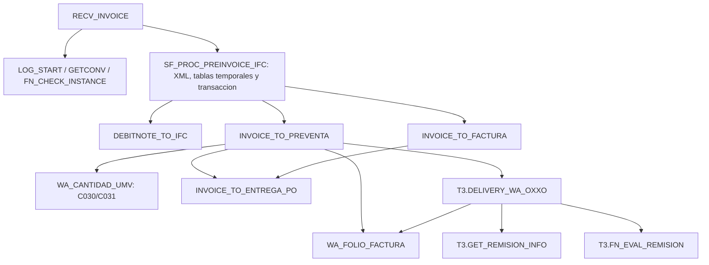

# Analisis de rendimiento de RECV_INVOICE

Fecha: 19 de octubre de 2026. Base de analisis: codigo MSSQL del repositorio,
incluidas las correcciones recientes de transacciones y avisos NULL.
El usuario reporta **2 documentos completos por segundo hasta terminar el flujo**.
No se dispone de planes reales, esperas, indices desplegados ni acceso a la
ejecucion productiva. Los hallazgos de codigo son verificables; su peso en los
500 ms medios por documento requiere medicion. No se modificaron procedimientos
de negocio como parte de este analisis.

La prioridad es medir el parser y las ramas de negocio, y verificar accesos por
referencia/factura/material y bloqueos de folios. Contar el lote una sola vez es
una mejora inmediata de bajo alcance, pero no debe presentarse como la solucion
principal a los 2 documentos/s.

**Flujo revisado**

Tambien intervienen GETCONV, LINE_ITEM_TEXT, FN_GET_DOC_TYPE,
FN_GET_CLIENTE_TMD y EAI.CONV_PLANT_TO_DIST. No se encontro la definicion MSSQL de
T3.FN_EVAL_REMISION en el repositorio: se debe inspeccionar su version desplegada.
Los triggers y restricciones de las tablas destino pueden agregar trabajo que no
aparece como EXEC en estos archivos; el diagnostico los inventaria.

**Prioridad y evidencia**

| Prioridad | Hallazgo | Accion propuesta | Como verificar su importancia |
|---|---|---|---|
| P0 | Se desconoce que parte consume los 500 ms medios | Capturar diferencias de CPU, lecturas, duracion y esperas durante el mismo lote | Diagnostico adjunto, Query Store existente y plan real de una muestra |
| P1 | RECV_INVOICE vuelve a contar @Records en cada iteracion | Calcular COUNT_BIG una vez antes del WHILE; normalizar UPPER(SalesForceOn) una vez | Microprueba adjunta y A/B del lote completo |
| P1 | Parser con cursores de partidas, textos y material; XML.value repetido | Si domina CPU, extraer por documento a filas tipadas y procesar detalles por conjunto | CPU/lecturas por sentencia y tiempo vs numero de partidas |
| P1 | DELETE, lectura e INSERT por ReferenceID/Factura en varias tablas | Verificar indices reales y planes antes de crear los que falten | Scans, lecturas por documento, estadisticas, filas estimadas/reales |
| P1 | WA_FOLIO_FACTURA usa UPDLOCK/HOLDLOCK dentro de la transaccion de factura | Buscar esperas de bloqueos, revisar claves de NRIV y duracion de la transaccion | LCK_M_*, bloqueador, antiguedad de transaccion y rango bloqueado |
| P1 condicionada | Parser compara variables NVARCHAR con claves VARCHAR del DDL | Revisar CONVERT_IMPLICIT y conversion del lado de la columna | Plan real y collation; no cambiar tipos sin validar contenido |
| P2 | C030/C031 y OXXO conservan recorridos por partida | Optimizar solo si esa mezcla de documentos es relevante | Separar tiempos por clase y numero de partidas |
| P2 | Cambios para eliminar avisos agregaron MAX auxiliares y subconsultas | Medir costo; compartir lecturas de material si los planes repiten accesos | Plan de DetailBase y de la linea de envio OXXO |
| P2 condicionada | Muchas escrituras y commit por factura autonoma | Investigar WRITELOG/IO antes de modificar atomicidad | Esperas del SPID y deltas de latencia del archivo de log |
| P3 | Validaciones y conversiones escalares repetidas | Reutilizar valores por documento o catalogos estables donde el contrato lo permita | CPU marginal de funciones; verificar si el optimizador las integra |

**RECV_INVOICE: coordinador**

En [RECV_INVOICE.SQL](RECV_INVOICE.SQL), el lote se materializa completo en una
variable de tabla con clave primaria Item. El ORDER BY CREATED, ROW_ID puede
requerir ordenamiento; la instancia se extrae del XML para cada mensaje.
La busqueda por Item ya tiene clave: cambiar a #temp no garantiza mejora por si
solo y debe justificarse con planes, volumen o necesidad de estadisticas.

La condicion `WHILE @i <= (SELECT COUNT_BIG(*) FROM @Records)` vuelve a evaluar
una agregacion sobre un lote que no cambia. El recorrido puede hacer trabajo
cuadratico de conteo si se recorre el lote para cada evaluacion. La correccion
conservadora es almacenar el total una sola vez. El conteo tambien se evalua al
salir del bucle. `FN_CHECK_INSTANCE` consulta configuracion por mensaje y aplica
TRIM a Target; normalmente es una tabla pequeña, por lo que no se debe asumir
que domina el tiempo. Cachear instancias por lote cambiaria el efecto de una
modificacion de configuracion durante el proceso.

Los indices consolidados del repositorio ya contienen:

- MX_RECVMSG_IDX1: ROW_ID.
- MX_RECVMSG_IDX2: QUEUE_NAME.
- MX_RECVMSG_IDX5: QUEUE_NAME, CREATED, PROCESSED.

Para una cola historica grande con pocos pendientes, evaluar un indice filtrado
con claves `(QUEUE_NAME, CREATED, ROW_ID)`, `INCLUDE(PROCESSED)` y filtro
`PROCESSED IS NULL`. La fecha variable de cinco dias permanece en la consulta,
no en el filtro del indice. No incluir XML_CONTENT de entrada: aumentaria el
tamaño y las escrituras. El beneficio depende de la selectividad y del costo
de recuperar el XML. Verificar indices equivalentes en produccion.

Microsoft documenta que incluir la columna del predicado IS NULL puede ser
necesario para que se utilice ese indice filtrado.
[Referencia oficial](https://learn.microsoft.com/en-us/troubleshoot/sql/database-engine/performance/filtered-index-with-column-is-null).

**Microprueba del conteo, ejecutada en LocalDB**

[RECV_INVOICE_BENCH_CONTEO.SQL](RECV_INVOICE_BENCH_CONTEO.SQL) utiliza solo variables
de tabla, sin XML ni llamadas de negocio. Ambos recorridos hacen la misma busqueda
por clave y se comprueba la suma de los identificadores recorridos.

| Filas | COUNT dentro de WHILE | COUNT una sola vez |
|---:|---:|---:|
| 1,000 | 52.063 ms | 6.938 ms |
| 5,000 | 1,049.621 ms | 22.020 ms |
| 10,000 | 3,981.128 ms | 55.914 ms |

Una ejecucion local sintetica, no un benchmark del flujo productivo. No permite
prometer ese factor de mejora en facturas. A 2 documentos/s, 10,000 documentos
tardarian aproximadamente 5,000 segundos; los casi 4 segundos de conteo de la
microprueba ilustran por que hay que medir las llamadas internas. No se esta
atribuyendo ese costo local al servidor productivo.

**SF_PROC_PREINVOICE_IFC: principal candidato de CPU por documento**

En [SF_PROC_PREINVOICE_IFC.SQL](../Procedures/SF_PROC_PREINVOICE_IFC.SQL):

- Abre una transaccion propia o crea un savepoint antes de leer y transformar
  el documento. El commit propio ocurre despues de terminar las llamadas de negocio.
- Lee el XML por ROW_ID y borra encabezado, detalle y condiciones por ReferenceID.
  TMP_DOCUMENT_* son tablas persistentes compartidas, no tablas #temp de sesion.
- Recorre OrganizationData, textos de cabecera, ItemData, textos por partida y
  coincidencias de material. El costo depende de partidas, condiciones y textos,
  no solo de cuantos mensajes hay en la cola.
- Extrae DocumentNumber tres veces seguidas; reutilizar el valor es una mejora
  pequeña. El candidato mayor es evitar recorridos y llamadas por cada partida.
- Consulta MATERIAL y GETCONV durante cada partida. El cursor de material conserva
  conversiones secuenciales ante duplicados: reemplazarlo por un JOIN o TOP 1
  sin estudiar duplicados puede cambiar cantidades.
- @sReferenceID y @sMaterialUOM son NVARCHAR mientras ReferenceID y Material son
  VARCHAR en los DDL. Buscar conversiones sobre columnas y perdida de acceso por
  indice; el efecto depende del plan y la collation. Convertir una vez a la clave
  destino requiere validar longitud y caracteres, no truncarlos silenciosamente.

Propuesta si el perfil confirma CPU alta: extraer cada bloque XML una vez por
documento a columnas tipadas, conservar un ordinal de partidas/textos, realizar
consultas de catalogos por conjunto y usar INSERT SELECT para el detalle.
Primero hacer un prototipo por documento, no por lote completo. Comparar nulos,
vacios, redondeos, duplicados, orden y estados. Materializar XML indiscriminadamente
puede aumentar tempdb y no necesariamente mejora el rendimiento.

**INVOICE_TO_PREVENTA y sus llamadas**

[INVOICE_TO_PREVENTA.SQL](../Procedures/INVOICE_TO_PREVENTA.SQL) conserva cursor de
cabeceras y usa operaciones por conjunto para las partidas salvo C030/C031.
No es correcto tratarlo como si todo el detalle siguiera siendo fila por fila.

Hay limpieza/reconstruccion de PREVENTA_GENERAL y PREVENTA_DETALLE, consultas de
folios, agregacion de importes y una lectura posterior del detalle para totales.
Las clases C030/C031 abren cursor de detalles y llaman WA_CANTIDAD_UMV por partida.
Esta llamada vuelve a consultar GETCONV y MATERIAL. Es candidata a integrar en
la consulta si se preservan TOP 1, duplicados y formulas de conversion.

El LEFT JOIN a MATERIAL de las consultas de detalle no proyecta sus columnas,
pero puede multiplicar cantidades si existen materiales repetidos. No eliminarlo
solo por apariencia redundante. Primero establecer la unicidad efectiva y el
contrato esperado; tambien pueden multiplicar cabeceras los catalogos duplicados.

[WA_FOLIO_FACTURA.SQL](../Procedures/WA_FOLIO_FACTURA.SQL) busca relacion por
FacturaSAP/Clase_Factura y consecutivo por Centro/Clase_Factura con UPDLOCK/HOLDLOCK.
Muchas clases usan el centro MX99; sesiones que compiten por el mismo rango pueden
serializarse. Al ejecutarse dentro del parser, no libera esos bloqueos hasta el
commit de la factura o de la transaccion externa. No quitar los bloqueos: protegen
la asignacion de folios. Primero indices, luego reducir tiempo despues de tomar
el consecutivo; separar su transaccion requiere definir atomicidad y folios fallidos.

[INVOICE_TO_ENTREGA_PO.SQL](../Procedures/INVOICE_TO_ENTREGA_PO.SQL) ya es por
conjuntos: hace UPDATE e INSERT con acceso a IFC_FOLIOS_FE por Var_1. El indice
IFC_FOLIOS_FE_DOCNUM(Var_1) ya esta definido en el repositorio; verificar despliegue
y uso. La regla CreadoPor NULL no equivale necesariamente a NOT EXISTS: no cambiarla
como supuesta optimizacion sin comprobar el comportamiento.

[T3.DELIVERY_WA_OXXO](../../T3/Procedures/DELIVERY_WA_OXXO.sql)
se invoca al final de preventa, pero su consulta filtra C005 y FN_EVAL_REMISION.
Las facturas que no califican aun pagan el costo de esa consulta, pero no todo el
recorrido de remisiones. Las que califican consultan datos fiscales, generan
folio, recorren detalles e insertan remision. Medir esta rama por separado.

GET_REMISION_INFO utiliza cursores de catalogos fiscales y clientes, con UNION
para cliente V3/SAP. Puede optimizarse cuando se definan precedencia y duplicados;
UNION ALL o TOP 1 arbitrario no son sustituciones equivalentes. Revisar indices
de clientes por identificador/vigencia, centro fiscal y TAO_CEDIS_VALID.Shipto_Hub.

**INVOICE_TO_FACTURA y DEBITNOTE_TO_IFC**

[INVOICE_TO_FACTURA.SQL](../Procedures/INVOICE_TO_FACTURA.SQL) ya procesa detalle
por conjuntos. Los candidatos son accesos por Factura a FACTURA_GENERAL,
FACTURA_DETALLE y RF_COMPLEMENTO, la reconstruccion DELETE/INSERT, conversiones
de material y consultas de catalogos. FN_GET_CLIENTE_TMD busca MOV_CLIENTE por
Cliente_SAP; EAI.CONV_PLANT_TO_DIST delega a GETCONV. Verificar sus indices antes
de reescribir las funciones.

Los cambios recientes que eliminaron avisos introdujeron dos subconsultas MAX
filtradas a MATERIAL en DetailBase. Preservan los valores, pero el plan puede
hacer accesos adicionales por grupo. Con indice pueden ser baratos; sin el,
pueden ser caros. Si el perfil lo confirma, preparar los maximos una vez por
material del documento y reutilizarlos sin cambiar la multiplicidad del JOIN.
OXXO tiene un MAX filtrado semejante para Num_Linea: necesita acceso por Factura.
Las sumas con indicador de presencia y los MAX auxiliares del parser agregan
trabajo de agregacion; no hay medicion que pruebe que sean el cuello principal.

[DEBITNOTE_TO_IFC.SQL](../Procedures/DEBITNOTE_TO_IFC.SQL) ya hace INSERT SELECT;
revisar la busqueda en DEBIT_NOTE_IFC por DEBIT_NOTE y los accesos ReferenceID.
La condicion SAP_DOCUMENT IS NULL no equivale siempre a ausencia de la nota.

**Indices a verificar, no lista de creacion automatica**

| Acceso | Clave inicial que se debe buscar | Evidencia local / observacion |
|---|---|---|
| Cola pendiente | QUEUE_NAME, CREATED, ROW_ID filtrado | Candidato; el consolidado tiene otra forma |
| Mensaje individual | MX_RECEIVE_MESSAGE_LOG(ROW_ID) | MX_RECVMSG_IDX1 ya definido |
| Reconstruccion temporal | ReferenceID en las tres TMP_DOCUMENT_* | Header/detail ya definidos; CONDITIONS aparece en script alternativo |
| Conversiones de material | MATERIAL(Material) | Evaluar cobertura UM, Unidad_Med_Vta, Cig_x_CLL/PAQ/CT |
| Catalogos | MX_HASHTABLE(Type, Source) | MX_HASHTABLE_IX ya definido; evaluar Target incluido |
| Folios | MX_NRIV(Centro, Clase_Factura); MX_NRIV_RELACION(FacturaSAP, Clase_Factura) | Verificar despliegue y duplicados antes de proponer UNIQUE |
| Limpieza, detalle y totales | Factura en PREVENTA_*, FACTURA_*, REMISION_* y RF_COMPLEMENTO | Los DDL de tablas por si solos no demuestran indices productivos |
| Entrega/pedido | IFC_FOLIOS_FE(Var_1) | IFC_FOLIOS_FE_DOCNUM ya definido |
| Nota de debito | DEBIT_NOTE_IFC(DEBIT_NOTE) | Importante para evitar escanear interfaz por factura |
| Clientes | MOV_CLIENTE(Cliente_SAP); CLIENTE(Cliente_SAP) y (Cliente_V3) | Ajustar cobertura/vigencia segun planes |

Cada indice adicional aumenta costo de INSERT/DELETE/UPDATE; no crear todos sin
medir. Verificar estadisticas, distribucion y planes, no solo nombres de indices.
No asumir que un script existente ya fue ejecutado en produccion.

**Transacciones, concurrencia y medicion de documentos completos**

Sin transaccion externa, el parser confirma por documento. Con BEGIN TRAN del
llamador, cada documento usa savepoint, y los cambios/bloqueos permanecen hasta
el commit externo. No usar una transaccion de todo el lote solo para reducir
commits: cambia atomicidad, retencion de log y concurrencia.

El coordinador selecciona pendientes sin reservarlos atomicamente. LOG_START
actualiza estado, pero no constituye una adquisicion exclusiva del lote. No
ejecutar varias copias para multiplicar el throughput antes de diseñar una
reserva de mensajes, recuperacion de reservas e idempotencia por referencia.
Ademas, los folios pueden seguir serializando a esos trabajadores.

PROCESO_4 cuenta mensajes recorridos, incluso rechazados por instancia o saltados
por configuracion. PROCESO_1 se fija en cero. Por ello PROCESO_4/segundos mide
recorrido, no necesariamente documentos completos, y PROCESO_1/segundos no mide
la capacidad de este coordinador. Algunas llamadas registran errores sin
propagarlos y el mensaje se marca antes de concluir las llamadas internas.
Corroborar exitos con tablas destino, errores y commit, no solo Status=Processed.

Conservar para cada lote: tamaño, documentos completos, fallidos/reintentados,
rechazados, tiempo total sin redondear, partidas y bytes XML; separar ramas
preventa, factura, debito y OXXO. A 2 documentos/s el costo medio total es 500 ms.
Como referencias matematicas, 5 documentos/s exigirian 200 ms y 10 exigirian
100 ms; no son metas acordadas ni estimaciones de mejora.

**Medicion y orden de trabajo propuesto**

1. Ejecutar [RECV_INVOICE_DIAGNOSTICO.SQL](RECV_INVOICE_DIAGNOSTICO.SQL) antes,
   durante y despues de un lote representativo. El script no procesa mensajes,
   modifica datos de negocio ni habilita configuraciones. El DBA necesita permisos
   de monitoreo; la ausencia de filas puede significar falta de visibilidad/cache.
2. Comparar versiones desplegadas, indices, estadisticas, triggers y dependencias.
   Capturar la sesion del lote y sus bloqueadores; Query Store es opcional y solo
   consulta informacion ya capturada. No habilitarlo ni cambiar configuracion
   automaticamente por ejecutar el diagnostico.
3. Ordenar sentencias por CPU y lecturas del intervalo. Si predominan esperas:
   LCK_M_* apunta a bloqueos; WRITELOG a confirmacion de log; PAGEIOLATCH_* a
   lecturas fisicas; PAGELATCH_* requiere identificar la pagina/recurso, no asumir
   tempdb; HADR_SYNC_COMMIT aplica si existe replica sincronica. Una muestra aislada
   no basta. Si CPU domina, priorizar XML, cursores y conversiones.
4. Aplicar y validar en QA el conteo unico y los indices realmente faltantes.
   Mantener la version actual de transacciones y de manejo de NULL.
5. Optimizar el bloque que concentre mayor costo con un prototipo y A/B sobre
   copias equivalentes. Variar partidas, textos, clases y documentos repetidos;
   verificar totales, folios, nulos, errores y estados, ademas del tiempo.
6. Repetir con la mezcla productiva y concurrencia habitual; solo despues evaluar
   trabajadores paralelos o agrupacion de commits.

No sumar tiempo de RECV_INVOICE, del parser y sus hijos como si fueran costos
independientes: se solapan. Las estadisticas de procedimientos son acumuladas
de ejecuciones finalizadas en cache; desaparecen o reinician con recompilacion,
expulsion o reinicio. Comparar deltas con mismo plan/cached_time. El contador
del coordinador es por lote y el del parser por mensaje.
[Documentacion de la DMV](https://learn.microsoft.com/en-us/sql/relational-databases/system-dynamic-management-views/sys-dm-exec-procedure-stats-transact-sql).

La distincion CPU/esperas y la historia por consulta permiten decidir entre
reescritura, indices y recursos sin atribuir toda lentitud al codigo.
[Diagnostico oficial](https://learn.microsoft.com/en-us/troubleshoot/sql/database-engine/performance/troubleshoot-slow-running-queries),
[Query Store](https://learn.microsoft.com/en-us/sql/relational-databases/performance/monitoring-performance-by-using-the-query-store).

**Versiones alternativas existentes**

RECV_INVOICE_OPTIMIZADO ya tiene conteo unico, pero su CATCH local no incorpora
la proteccion de transaccion externa añadida al original. El archivo alternativo
SF_PROC_PREINVOICE_IFC_OPTIMIZADO aun contiene MAX(CASE...) con NULL y rollback
completo. No activar archivos solo porque se llaman OPTIMIZADO: reconciliar las
correcciones recientes y verificar que los EXEC apunten a la version esperada.
La definicion local del job 550 sigue llamando RECV_INVOICE, no la alternativa.

Validacion realizada en esta revision: ejecucion del diagnostico en LocalDB y
microprueba del conteo con comprobacion del recorrido. No se midio el rendimiento
completo de produccion ni se cambiaron procedimientos, jobs o indices.
