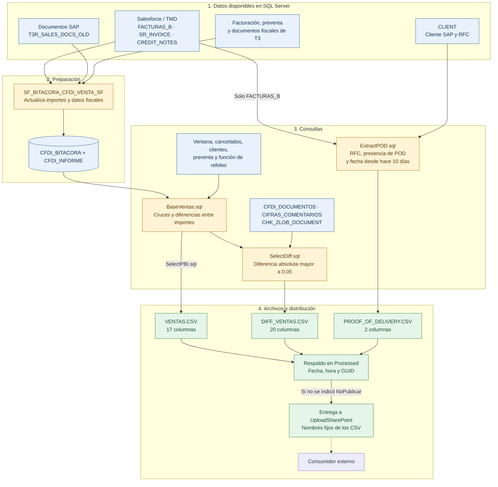

# Documentación del proceso ExtractSaleInfo en MSSQL

Fecha: 12 de octubre de 2026. Carpeta: `MSSQL/T3/Procesos/ExtractSaleInfo`.

Documento funcional y operativo basado en los archivos implementados. La [guía de migración y configuración](README.md) contiene las diferencias con Oracle y los requisitos de despliegue. Este documento describe cómo funciona la versión MSSQL, cómo interpretar sus reportes y cómo revisar una ejecución.

## 1. Objetivo y alcance

ExtractSaleInfo compara importes de ventas entre Salesforce/TMD, SAP, T3 y la información fiscal PAC/SAT almacenada en SQL Server. Produce un reporte general, otro con discrepancias y un archivo independiente de comprobantes de entrega.

| Salida | Contenido | Uso funcional |
|---|---|---|
| `VENTAS.CSV` | Documentos del periodo con sus referencias y cuatro importes comparados. | Alimentación del reporte de ventas para PBI. |
| `DIFF_VENTAS.CSV` | Documentos cuya diferencia absoluta acumulada supera `0.05`, con datos de seguimiento. | Revisión de discrepancias, estado ZLOB y comentarios. |
| `PROOF_OF_DELIVERY.CSV` | Documento y comprobante de entrega, para el RFC configurado en la consulta. | Entrega de información POD al consumidor externo. |

El proceso lee tablas ya disponibles en SQL Server. No obtiene información directamente de Salesforce, SAP o SAT, no carga archivos de entrada y no publica directamente en SharePoint. La carga de fuentes, la programación de horarios y el consumo posterior de los CSV pertenecen a componentes externos.

PBI y POD ejecutan un procedimiento que modifica datos antes de consultar. Por tanto, su ejecución completa no es de solo lectura.

## 2. Gráfico del flujo de información

Las flechas continuas representan datos que utiliza o genera esta implementación. La flecha punteada representa un consumo externo que los scripts no ejecutan.



PBI y diferencias ejecutan consultas separadas y reconstruyen su propia tabla temporal `#Sale`; diferencias no lee `VENTAS.CSV`. POD consulta directamente facturas y clientes, aunque su entrada también ejecuta el procedimiento de preparación.

## 3. Entradas y componentes

| Componente | Responsabilidad |
|---|---|
| [Extract_Sale_PBI.bat](Extract_Sale_PBI.bat) | Carga configuración y solicita al exportador el modo `PBI`: preparación, ventas y diferencias. |
| [Extract_Diff_Sale.bat](Extract_Diff_Sale.bat) | Solicita el modo `Diff`, sin preparación previa. |
| [Extract_POD.bat](Extract_POD.bat) | Solicita el modo `POD`, con preparación previa. |
| [Configuracion.bat](Configuracion.bat) | Define valores de conexión y destino si no existen en el ambiente. |
| [Exportar_CSV.ps1](Exportar_CSV.ps1) | Conecta, valida, coordina consultas, escribe CSV, respalda, entrega y registra resultados. |
| [soporte/Preparar.sql](soporte/Preparar.sql) | Ejecuta `EAI.SF_BITACORA_CFDI_VENTA_SF @nEtapa=0`. |
| [soporte/BaseVentas.sql](soporte/BaseVentas.sql) | Materializa en `#Sale` las referencias, importes y diferencias. |
| [soporte/SelectPBI.sql](soporte/SelectPBI.sql) / [soporte/SelectDiff.sql](soporte/SelectDiff.sql) | Seleccionan las columnas finales de cada reporte de ventas. |
| [ExtractPOD.sql](ExtractPOD.sql) | Extrae comprobantes de entrega. |
| `ExtractPBI.sql`, `ExtractDiffSale.sql` y variantes `-Mensual` | Seleccionan la ventana y enlazan los SQL comunes mediante `:r`. |
| `HeaderPBI.sql`, `HeaderDiffSale.sql`, `HeaderPOD.sql` | Secuencias SQL equivalentes para revisión o ejecución manual con soporte `:r`. No distribuyen archivos ni registran la entrega. |
| [Copy_Processed.bat](Copy_Processed.bat) y su auxiliar PowerShell | Utilidad independiente para respaldar un archivo recibido como argumento. El flujo principal realiza su propio respaldo dentro del exportador. |
| [tests/Verify.ps1](tests/Verify.ps1) y [tests/Schema.sql](tests/Schema.sql) | Pruebas de integración con datos ficticios en LocalDB. |

Los BAT devuelven el código de salida de PowerShell. El flujo principal utiliza ADO.NET y no requiere SQL*Plus, SQL*Loader, `sqlcmd`, `bcp` ni Python.

## 4. Secuencia de ejecución

1. **Validación inicial.** Comprueba servidor, base, compatibilidad de opciones y existencia del destino cuando se publicará. Crea las carpetas de trabajo e histórico si es necesario.
2. **Identificación.** Crea un lote con fecha y hora del equipo Windows, milisegundos y GUID; inicia `ejecucion.json` con estado `Iniciado`.
3. **Conexión y concurrencia.** Abre una conexión SQL y solicita el bloqueo exclusivo `ExtractSaleInfo`, por sesión y base, sin esperar si otra ejecución lo tiene ocupado.
4. **Dependencias y fechas.** Comprueba los objetos visibles requeridos por los reportes del lote, que exista ventana y que `Start_Date` sea válido. En modo mensual también comprueba `End_Date`. Para publicación de ventas exige exactamente una fila por reporte en `CONTROL_REPORTE`.
5. **Inicio y preparación.** Obtiene el inicio con `GETDATE()` del servidor SQL. En PBI y POD ejecuta el procedimiento previo; en `Diff` lo omite.
6. **Consultas y CSV.** Genera cada archivo en la carpeta exclusiva del lote. Verifica 17, 20 o 2 columnas según el reporte; escribe el encabezado incluso sin filas y consume el resultado completo para detectar errores SQL posteriores al `SELECT`.
7. **Respaldo.** Solo después de terminar todas las consultas copia los CSV al histórico, con nombres únicos. Registra las rutas en el manifiesto.
8. **Entrega.** Si se indicó `-NoPublicar`, conserva los CSV locales y termina con `GeneradoSinPublicar`. En caso contrario copia cada CSV a un temporal del directorio destino y después lo mueve o reemplaza con su nombre definitivo.
9. **Control.** Después de todas las copias actualiza los registros de ventas en una transacción. POD no tiene una fila de control específica en este flujo.
10. **Finalización.** Elimina únicamente los CSV locales del lote que se entregó, conserva el manifiesto y los respaldos, y registra `Publicado`. Finalmente libera el bloqueo y cierra la conexión.

El proceso registra `Error` y devuelve código `1` si falla una etapa. Si falla antes de crear el lote, el diagnóstico aparece en la salida del proceso y puede no existir manifiesto. Si el error afecta al propio manifiesto, este también puede quedar sin la última actualización.

## 5. Preparación y efectos en la base

La rutina reutilizada es [EAI.SF_BITACORA_CFDI_VENTA_SF](../../EAI/Procedures/SF_BITACORA_CFDI_VENTA_SF.SQL), sin sufijo `_OPTIMIZADO`. El exportador no instala ni altera esta rutina.

Su función es conciliar fuentes Salesforce con `CFDI_BITACORA`, completar importes SAP y datos fiscales, aplicar ajustes de notas y cierre de mes y mantener la auditoría del componente `826`.

| Objeto modificado | Efecto principal |
|---|---|
| `EAI.CFDI_BITACORA` | Inserción de documentos faltantes, actualización de importes/referencias/fechas y eliminación de documentos según reglas del procedimiento. |
| `EAI.CFDI_INFORME` | Complemento de datos fiscales desde documentos de T3. |
| `T3.RF_PROCESOS_LOG` | Inicio, fin y contadores de preparación. |
| `EAI_OWNER.MX_COMPONENTS` | Estado del componente. |
| `EAI_OWNER.MX_EAI_MESSAGE_LOG` | Registro de errores cuando se ejecuta su manejador. |

También utiliza `EAI_OWNER.LOG_START`, la secuencia `PROCESSID`, `T3.FN_TOTAL_FACT` y fuentes de facturas, preventas, devoluciones y notas. Las rutinas llamadas pueden tener efectos adicionales propios.

El parámetro `@nEtapa=0` no omite la preparación. No se envía `@sPeriod`; los días 1 y 2 el procedimiento puede activar ajustes del mes anterior. La preparación consulta fuentes desde 45 días antes del inicio configurado, mientras que la extracción de ventas usa el inicio de ventana sin ese desplazamiento.

**`-NoPublicar` no desactiva estas escrituras.** La implementación compartida propaga errores, pero el exportador no la envuelve en una transacción global. Una falla puede dejar cambios previos confirmados en la base.

Con varias filas de `FC__TIME_WINDOW`, la consulta de ventas conserva todas mediante un cruce; el procedimiento previo asigna su inicio a una variable escalar sin orden. Es necesario revisar esa configuración para evitar periodos ambiguos o filas multiplicadas.

## 6. Reglas de ventas y diferencias

### 6.1 Universo y relaciones

`EAI.CFDI_BITACORA` es la base de las consultas. Se cruza con:

| Fuente | Relación / regla | Información aportada |
|---|---|---|
| `EAI.FC__TIME_WINDOW` | `CROSS JOIN`, sin filtro de mandante. | Periodo de consulta. |
| `T3.PREVENTA_GENERAL` | `B.Doc_Num = PG.Factura`, unión izquierda. | Clasificación `Prompt` / `Presales`. |
| `EAI.CFDI_INFORME` | `B.Nota_Venta_CFDI = Inf.Folio_Interno`, unión izquierda. | UUID, addenda e importes fiscales. |
| `T3.MOV_CLIENTE` | `B.Cliente_SAP = MC.Cliente_SAP`, unión izquierda. | Nombre del cliente. |
| `EAI_OWNER.DOCTOS_CANCELLED` | Excluye `B.Doc_Num` mediante `NOT IN`. | Documentos a descartar. |
| `T3.CFDI_DOCUMENTOS`, solo diferencias | Referencia CFDI original contra `Nota_Venta`, unión izquierda. | Fecha EDICOM. |
| `EAI.CIFRAS_COMENTARIOS`, solo diferencias | Referencia TMD transformada contra `Referencia`, unión izquierda. | Comentarios. |

No hay deduplicación ni agrupación. Varias coincidencias de cliente, preventa, informe, comentarios, documento fiscal o ventana pueden producir más de una fila por documento. Un nulo en la lista de cancelados puede dejar ventas y diferencias sin filas por la semántica de `NOT IN`.

### 6.2 Periodos

| Consulta | Inicio | Fin |
|---|---|---|
| PBI normal | `Start_Date` inclusivo. | Antes de hoy, usando la fecha del servidor SQL. |
| Diferencias normal | `Start_Date` inclusivo. | Antes de hoy. |
| PBI mensual | `Start_Date` inclusivo. | Antes de hoy; conserva la regla efectiva del origen. |
| Diferencias mensual | `Start_Date` inclusivo. | `End_Date` inclusivo, considerando todo ese día. |

`Start_Date` y `End_Date` se interpretan como `DD/MM/YYYY`. Los SQL de ventas no aceptan fechas por argumento del BAT: se obtienen de la tabla. No se valida que el fin sea posterior al inicio; un intervalo invertido puede resultar vacío.

### 6.3 Referencias y clasificación

- `Referencia_TMD = T3.FN_CFDI_REFOLEO(B.Doc_Num, 'Venta')`. La referencia SAP de salida utiliza el mismo resultado.
- La función busca `Docto_T3MX` en `T3.CFDI_REFOLEO`, para tipo `Venta`, y devuelve `Docto_SAP`. Si no hay mapa, conserva el documento recibido. Múltiples mapas no tienen orden definido.
- Referencia SAT: `B.Nota_Venta_CFDI` sin espacios exteriores. UUID: `Inf.Folio_Fiscal` sin espacios exteriores.
- Tipo de documento: `Prompt` si `PG.Entrega` es nulo o de longitud cero; `Presales` en otro caso. Este campo no representa venta/devolución.
- Nombre del cliente: sin espacios exteriores y con comas sustituidas por espacios.

### 6.4 Importes y diferencia

Los componentes numéricos nulos se toman como cero:

```text
Monto_TMD  = SF_Amount
Monto_SAP  = SAP_Amount
Monto_T3MX = Valor_Subt + Valor_IVA + Envio_Subt + Envio_IVA
            + Credito_Subt + Credito_IVA
```

`Monto_SAT` aplica el primer caso que se cumpla:

| Orden | Condición | Resultado |
|---:|---|---|
| 1 | Misma referencia `Doc_Num = Nota_Venta_CFDI`, tipo `Dev` y sin UUID. | Total T3MX, incluidos créditos. |
| 2 | Misma referencia, tipo `Vta`, sin UUID y addenda diferente de `NO`. | Valor + IVA + envío + IVA del envío; excluye créditos. |
| 3 | Misma referencia y UUID presente. | `Inf.Valor_Subt + Inf.Valor_IVA`. |
| 4 | Referencia CFDI con prefijo `G-`. | Total T3MX, incluidos créditos. |
| 5 | Ninguno de los anteriores. | Cero. |

La addenda nula o de longitud cero se interpreta como `NO`. Los importes PAC/SAT son resultados de estas reglas internas, no una consulta en línea al SAT.

```text
D1 = Monto_TMD  - Monto_SAP
D2 = Monto_SAP  - Monto_T3MX
D3 = Monto_T3MX - Monto_SAT
Factor = 1 si Tipo_Vta = 'Vta'; -1 en cualquier otro caso
Diferencia = (abs(D1) + abs(D2) + abs(D3)) * Factor
```

El factor no modifica los cuatro importes ni las tres restas individuales. Por ejemplo, TMD=100, SAP=90, T3=100 y SAT=100 produce una diferencia total de 20 para venta, aunque TMD y SAT coincidan.

Ventas incluye todo su universo. Diferencias aplica `ABS(Diferencia) > 0.05`: exactamente `0.05` se excluye; `0.051` se incluye antes de cualquier redondeo de presentación.

## 7. Diccionario de los CSV

### 7.1 VENTAS.CSV

Fuente final: [SelectPBI.sql](soporte/SelectPBI.sql). Los ocho campos de importes y diferencias se convierten a `decimal(28,2)`.

| Posición | Columna | Contenido |
|---:|---|---|
| 1 | `PLANT` | Centro de bitácora. |
| 2 | `INVOICE_DATE` | Fecha de bitácora, `yyyy-MM-dd`. |
| 3 | `DOCUMENT_TYPE` | `Prompt` o `Presales`. |
| 4 | `CUSTOMER` | Cliente SAP. |
| 5 | `SFDC_REFERENCE` | Referencia transformada por refoleo. |
| 6 | `SAP_ORDER` | La misma referencia transformada. |
| 7 | `PAC_ORDER_NUMBER` | Referencia CFDI de bitácora. |
| 8 | `SF_SALES_AMOUNT` | Monto TMD. |
| 9 | `SAP_SALES_AMOUNT` | Monto SAP. |
| 10 | `T3_SALES_AMOUNT` | Monto T3MX. |
| 11 | `PAC_SALES_AMOUNT` | Monto SAT calculado. |
| 12 | `PAC_FISCAL_UUID` | UUID del informe fiscal. |
| 13 | `TMD_VS_SAP` | D1. |
| 14 | `SAP_VS_T3MX` | D2. |
| 15 | `T3MX_VS_SAT` | D3. |
| 16 | `DIFERENCIA` | Suma de valores absolutos por factor. |
| 17 | `NOMBRE_CLIENTE` | Nombre normalizado. |

### 7.2 DIFF_VENTAS.CSV

Fuente final: [SelectDiff.sql](soporte/SelectDiff.sql). Los números conservan la escala que devuelve SQL; no se les aplica el redondeo a dos decimales de PBI.

| Posición | Columna | Contenido |
|---:|---|---|
| 1 | `CTRO` | Centro. |
| 2 | `FECHA` | Fecha de bitácora, `yyyy-MM-dd`. |
| 3 | `TIPO_DOCUMENTO` | `Prompt` o `Presales`. |
| 4 | `CLIENTE_SAP` | Cliente SAP. |
| 5 | `NOMBRE_CLIENTE` | Nombre normalizado. |
| 6 | `REFERENCIA TMD` | Referencia transformada. |
| 7 | `REFERENCIA SAP` | La misma referencia transformada. |
| 8 | `REFERENCIA SAT` | Referencia CFDI. |
| 9 | `FOLIO FISCAL` | UUID. |
| 10 | `IMPORTE_TMD` | Monto TMD. |
| 11 | `IMPORTE_SAP` | Monto SAP. |
| 12 | `IMPORTE_T3MX` | Monto T3MX. |
| 13 | `IMPORTE_SAT` | Monto SAT calculado. |
| 14 | `DIF_TMD_SAP` | D1. |
| 15 | `DIF_SAP_T3MX` | D2. |
| 16 | `DIF_T3MX_SAT` | D3. |
| 17 | `DIFERENCIA` | Diferencia total filtrada. |
| 18 | `FECHA_EDICOM` | Fecha de liberación, o fecha de envío si la primera es nula; formato `yyyy-MM-dd HH:mm:ss`. |
| 19 | `ZLOB_PROCESS` | `LOB-Ok` si `CHK_ZLOB_DOCUMENT(Referencia_TMD)` devuelve `Discard`; vacío en otro caso. |
| 20 | `COMENTARIOS` | Texto asociado a la referencia transformada. |

`ZLOB_PROCESS` es una etiqueta de consulta; no representa una cancelación o procesamiento realizado por este reporte.

### 7.3 PROOF_OF_DELIVERY.CSV

| Posición | Columna | Contenido |
|---:|---|---|
| 1 | `Doc_Num` | `FACTURAS_B.Doc_Num`. |
| 2 | `Proof_of_Delivery` | `FACTURAS_B.Proof_of_Delivery__C`. |

Se hace una unión interna entre `FACTURAS_B.Cte_SAP` y `CLIENT.Cliente_SAP`; se exige RFC `SEM980701STA`, POD de longitud mayor a cero y `Invc_dt` desde la fecha de hace diez días.

El filtro conserva la comparación textual ISO `yyyy-MM-dd`, acorde con `INVC_DT varchar` en el DDL migrado. No hay límite superior: incluye hoy y puede incluir fechas futuras. No se filtran estados de factura o entrega. Un cliente repetido puede multiplicar filas. Aunque esta consulta no usa la ventana, la ejecución POD sí valida `FC__TIME_WINDOW` por la preparación previa.

### 7.4 Formato común

UTF-8 con BOM, finales de línea CRLF, separador coma y punto decimal. Los nulos se escriben como campos vacíos. Los textos con comas, comillas o saltos de línea se entrecomillan y las comillas internas se duplican. No hay orden contractual entre documentos.

Un registro con saltos de línea internos puede ocupar varias líneas físicas: para contar documentos se debe usar un lector CSV o `Filas` del manifiesto, no contar líneas del archivo. Los comentarios largos se escriben mediante lectura secuencial y no están sujetos al ancho de presentación de sqlcmd.

## 8. Configuración y ejemplos operativos

Valores predeterminados de los BAT: servidor `AZCRNMXNEVTD06`, base `T3QA` y destino `E:\IntegrationToolBox\UploadSharePoint`. Son valores de configuración, no una confirmación de conexión o despliegue.

| Parámetro / variable | Significado |
|---|---|
| `-Servidor` / `ESI_SERVER` | Instancia SQL. |
| `-BaseDatos` / `ESI_DATABASE` | Base de datos. |
| `-Destino` / `ESI_DESTINO` | Directorio de entrega, que debe existir al publicar. |
| `ESI_USER` y `SQLCMDPASSWORD` | Autenticación SQL. Sin `ESI_USER` se usa la identidad Windows del proceso. |
| `ESI_TRUST_CERTIFICATE=1` | Acepta el certificado del servidor sin validarlo. Por defecto se valida. |
| `-NoPublicar` | Genera y respalda; no entrega CSV ni actualiza las filas de control del exportador. |
| `-Mensual` | Selecciona las variantes mensuales de ventas/diferencias. No aplica a POD. |
| `-DirectorioTrabajo` | Por defecto, `work` dentro del proceso. |
| `-DirectorioHistorico` | Por defecto, `Processed` dentro del proceso. |
| `-TimeoutSegundos` | Tiempo máximo de cada comando SQL: 600 por defecto, rango 1–86400. No es el tiempo máximo del lote. |

Los parámetros explícitos de conexión/destino tienen prioridad sobre el ambiente. Los BAT conservan los valores del ambiente y solo completan los que faltan. Invocar directamente el `.ps1` no carga `Configuracion.bat`: deben proporcionarse esos valores por ambiente o parámetros.

Ejemplos desde CMD, ubicado en la carpeta del proceso:

```bat
rem Ventas y diferencias con entrega
Extract_Sale_PBI.bat

rem Solo diferencias con entrega
Extract_Diff_Sale.bat

rem Comprobantes de entrega
Extract_POD.bat

rem Generacion mensual sobre QA sin entregar archivos
Extract_Sale_PBI.bat -Servidor MI_SERVIDOR_QA -BaseDatos T3QA -Mensual -NoPublicar
```

Los scripts se resuelven desde la carpeta de la aplicación aunque el BAT se invoque desde otra ubicación. Las rutas personalizadas relativas de trabajo/histórico/destino dependen del directorio actual; para una tarea programada conviene usar rutas absolutas. No existe una tarea programada creada por estos scripts ni una periodicidad definida en el repositorio.

## 9. Auditoría y estados

El identificador de lote sigue el patrón `yyyyMMdd_HHmmss_fff_GUID` usando el reloj Windows. Las ventanas y el control de fechas usan el reloj del servidor SQL; no se aplica una conversión de zona horaria entre ambos.

Cada elemento de `Archivos` en `ejecucion.json` contiene `Archivo`, `Filas`, `Historico` y `Publicado`. El manifiesto también contiene `Lote`, `Reporte`, `Mensual`, `NoPublicar`, `Estado` y `Error`.

| Estado | Interpretación |
|---|---|
| `Iniciado` | Se creó el lote; no demuestra que terminó. Puede permanecer así si el proceso fue interrumpido. |
| `GeneradoSinPublicar` | Consultas y respaldos finalizados bajo `-NoPublicar`; CSV locales conservados. |
| `Publicado` | Se completaron las copias, el control aplicable y la limpieza local. |
| `Error` | Falló la ejecución. Revisar el mensaje y los estados individuales de archivo. |

En `EAI.CONTROL_REPORTE`, PBI actualiza `AUTO-CIFRAS VENTAS` y `AUTO-CIFRAS VENTAS DIFF`; diferencias independiente actualiza solo la segunda. Ambas filas de un lote PBI comparten el inicio capturado antes de preparar datos. `Fin` se asigna después de copiar. POD no actualiza esos registros; la preparación sí mantiene su auditoría del componente `826`.

Código de salida `0` significa finalización normal del exportador; `1` indica error gestionado. Un archivo con cero filas también puede ser una ejecución exitosa y debe interpretarse según su ventana y reglas.

## 10. Errores y recuperación

| Situación | Evidencia / efecto | Revisión operativa |
|---|---|---|
| Servidor/base sin configurar, destino ausente u opción incompatible | Error inicial; puede no existir carpeta de lote. | Revisar parámetros, ambiente y carpeta destino. |
| Conexión o certificado | Error de apertura; no se ejecuta la preparación. | Revisar instancia, autenticación, permisos y configuración de certificado. |
| Otra ejecución activa | Bloqueo rechazado inmediatamente. | Revisar la ejecución que ocupa la base y reprogramar; no eliminar archivos de trabajo para intentar liberar el bloqueo SQL. |
| Dependencia no visible o fecha inválida | Se detiene antes de preparar datos. | Comprobar objeto/permisos y `FC__TIME_WINDOW`; la validación de metadatos no certifica el grafo completo de dependencias. |
| Error del procedimiento o consulta | No se inicia la entrega; puede haber datos modificados o CSV locales parciales. | Revisar mensaje SQL, auditoría de preparación y lote. No copiar archivos parciales manualmente. |
| Respaldo fallido | No comienza la publicación del lote. | Revisar espacio y permisos del histórico; conservar los CSV generados. |
| Copia o reemplazo fallido | Puede existir un `.tmp` en destino; pueden haberse entregado archivos anteriores del mismo lote. | Revisar manifiesto, archivos reales, permisos y consumidores que mantengan abierto el CSV. |
| Control fallido después de las copias | CSV ya entregados; registros de control del lote se revierten si falla su transacción. | Conciliar las entregas con el manifiesto antes de repetir. |
| Limpieza o escritura final del manifiesto fallida | Copias y control pueden estar completos, aunque el lote indique error o conserve CSV locales. | Revisar cada etapa; no interpretar `Error` como garantía de ausencia de entrega. |

No hay una transacción conjunta entre base y sistema de archivos, ni reemplazo atómico del par ventas/diferencias. Los respaldos, los CSV temporales y el manifiesto permiten revisar una entrega parcial, pero no implementan una reanudación automática.

Una nueva llamada crea un lote nuevo y vuelve a consultar los datos; en PBI/POD vuelve a ejecutar la preparación. Puede producir resultados distintos si las fuentes cambiaron. Antes de repetir, revisar efectos en base y destino. Los consumidores posteriores deberían contemplar el reemplazo de nombres fijos.

Los respaldos y logs no tienen limpieza por antigüedad. Su retención y la revisión de temporales de intentos fallidos quedan a cargo de la operación.

## 11. Validación y límites conocidos

En la migración del 12 de octubre de 2026, [Verify.ps1](tests/Verify.ps1) terminó con código `0` sobre una base LocalDB temporal. Verificó las tres salidas, reglas fiscales, signos, umbral, periodos, nulos, refoleo, ZLOB, escape CSV, respaldos, control, fallos de copia y concurrencia, además de una entrada BAT.

Las funciones de refoleo y ZLOB fueron las implementaciones reales MSSQL. La preparación utilizó un procedimiento de prueba para comprobar invocaciones y propagación de fallos; esa prueba no certifica la conciliación interna de `SF_BITACORA_CFDI_VENTA_SF` con datos reales. Tampoco representa una medición de rendimiento o una comparación completa contra Oracle.

Esta documentación se contrastó con los archivos del proceso, sin ejecutar nuevas consultas de negocio ni modificar su implementación. Antes de programar el flujo en un servidor se requiere validar configuración, permisos, preparación completa, intercalación y resultados sobre una muestra de QA común a ambos motores. La existencia de scripts en el repositorio no confirma que sus objetos estén instalados en la base destino.
