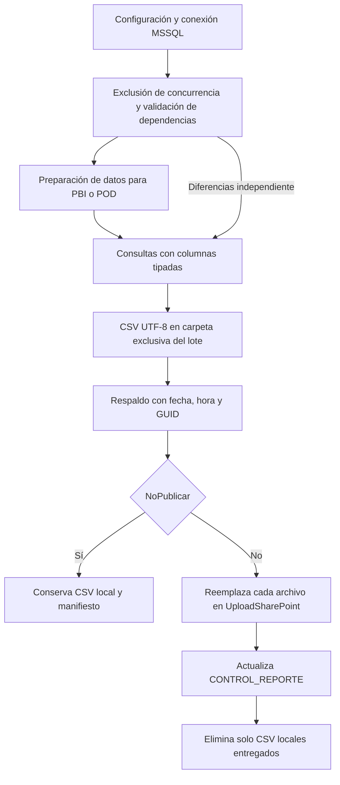

# ExtractSaleInfo — migración a MSSQL

Migración del flujo activo de `ORA/T3/Procesos/ExtractSaleInfo`. Fecha: 12 de octubre de 2026.

La [documentación funcional y operativa del proceso MSSQL](Documentacion_Proceso_ExtractSaleInfo_MSSQL.md) incluye el gráfico de información, la secuencia de ejecución, las reglas de cálculo, el diccionario de los tres CSV y la guía de recuperación ante errores.

Genera `VENTAS.CSV`, `DIFF_VENTAS.CSV` y `PROOF_OF_DELIVERY.CSV`, conserva una copia histórica y entrega los archivos a la carpeta local de integración. El análisis funcional de Oracle está en [Readme_ExtractSaleInfo.md](../../../../ORA/T3/Procesos/ExtractSaleInfo/Readme_ExtractSaleInfo.md).

## Ejecución

Requiere Windows PowerShell 5.1 con .NET Framework y acceso a SQL Server. La operación usa ADO.NET; no requiere Python, módulos externos, `sqlcmd` ni `bcp`.

Revise [Configuracion.bat](Configuracion.bat). Los valores existentes en el ambiente tienen prioridad:

| Variable | Uso / valor predeterminado |
|---|---|
| `ESI_SERVER` | Servidor: `AZCRNMXNEVTD06`. |
| `ESI_DATABASE` | Base: `T3QA`. |
| `ESI_DESTINO` | Carpeta de entrega existente: `E:\IntegrationToolBox\UploadSharePoint`. |
| `ESI_USER` | Si está vacía, autenticación Windows. Si tiene valor, autenticación SQL. |
| `SQLCMDPASSWORD` | Contraseña para autenticación SQL; se lee del ambiente aunque no se ejecuta sqlcmd. No se guarda en archivos ni se pasa en la línea de comandos. |
| `ESI_TRUST_CERTIFICATE` | `1` permite confiar en el certificado del servidor; por defecto se valida. |

Las conexiones de servidor solicitan cifrado. Solo para `(localdb)\...` se desactiva TLS, que LocalDB no soporta.

Desde CMD, con la identidad Windows que tenga los permisos requeridos:

```bat
set "ESI_SERVER=MI_SERVIDOR"
set "ESI_DATABASE=T3QA"
set "ESI_DESTINO=E:\IntegrationToolBox\UploadSharePoint"
Extract_Sale_PBI.bat
Extract_POD.bat
```

| Entrada | Reportes / preparación |
|---|---|
| [Extract_Sale_PBI.bat](Extract_Sale_PBI.bat) | Ejecuta `SF_BITACORA_CFDI_VENTA_SF(0)` una vez, genera ventas y luego diferencias. |
| [Extract_Diff_Sale.bat](Extract_Diff_Sale.bat) | Solo diferencias; no ejecuta el procedimiento previo. |
| [Extract_POD.bat](Extract_POD.bat) | Ejecuta el mismo procedimiento previo y después extrae POD. |

Opciones que pueden agregarse al BAT:

```bat
Extract_Sale_PBI.bat -NoPublicar
Extract_Sale_PBI.bat -Mensual -NoPublicar
Extract_Diff_Sale.bat -Mensual
```

`-NoPublicar` genera CSV y respaldos, conserva los CSV del lote y no actualiza `CONTROL_REPORTE` ni entrega archivos al destino. **Sí ejecuta el procedimiento previo en PBI y POD**, por lo que no constituye una ejecución de solo lectura. Úselo sobre la base de QA adecuada.

`-Mensual` selecciona los SQL mensuales. PBI conserva el límite hasta ayer, porque el filtro `End_Date` está comentado en Oracle. Diferencias usa `End_Date` inclusivo. En una ejecución PBI mensual se valida `End_Date` porque también se ejecuta diferencias mensual. POD no admite esta opción.

El exportador también acepta `-Servidor`, `-BaseDatos`, `-Destino`, `-DirectorioTrabajo`, `-DirectorioHistorico` y `-TimeoutSegundos` (600 por comando). Los BAT pueden ejecutarse desde otro directorio; los scripts se resuelven respecto de su propia carpeta.

## Flujo migrado



El bloqueo SQL `ExtractSaleInfo` es exclusivo por base y sesión. Evita solapamientos entre estas entradas incluso cuando se ejecutan desde distintas carpetas. No bloquea a otros procesos externos que actualicen las tablas; las dos consultas de ventas no constituyen una instantánea conjunta.

Cada ejecución guarda `work/<fecha_hora_GUID>/ejecucion.json`, con estado, conteo de filas, rutas de respaldo, archivos publicados y mensaje de error. Los respaldos se escriben en `Processed` con nombres únicos. Los archivos de trabajo, respaldos y evidencias de QA están excluidos de Git por [.gitignore](.gitignore).

## SQL y reglas conservadas

Los [HeaderPBI.sql](HeaderPBI.sql), [HeaderDiffSale.sql](HeaderDiffSale.sql) y [HeaderPOD.sql](HeaderPOD.sql) mantienen la secuencia de consultas para revisión o uso manual con un cliente que soporte `:r`. Las rutas de `:r` son relativas a la carpeta del proceso. En operación el exportador expande esas inclusiones y ejecuta la preparación y las consultas por separado sobre una única conexión. La distribución y el registro final de control corresponden al exportador, no a los encabezados.

- [soporte/BaseVentas.sql](soporte/BaseVentas.sql): cruces, ventana temporal, exclusión `NOT IN`, importes y diferencias. Conserva la multiplicidad de tablas y ventanas; no introduce `DISTINCT` ni agregación.
- [soporte/SelectPBI.sql](soporte/SelectPBI.sql): 17 columnas, en el orden Oracle, incluidos los ocho valores numéricos a dos decimales.
- [soporte/SelectDiff.sql](soporte/SelectDiff.sql): 20 columnas y filtro estricto `ABS(Diferencia) > 0.05`, antes del redondeo de presentación; incluye EDICOM, ZLOB y comentarios.
- [ExtractPOD.sql](ExtractPOD.sql): dos columnas, RFC `SEM980701STA`, comprobante no vacío y fecha textual ISO desde hace diez días. Conserva la ausencia de límite superior y de filtros de estado de factura.
- Los SQL `-Mensual` conservan las diferencias de periodo del origen.
- Las referencias TMD y SAP usan la misma función `T3.FN_CFDI_REFOLEO(Doc_Num,'Venta')`; no se sustituyen por `Factura_SAP` ni por una búsqueda de sentido contrario.
- No se migra `Backup`: contiene versiones históricas que los BAT activos no invocan.

Las consultas devuelven columnas tipadas; el exportador escribe el encabezado una vez, incluso sin filas. No hay un orden garantizado entre documentos, igual que en el origen. Los CSV conservan nombres, orden y cantidad de columnas.

## Dependencias y despliegue

No es necesario crear procedimientos específicos de este proceso. Las consultas son scripts; reutilizan los objetos compartidos de la base. Esta entrega no ejecuta DDL ni modifica esos objetos en un servidor de negocio.

Antes de usar los BAT, verifique:

1. Las tablas `EAI.CFDI_BITACORA`, `CFDI_INFORME`, `FC__TIME_WINDOW`, `CIFRAS_COMENTARIOS`, `CONTROL_REPORTE`; `T3.PREVENTA_GENERAL`, `MOV_CLIENTE`, `CFDI_DOCUMENTOS`, `CFDI_REFOLEO`; `EAI_OWNER.DOCTOS_CANCELLED`, `FACTURAS_B`, `CLIENT` y `TMP_DOCUMENT_HEADER`.
2. El procedimiento [EAI.SF_BITACORA_CFDI_VENTA_SF](../../EAI/Procedures/SF_BITACORA_CFDI_VENTA_SF.SQL) y sus dependencias de ventas, devoluciones, notas, SAP, facturas, totales y logging. Se llama al nombre sin sufijo; no se cambia automáticamente a `_OPTIMIZADO`. La versión MSSQL revisada propaga fallos con `THROW`.
3. La función [T3.FN_CFDI_REFOLEO](../../T3/Funciones/FN_CFDI_REFOLEO.SQL), agregada durante esta migración. Se contrastó con [su fuente Oracle](../../../../ORA/T3/T3/Funciones/FN_CFDI_REFOLEO.SQL): para `Venta` transforma T3MX → SAP y conserva el documento si no hay coincidencia. Ambas implementaciones recorren mapas sin orden: si hay varios mapas, el resultado no es determinista. La función MSSQL no reproduce el `WHEN OTHERS RETURN 0` de Oracle; un error puede detener la ejecución. No se modificó esa función compartida.
4. La función [EAI_OWNER.CHK_ZLOB_DOCUMENT](../../EAI_OWNER/Functions/CHK_ZLOB_DOCUMENT.SQL), que devuelve `Discard` para la etiqueta `LOB-Ok`. No se dispuso de la fuente Oracle para certificar su equivalencia completa.
5. Al menos una ventana con `Start_Date` válido en `DD/MM/YYYY`. Para diferencias mensual se requiere también `End_Date` válido. No se elige un `MANDANT`: se conservan todas las filas de ventana.
6. Una fila de `CONTROL_REPORTE` para `AUTO-CIFRAS VENTAS` y otra para `AUTO-CIFRAS VENTAS DIFF`, según el reporte solicitado. Las filas se validan antes de preparación cuando se publica; no se crean automáticamente.

Los scripts compartidos de refoleo y preparación contienen `USE [T3QA]` y/o `ALTER`; revise el contexto y la existencia del objeto antes de desplegarlos. El exportador no instala ni ejecuta esos archivos de definición. La prueba local adapta únicamente `USE`/`ALTER` en memoria para crear las funciones en la base aislada.

La cuenta necesita lectura sobre las fuentes, ejecución del procedimiento, acceso a las funciones y visibilidad de sus metadatos, actualización de las filas de control y los permisos que requieran las dependencias internas del procedimiento. En disco necesita crear/escribir en trabajo y respaldo, y crear/reemplazar archivos en el destino. El proceso conserva la actualización previa de datos en POD.

## Mejoras operativas y diferencias explícitas respecto de Oracle

| Cambio | Comportamiento |
|---|---|
| CSV con escape | Los textos que contienen comas, comillas o saltos de línea se entrecomillan y las comillas internas se duplican. Se conserva el reemplazo de comas por espacios en el nombre del cliente. |
| Formato independiente de sesión | UTF-8 con BOM, finales CRLF, punto decimal y `FECHA_EDICOM` en `yyyy-MM-dd HH:mm:ss`. Oracle dependía de NLS para esa fecha y los importes de diferencias. |
| Máscara numérica | PBI usa `decimal(28,2)` en lugar de una máscara de ancho fijo que puede producir signos `#` para importes grandes. Diferencias conserva la escala devuelta por SQL, sin forzar dos decimales ni cambiar su filtro. |
| Cadenas vacías | En las pruebas de presencia de entrega, UUID, addenda y POD se trata longitud cero como nulo, para aproximar Oracle; una cadena de espacios no se elimina por ese solo motivo. |
| Prevalidación | Falta de dependencias visibles, configuración de fechas ausente/inválida o fila de control ausente detiene el lote antes de preparación. Las validaciones no certifican todo el grafo transitivo del procedimiento. |
| Errores | Código de salida distinto de cero, diagnóstico y conservación de archivos generados. No se copian resultados de consultas incompletas. |
| Preparación de ventas | Se usa el procedimiento MSSQL existente, que relanza errores. No se agrega una transacción global ni se modifica su lógica: puede haber cambios parciales en base antes de una falla. |
| Publicación | Primero se generan todos los reportes del lote y sus respaldos. Cada archivo se copia con nombre temporal en el destino y se reemplaza al terminar; no se emplean comodines. |
| Control | `Inicio` corresponde al momento anterior a preparación y `Fin` al registro posterior a las copias exitosas. Las dos filas de control del lote PBI se actualizan en una transacción. |
| Limpieza | Solo se borran los CSV del lote después de publicar y actualizar el control; `-NoPublicar` los conserva. No se aplica retención automática a respaldos y logs. |

Las operaciones en SQL y disco no forman una transacción distribuida. Un fallo al publicar el segundo CSV puede dejar el primero actualizado; el manifiesto identifica qué archivo se entregó. Un fallo de control posterior a las copias tampoco revierte los archivos publicados. Ante esos casos se conserva evidencia y se requiere revisar el lote antes de volver a ejecutar. La publicación remota a SharePoint sigue siendo externa.

Las comparaciones de texto usan la intercalación de los objetos MSSQL. Valide diferencias de mayúsculas, acentos y espacios finales contra los datos reales. Se conserva `NOT IN`: un nulo en `DOCTOS_CANCELLED.Referencia` puede dejar ambos reportes de ventas sin datos. No se corrige silenciosamente esa regla.

## Validación local

Resultado del 12 de octubre de 2026: `tests/Verify.ps1` terminó con código 0 en LocalDB, incluidos los escenarios funcionales, de publicación y de concurrencia descritos abajo. También se verificaron la sintaxis PowerShell y los enlaces de esta documentación. No se realizó despliegue ni ejecución sobre un servidor de negocio.

Ejecute desde la raíz del repositorio:

```powershell
powershell.exe -NoProfile -ExecutionPolicy Bypass -File MSSQL/T3/Procesos/ExtractSaleInfo/tests/Verify.ps1
```

La prueba crea una base `CodexExtractSale_<id>` en `(localdb)\MSSQLLocalDB`, carga datos ficticios, instala las funciones reales de refoleo y ZLOB y ejecuta el exportador. Elimina exclusivamente esa base al finalizar. Los CSV y manifiestos quedan en `tests/work`.

Se usa un doble de prueba para `SF_BITACORA_CFDI_VENTA_SF`: permite comprobar llamadas y errores del caller, pero no prueba la conciliación interna del procedimiento compartido. El esquema sintético permite tres decimales para probar el umbral; no reemplaza la validación de tipos reales del DDL.

Escenarios: ramas de importe fiscal, venta/devolución, nulos, referencias refoleadas, ZLOB, nombres y comentarios con comillas y saltos de línea, más de 6000 caracteres, 17/20/2 columnas, umbral anterior al redondeo, variantes mensuales, duplicación por múltiples ventanas, `NOT IN` con nulo, encabezado sin datos, POD con fechas límite y futuras, respaldo idéntico, reemplazo de archivos, registro de control y fallos de preparación/dependencias/fechas. También se verifica recuperación ante destino bloqueado, exclusión de concurrencia y una entrada BAT.

La validación local no compara contra una ejecución Oracle ni certifica volumen o desempeño en QA. Antes de programar el proceso, compare documentos, multiplicidad, importes y archivos sobre una muestra real común a ambos motores.
