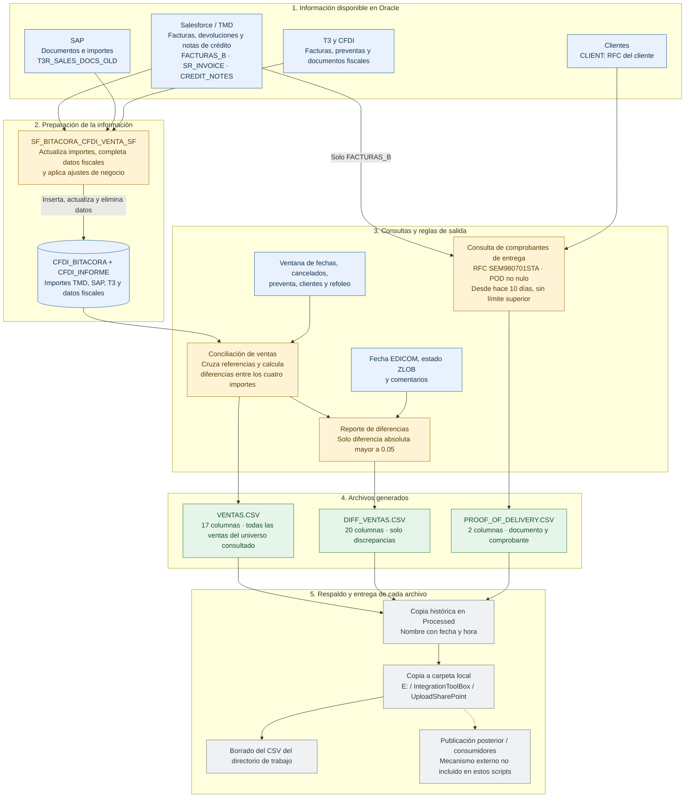
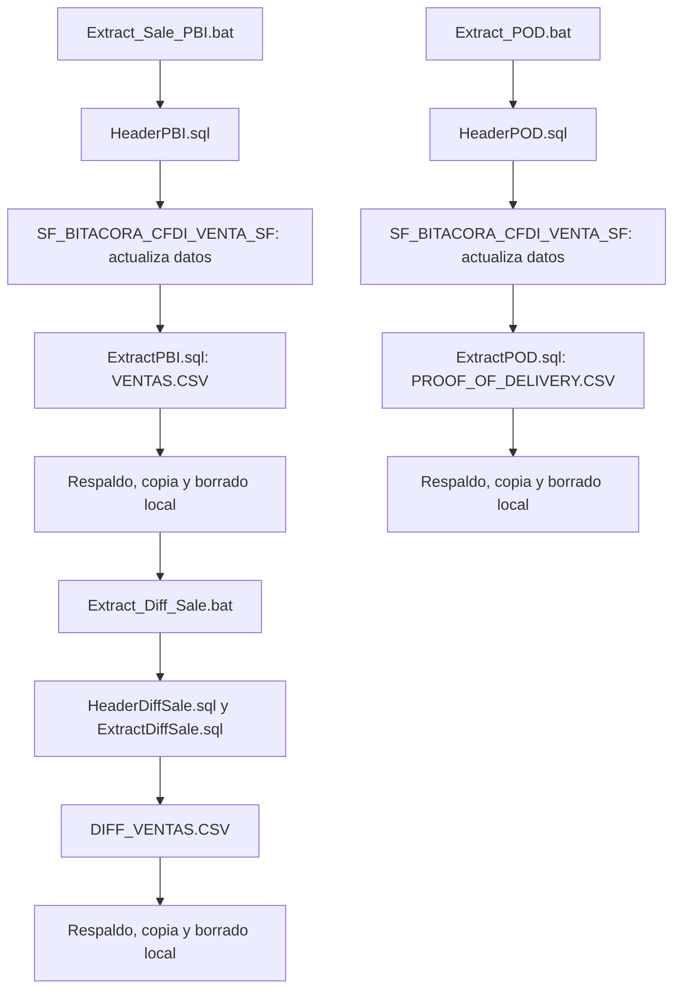

# Análisis del proceso ExtractSaleInfo

Fecha del análisis: 12 de octubre de 2026. Estado: documentación previa a la migración a MSSQL.

Actualización posterior del 12 de octubre de 2026: se agregó la definición de `T3.FN_CFDI_REFOLEO` para ambos motores y se implementó el proceso en su [carpeta homóloga MSSQL](../../../../MSSQL/T3/Procesos/ExtractSaleInfo/README.md). Las secciones siguientes describen el comportamiento Oracle; la guía MSSQL detalla los cambios operativos y las pruebas de la migración.

## 1. Objetivo y alcance de la revisión

El proceso genera archivos CSV para comparar importes de ventas entre Salesforce/TMD, SAP, T3 y la información fiscal PAC/SAT almacenada en Oracle. Además, tiene un flujo independiente que extrae referencias de comprobantes de entrega para un RFC específico.

La revisión es estática, basada en los BAT y SQL del repositorio y en sus dependencias localizadas. No se ejecutaron los BAT, no se conectó a Oracle ni a SQL Server y no se modificaron datos. La existencia de scripts MSSQL no confirma su instalación ni su equivalencia funcional en destino.

La carpeta contiene 12 archivos operativos en la raíz (4 BAT y 8 SQL), 14 archivos históricos en `Backup` (2 BAT y 12 SQL) y un directorio `Processed` vacío al momento de la revisión. No hay CSV de salida ni logs locales con los que validar una ejecución real.

### Vista general del flujo de información

El gráfico se lee de arriba hacia abajo: las tablas de origen alimentan la preparación y las consultas; estas producen tres archivos que se respaldan y se entregan a la carpeta de integración. Los colores distinguen fuentes (azul), transformaciones (amarillo), archivos (verde) y destinos (gris).



**Cómo interpretar el gráfico:** PBI y diferencias comparten reglas de conciliación, pero ejecutan consultas separadas; diferencias no lee `VENTAS.CSV`. POD consulta directamente facturas y clientes, aunque su encabezado también ejecuta el procedimiento de preparación. Las fuentes del gráfico ya están en Oracle: su carga desde sistemas externos no forma parte de estos BAT.

Las flechas de respaldo, copia y borrado representan la secuencia que intentan los BAT, sin comprobación de éxito entre pasos. La flecha punteada señala una integración externa no verificada. El siguiente diagrama detalla el orden de ejecución de los scripts.

## 2. Entradas, salidas y orquestación

Las entradas son tablas de base de datos; este proceso no carga archivos con SQL*Loader. La carga previa de Salesforce, SAP y CFDI y la programación de ejecuciones son externas a los BAT analizados.

| Punto de entrada | Secuencia de SQL | Archivo generado | Comportamiento posterior |
|---|---|---|---|
| [Extract_Sale_PBI.bat](Extract_Sale_PBI.bat) | `HeaderPBI.sql` → `ExtractPBI.sql` | `VENTAS.CSV` | Respalda, copia, elimina el archivo local y llama a `Extract_Diff_Sale.bat`. |
| [Extract_Diff_Sale.bat](Extract_Diff_Sale.bat) | `HeaderDiffSale.sql` → `ExtractDiffSale.sql` | `DIFF_VENTAS.CSV` | Respalda, copia y elimina el archivo local. También se puede invocar por separado. |
| [Extract_POD.bat](Extract_POD.bat) | `HeaderPOD.sql` → `ExtractPOD.sql` | `PROOF_OF_DELIVERY.CSV` | Respalda, copia y elimina el archivo local. No lo llama el BAT de PBI. |
| [Copy_Processed.bat](Copy_Processed.bat) | No ejecuta SQL | Copia con fecha y hora en `processed` | Recibe el nombre de archivo como primer argumento. |



Los tres BAT se conectan mediante SQL*Plus con el usuario `EAI_APPS` y el alias Oracle `owba030p`. Las credenciales están incrustadas en los archivos originales; no se reproducen aquí. Debe definirse el mecanismo de autenticación del proceso migrado.

No se reciben fechas ni parámetros de negocio en estos BAT. Las rutas de scripts y de `processed` son relativas al directorio de trabajo: no se hace `cd` al directorio del BAT ni se crea la carpeta de respaldo.

## 3. Preparación de datos: no es una extracción de solo lectura

[HeaderPBI.sql](HeaderPBI.sql) y [HeaderPOD.sql](HeaderPOD.sql) comienzan con:

```sql
EXECUTE EAI.SF_BITACORA_CFDI_VENTA_SF(0);
```

La implementación Oracle está en [SF_BITACORA_CFDI_VENTA_SF.SQL](../../EAI/Procedures/SF_BITACORA_CFDI_VENTA_SF.SQL). `nEtapa = 0` no limita bloques: el parámetro está declarado pero no gobierna el flujo. `sPeriod` se omite; los días 1 y 2 el procedimiento calcula automáticamente el periodo del mes anterior usando `SYSDATE - 3`.

Su funcionamiento relevante para estos reportes es:

1. Obtiene ventas de `EAI_OWNER.FACTURAS_B`, devoluciones de `EAI_OWNER.SR_INVOICE` y notas `DESC%`/`CONECT%` de `EAI_OWNER.CREDIT_NOTES`. El periodo fuente empieza 45 días antes de `FC__TIME_WINDOW.Start_Date` y excluye el día actual. Las facturas excluyen estados `Cancelled` e `Invalid`; facturas y devoluciones excluyen `DOCTOS_CANCELLED`.
2. Actualiza `SF_AMOUNT` de documentos existentes, salvo estado `Unsuccessful-X`; inserta los faltantes con territorio `0000`. Esa excepción no impide insertar documentos nuevos. Los importes de devoluciones y notas se multiplican por `-1`.
3. Actualiza `SAP_AMOUNT` y `FACTURA_SAP` desde `EAI.T3R_SALES_DOCS_OLD`, para documentos SAP de estado `C`, aplicando el factor de venta/devolución.
4. Elimina ciertas notas `DESC%`/`CONECT%` cuya fecha en bitácora excede por al menos 35 días la fecha de preventa. Ajusta `SF_AMOUNT` contra SAP para notas recientes que cumplen las condiciones del SQL.
5. Completa `EAI.CFDI_INFORME` desde `T3.CFDI_DOCUMENTOS` cuando falta el folio fiscal. El `UPDATE` Oracle usa una subconsulta escalar: sin coincidencia asigna nulos a los campos actualizados; múltiples coincidencias pueden producir error.
6. Cuando se activa el periodo de cierre, reconstruye importes con `T3.FN_TOTAL_FACT`, corrige fechas contra facturación y agrega determinadas preventas canceladas `C005`/`C006` faltantes en bitácora.
7. Elimina documentos `CHP%` de la bitácora y registra proceso `826`, contadores, estado y errores.

Esto implica inserciones, actualizaciones y eliminaciones en la base incluso al pedir solamente el reporte POD. La consulta POD no usa directamente la bitácora actualizada; la llamada sigue siendo parte del comportamiento actual y su necesidad debe decidirse antes de migrar.

El procedimiento hace `COMMIT` al finalizar. Su manejador `WHEN OTHERS` también hace `COMMIT`, registra el error y no lo relanza: puede conservar cambios parciales y permitir que el encabezado continúe generando el CSV. Añadir control de errores solo al BAT no resuelve por sí mismo este comportamiento.

`HeaderDiffSale.sql` no llama al procedimiento: normalmente aprovecha la actualización ejecutada por PBI, pero una invocación independiente utiliza los datos que existan en ese momento.

## 4. Reglas comunes de ventas y diferencias

Fuentes: [ExtractPBI.sql](ExtractPBI.sql) y [ExtractDiffSale.sql](ExtractDiffSale.sql).

### Universo y relaciones

La base del resultado es `EAI.CFDI_BITACORA` (`Bita`). No se consulta directamente SAP o Salesforce para cada fila del reporte: se usan los importes ya almacenados en esa bitácora.

| Relación | Condición | Propósito |
|---|---|---|
| `EAI.FC__TIME_WINDOW` | Cruce sin llave ni filtro de `MANDANT` | Obtener el inicio de la ventana. |
| `T3.PREVENTA_GENERAL` (`PG`) | `Bita.Doc_Num = PG.Factura(+)` | Clasificar venta inmediata/preventa. |
| `EAI.CFDI_INFORME` (`Inf`) | `Bita.Nota_Venta_CFDI = Inf.Folio_Interno(+)` | UUID, addenda e importes fiscales. |
| `T3.MOV_CLIENTE` (`MC`) | `Bita.Cliente_SAP = MC.Cliente_SAP(+)` | Nombre de cliente. |
| `EAI_OWNER.DOCTOS_CANCELLED` | `Bita.Doc_Num NOT IN (SELECT Referencia ...)` | Exclusión de documentos cancelados. |
| `T3.CFDI_DOCUMENTOS` (`CFD`), solo diferencias | `Bita.Nota_Venta_CFDI = CFD.Nota_Venta(+)` | Fecha de liberación/envío. |
| `EAI.CIFRAS_COMENTARIOS` (`Comm`), solo diferencias | `Info.Referencia_TMD = Comm.Referencia(+)` | Comentarios por referencia transformada. |

Los `(+)` indican relaciones externas que conservan la fila de bitácora sin coincidencia. No hay agregación ni `DISTINCT`: varias coincidencias en las tablas relacionadas pueden multiplicar filas. El reporte no garantiza una fila por documento.

### Periodo activo

```sql
TRUNC(Bita.Invc_dt) >= TO_DATE(TW.Start_Date, 'DD/MM/YYYY')
AND TRUNC(Bita.Invc_dt) < TRUNC(SYSDATE)
```

Incluye desde `Start_Date` hasta ayer; no utiliza `End_Date`. Depende de la fecha del servidor Oracle. No es necesariamente un periodo de un mes.

La muestra [FC__TIME_WINDOW.csv](../../EAI/Datos/FC__TIME_WINDOW.csv) contiene `01/07/2026,31/07/2026,FFP`. Es una muestra del repositorio, no una comprobación de la configuración actual en Oracle. Cero filas de ventana producen cero filas de datos; varias filas pueden repetir documentos porque no se selecciona un mandante.

### Identificación y clasificación

- Fecha de salida: `Bita.Invc_dt` en `YYYY-MM-DD`.
- `Tipo_Docto`: `Prompt` cuando `PG.Entrega` es nulo; `Presales` en caso contrario. No identifica venta/devolución; esa condición proviene de `Bita.Tipo_Vta`.
- Factor: `1` si `Tipo_Vta = 'Vta'`; `-1` para cualquier otro valor, incluido nulo.
- Referencias TMD y SAP: ambas se calculan con `T3.FN_CFDI_REFOLEO(Bita.Doc_Num, 'Venta')`. La columna de referencia SAP no toma `Bita.Factura_SAP`.
- Referencia SAT: `TRIM(Bita.Nota_Venta_CFDI)`; folio fiscal: `TRIM(Inf.Folio_Fiscal)`.
- Nombre: `MC.Nombre` sin espacios exteriores y con comas sustituidas por espacios.

### Importes

Cada componente numérico de las siguientes sumas se sustituye por cero cuando es nulo.

| Importe | Cálculo |
|---|---|
| TMD / Salesforce | `NVL(Bita.SF_Amount, 0)` |
| SAP | `NVL(Bita.SAP_Amount, 0)` |
| T3MX | `Valor_Subt + Valor_IVA + Envio_Subt + Envio_IVA + Credito_Subt + Credito_IVA` de bitácora. |

`Monto_SAT` aplica el primer caso que se cumpla, en este orden:

| Prioridad | Condición | Resultado |
|---:|---|---|
| 1 | `Doc_Num = Nota_Venta_CFDI`, tipo `Dev`, sin folio fiscal | Total T3MX, incluidos créditos. |
| 2 | Misma referencia, tipo `Vta`, sin folio fiscal y `NVL(Inf.Addenda,'NO') <> 'NO'` | Valor + IVA + envío + IVA de envío de bitácora; excluye créditos. |
| 3 | Misma referencia y folio fiscal presente | `Inf.Valor_Subt + Inf.Valor_IVA`. |
| 4 | `Nota_Venta_CFDI` empieza con `G-` | Total T3MX, incluidos créditos. |
| 5 | Ninguno de los anteriores | Cero. |

Los nombres SAT/PAC describen columnas del reporte; el proceso no consulta en línea al SAT. En varios casos el importe fiscal se sustituye por importes internos según las reglas anteriores.

### Diferencias

```text
Dif_TMD_vs_SAP  = Monto_TMD  - Monto_SAP
Dif_SAP_vs_T3MX = Monto_SAP  - Monto_T3MX
Dif_T3MX_vs_SAT = Monto_T3MX - Monto_SAT
Diferencia = (abs(Dif_TMD_vs_SAP) + abs(Dif_SAP_vs_T3MX)
              + abs(Dif_T3MX_vs_SAT)) * Factor
```

El factor solo se aplica a `Diferencia`, no a las tres restas individuales. La diferencia total es una suma de discrepancias absolutas entre etapas, no la resta directa entre TMD y SAT.

## 5. Contrato de cada archivo

### VENTAS.CSV: 17 columnas

Exporta todo el universo anterior, con y sin diferencias. El orden de columnas es:

```text
PLANT,INVOICE_DATE,DOCUMENT_TYPE,CUSTOMER,SFDC_REFERENCE,SAP_ORDER,PAC_ORDER_NUMBER,SF_SALES_AMOUNT,SAP_SALES_AMOUNT,T3_SALES_AMOUNT,PAC_SALES_AMOUNT,PAC_FISCAL_UUID,TMD_VS_SAP,SAP_VS_T3MX,T3MX_VS_SAT,DIFERENCIA,NOMBRE_CLIENTE
```

Los ocho campos numéricos se formatean con `TRIM(TO_CHAR(valor,'999999990.99'))`: cuatro importes, tres diferencias y la diferencia total. Debe verificarse el rango de esta máscara con datos reales.

### DIFF_VENTAS.CSV: 20 columnas

Exporta solo filas con `ABS(Info.Diferencia) > 0.05`. El umbral es estricto: una diferencia exactamente igual a `0.05` no se incluye. El filtro se evalúa antes de cualquier presentación o redondeo del archivo.

```text
CTRO,FECHA,TIPO_DOCUMENTO,CLIENTE_SAP,NOMBRE_CLIENTE,REFERENCIA TMD,REFERENCIA SAP,REFERENCIA SAT,FOLIO FISCAL,IMPORTE_TMD,IMPORTE_SAP,IMPORTE_T3MX,IMPORTE_SAT,DIF_TMD_SAP,DIF_SAP_T3MX,DIF_T3MX_SAT,DIFERENCIA,FECHA_EDICOM,ZLOB_PROCESS,COMENTARIOS
```

Añade tres campos respecto de las reglas comunes:

- `FECHA_EDICOM`: `NVL(CFD.Fecha_Liberacion, CFD.Fecha_Envio)`. Se concatena sin máscara de fecha explícita.
- `ZLOB_PROCESS`: `LOB-Ok` cuando `EAI_OWNER.CHK_ZLOB_DOCUMENT(Referencia_TMD)` devuelve `Discard`; vacío en cualquier otro caso. Solo es una etiqueta de consulta, no cancela ni procesa documentos.
- `COMENTARIOS`: texto de `EAI.CIFRAS_COMENTARIOS`, unido por la referencia TMD ya transformada.

Los importes se concatenan con `NVL(valor,0)` sin la máscara de dos decimales de PBI. Por ello, los dos CSV no tienen idéntica presentación numérica aunque compartan cálculos.

### PROOF_OF_DELIVERY.CSV: 2 columnas

Fuente: [ExtractPOD.sql](ExtractPOD.sql).

```text
Doc_Num,Proof_of_Delivery
```

Consulta `EAI_OWNER.FACTURAS_B` con unión interna a `EAI_OWNER.CLIENT` por `Inv.Cte_SAP = Cte.Cliente_SAP`. Exige:

- `Inv.Proof_of_Delivery__c IS NOT NULL`.
- `Cte.RFC = 'SEM980701STA'`.
- `Inv.Invc_dt >= TO_CHAR(SYSDATE - 10, 'YYYY-MM-DD')`.

No usa `FC__TIME_WINDOW`, no tiene límite superior, no excluye hoy ni fechas futuras y no filtra estados cancelados, entregados o fallidos. No es la misma población que ventas. El DDL MSSQL disponible declara `FACTURAS_B.INVC_DT` como `varchar(1024)`; debe verificarse el tipo y formato efectivo de origen antes de convertir esta comparación textual a fechas.

El encabezado tiene clave de orden `0` y los datos `1`, por lo que se ordena el encabezado primero. No hay orden definido entre documentos. Múltiples filas de cliente por `Cliente_SAP` pueden duplicar resultados.

## 6. Variantes mensuales y archivos históricos

Ningún `Header*.sql` de la raíz invoca los archivos `-Mensual` ni archivos de `Backup`.

| Archivo | Diferencia con el SQL activo |
|---|---|
| [ExtractDiffSale-Mensual.sql](ExtractDiffSale-Mensual.sql) | Límite superior inclusivo `TRUNC(Invc_dt) <= TO_DATE(TW.End_Date,'DD/MM/YYYY')`, en lugar de excluir hoy. Usa el intervalo configurado, que no necesariamente es un mes calendario. |
| [ExtractPBI-Mensual.sql](ExtractPBI-Mensual.sql) | La condición con `End_Date` está comentada. Las condiciones ejecutables conservan inicio de ventana y exclusión de hoy, como PBI activo. Su nombre no implica un cierre mensual efectivo. |
| `Backup/ExtractSaleInfo*.bat` y `Backup/Header*.sql` | Flujo histórico con `SALES_YYYYMMDDHH24MISS.CSV`; el `Backup/Header.sql` también invoca `EAI.CCEA_DATA_SALE`. |
| `Backup/Extract.sql`, copias y versiones fechadas | Consultas históricas; `Backup/Extract.sql` tiene un contrato de 12 columnas y una rama adicional de documentos SAP sin tipo de documento de T3 identificado. No equivale al reporte PBI vigente. |
| `Backup/ExtractPBI - Backup.sql` | Respaldo de consulta PBI; no es dependencia de los BAT activos. |

Las reglas de históricos no deben incorporarse al alcance activo por el solo hecho de estar en la carpeta. La invocación externa de alguna variante histórica o mensual no puede determinarse con los BAT disponibles.

## 7. Generación, control y distribución

Los encabezados configuran SQL*Plus sin títulos ni conteos, `PAGESIZE 0`, `TRIMSPOOL ON`, `LINESIZE 20000` y otras opciones de presentación. Cada consulta construye una única cadena por fila y añade el encabezado mediante `UNION ALL`; `SET COLSEP` no convierte estos resultados en un CSV con escape automático. Las declaraciones `COLUMN ... FORMAT` de PBI no corresponden a columnas separadas del resultado, que es `LINE_CONTENT`.

Después de `SPOOL OFF`:

| Flujo | Escritura de control |
|---|---|
| PBI | `UPDATE EAI.CONTROL_REPORTE SET Inicio=SYSDATE, Fin=SYSDATE WHERE Reporte='AUTO-CIFRAS VENTAS'`, seguido de `COMMIT`. |
| Diferencias | Mismo patrón para `AUTO-CIFRAS VENTAS DIFF`. |
| POD | `COMMIT`; no actualiza una fila de `CONTROL_REPORTE` en su encabezado. El procedimiento previo sí registra el proceso 826. |

No se inserta una fila de control si falta. `Inicio` y `Fin` se asignan juntos y no miden la duración real; tampoco certifican las copias posteriores.

Cada BAT llama a `Copy_Processed.bat`, que construye un nombre como `VENTAS_YYYYMMDD_HHMM.CSV` usando segmentos de `%date%` y `%time%`. Esa forma depende de la configuración regional de Windows y tiene resolución de un minuto. Se copia el archivo al directorio relativo `processed`.

A continuación, se ejecuta `COPY <prefijo>*.csv E:\IntegrationToolBox\UploadSharePoint\*.*` y `DEL <prefijo>*.csv`. Esto entrega archivos a una carpeta local de integración; no hay evidencia aquí de una llamada a SharePoint ni de que la publicación remota se complete. Los comodines pueden incluir otros archivos con el mismo prefijo.

## 8. Dependencias para MSSQL y brechas identificadas

Rutas de esta tabla relativas a la raíz del repositorio. Son evidencias de código disponible, no confirmaciones de despliegue.

| Objeto directo | Uso | Definición MSSQL localizada |
|---|---|---|
| `EAI.CFDI_BITACORA` | Base de ventas y diferencias; escrita por el procedimiento previo | `MSSQL/T3/EAI/Tablas/Tablas_Schema_EAI_T3.sql` |
| `EAI.CFDI_INFORME` | Información fiscal; escrita por el procedimiento previo | Mismo archivo EAI. |
| `EAI.FC__TIME_WINDOW` | Ventana de consulta | Mismo archivo EAI. |
| `EAI.CIFRAS_COMENTARIOS` | Comentarios de diferencias | Mismo archivo EAI. |
| `EAI.CONTROL_REPORTE` | Registro de generación | Mismo archivo EAI. |
| `T3.PREVENTA_GENERAL` | Clasificación y reglas del procedimiento | `MSSQL/T3/T3/Tables/T3.PREVENTA_GENERAL.Table.sql` |
| `T3.MOV_CLIENTE` | Nombre y centro de cliente | `MSSQL/T3/T3/Tables/T3.MOV_CLIENTE.Table.sql`; también existe `MOV_CLIENTE.SQL`. Resolver la definición efectiva al desplegar. |
| `T3.CFDI_DOCUMENTOS` | Fecha EDICOM y complemento fiscal | `MSSQL/T3/T3/Tables/T3.CFDI_DOCUMENTOS.Table.sql` |
| `EAI_OWNER.DOCTOS_CANCELLED` | Exclusiones | `MSSQL/T3/EAI_OWNER/Tables/Tablas_EAI_OWNER.sql` |
| `EAI_OWNER.FACTURAS_B` | POD y preparación de ventas | Mismo archivo EAI_OWNER; contiene `PROOF_OF_DELIVERY__C`. |
| `EAI_OWNER.CLIENT` | Filtro de RFC en POD | Mismo archivo EAI_OWNER. |
| `EAI.SF_BITACORA_CFDI_VENTA_SF` | Preparación con escrituras | `MSSQL/T3/EAI/Procedures/SF_BITACORA_CFDI_VENTA_SF.SQL`; existe además `SF_BITACORA_CFDI_VENTA_SF_OPTIMIZADO.SQL`. |
| `T3.FN_CFDI_REFOLEO` | Referencias TMD y SAP | Agregada posteriormente en `ORA/T3/T3/Funciones/FN_CFDI_REFOLEO.SQL` y `MSSQL/T3/T3/Funciones/FN_CFDI_REFOLEO.SQL`. Para `Venta` busca `Docto_T3MX` y devuelve `Docto_SAP`; sin mapa conserva el documento original. |
| `EAI_OWNER.CHK_ZLOB_DOCUMENT` | Etiqueta `LOB-Ok` | `MSSQL/T3/EAI_OWNER/Functions/CHK_ZLOB_DOCUMENT.SQL`. No se localizó la definición Oracle para contrastar su implementación. |

Son 11 tablas, un procedimiento y dos funciones directas de negocio. `DUAL` y las funciones integradas Oracle son dependencias de sintaxis, no tablas de negocio que deban copiarse.

La función MSSQL `CHK_ZLOB_DOCUMENT` devuelve `Discard` cuando identifica un original cancelado y procesado sin liberación fiscal, con referencia de reversa en `TMP_DOCUMENT_HEADER.MetodoPago`, y las reversas relacionadas cumplen sus condiciones. Consulta `T3.PREVENTA_GENERAL`, `T3.CFDI_DOCUMENTOS` y `EAI_OWNER.TMP_DOCUMENT_HEADER`. Esta descripción proviene del código MSSQL disponible; no demuestra equivalencia con la función Oracle ausente.

El procedimiento previo agrega dependencias de `EAI.T3R_SALES_DOCS_OLD`, `EAI_OWNER.SR_INVOICE`, `EAI_OWNER.CREDIT_NOTES`, `T3.FACTURA_GENERAL`, `T3.FN_TOTAL_FACT`, `EAI_OWNER.PROCESSID`, `EAI_OWNER.LOG_START`, `T3.RF_PROCESOS_LOG`, `EAI_OWNER.MX_COMPONENTS` y `EAI_OWNER.MX_EAI_MESSAGE_LOG`. Deben validarse junto con las dependencias internas de las rutinas de logging. No se certifica aquí el cierre transitivo completo de objetos.

La documentación existente del procedimiento MSSQL, `SF_BITACORA_CFDI_VENTA_SF.MD`, dice que no había un caller directo localizado. Los nuevos `HeaderPBI.sql` y `HeaderPOD.sql` aportan dos callers concretos del procedimiento sin sufijo. No debe suponerse que invocan automáticamente la variante optimizada.

## 9. Hallazgos que afectan la migración

| Hallazgo observado | Consecuencia / decisión necesaria |
|---|---|
| Definición de `FN_CFDI_REFOLEO` inicialmente ausente; posteriormente incorporada | Se reutiliza la función MSSQL agregada. Ambas versiones recorren mapas sin orden; con múltiples coincidencias el resultado no es determinista. |
| No se dispone del original Oracle de `CHK_ZLOB_DOCUMENT` | Contrastar resultados reales o recuperar su fuente antes de certificar `ZLOB_PROCESS`. |
| Preparación con escrituras, `COMMIT` incluso en excepción y sin relanzamiento | Definir atomicidad y señal de fallo del proceso completo; una extracción puede continuar tras una preparación parcial. |
| Sin `ERRORLEVEL` en BAT ni `WHENEVER SQLERROR/OSERROR` en encabezados | Pueden copiarse resultados incompletos o archivos anteriores; el borrado local continúa aun cuando falle una copia. |
| Nombres de salida fijos y respaldo por minuto | Riesgo de colisión en ejecuciones concurrentes o repetidas; no hay aislamiento por lote. |
| Ventana cruzada sin mandante y uniones sin deduplicación | Verificar cardinalidad antes de cambiar joins; deduplicar sería un cambio funcional. |
| `NOT IN` contra referencias sin exclusión explícita de nulos | Un nulo en la lista puede eliminar todo el universo de datos; cambiar a `NOT EXISTS` requiere una decisión explícita sobre semántica. |
| CSV concatenado manualmente | Comas, comillas y saltos de línea en comentarios, POD u otros textos no se escapan. Solo el nombre de cliente reemplaza comas. |
| Diferencias con números y fecha EDICOM sin formato explícito | La salida depende de la sesión Oracle; no están fijados `NLS_DATE_FORMAT` ni `NLS_NUMERIC_CHARACTERS`. |
| PBI y diferencias sin `ORDER BY` | No hay orden contractual entre filas ni garantía SQL de posición del encabezado por usar `UNION ALL`; explicitarlo en el exportador. |
| Datos consultados en sesiones sucesivas | PBI y diferencias pueden observar estados distintos si otra ejecución actualiza datos entre ambos. |
| Variantes mensuales inconsistentes | Confirmar si deben migrarse y cuál es el intervalo deseado; no corregirlo implícitamente por el nombre del archivo. |
| POD sin límite superior y con actualización previa ajena a su consulta | Confirmar que ambos comportamientos son necesarios. |

## 10. Alcance propuesto y criterios de aceptación de la futura migración

La migración deberá abarcar el procedimiento previo y sus dependencias, las consultas de los tres reportes, la ventana temporal, la generación de CSV, la copia histórica, la entrega al directorio de integración y los registros de control. Deben definirse además el programador externo, la identidad de ejecución, las rutas y la configuración de formatos. La carga de las fuentes y la publicación posterior desde `UploadSharePoint` requieren identificar sus componentes externos.

Para la traducción habrá que resolver `DECODE`, `NVL`, `TRUNC`, `TO_DATE`, `TO_CHAR`, `SUBSTR`, concatenación `||`, `DUAL` y joins `(+)`, preservando nulos, signos y precedencia del `CASE`. El exportador deberá reemplazar `SPOOL` y las opciones SQL*Plus. Antes de elegir tipos numéricos se deben contrastar precisión, escala y el umbral `0.05` con el DDL y los datos reales.

Pruebas funcionales previstas, aún no ejecutadas:

1. Comparar Oracle y MSSQL sobre la misma muestra y fecha de corte: documentos, multiplicidad, referencias, importes y totales; validar 17, 20 y 2 columnas y un único encabezado inicial.
2. Cubrir cada rama de `Monto_SAT`: devolución sin UUID, venta con addenda y sin UUID, documento con UUID, prefijo `G-` y caso cero; incluir nulos y componentes de crédito.
3. Validar signos de ventas/devoluciones y diferencias `0`, `0.049`, `0.05` y `0.051`, incluyendo casos donde las discrepancias intermedias se compensan entre extremos.
4. Probar inicio de ventana, ayer, hoy, cierre mensual y variantes mensuales; cero y múltiples filas de ventana y fechas inválidas.
5. Probar cancelados, nulos en `DOCTOS_CANCELLED`, referencias refoleadas, tablas sin coincidencia y múltiples coincidencias de cliente, informe, preventa, CFDI o comentarios.
6. Verificar `Discard` frente a otros resultados de ZLOB y la unión de comentarios sobre la referencia transformada.
7. Para POD, comprobar RFC, presencia de comprobante, límite de diez días, hoy, fechas futuras, formatos de fecha y duplicados de cliente.
8. Verificar todos los cambios del procedimiento previo, sus contadores y ramas de cierre de los días 1 y 2; repetir ejecución e introducir una falla para comprobar la política de persistencia acordada.
9. Validar CSV con acentos, comas, comillas, saltos de línea, campos vacíos e importes grandes; fijar codificación, separador decimal y formato de fecha EDICOM con el consumidor.
10. Simular error SQL, fallo de respaldo, fallo de copia, carpeta ausente y concurrencia; comprobar que el resultado publicado y el control de ejecución corresponden a un lote completo según el diseño acordado.

El análisis inicial se realizó sin ejecutar bases de datos. Posteriormente se creó la migración MSSQL y su validación local aislada; consulte el alcance y las limitaciones de esas pruebas en la [guía de migración](../../../../MSSQL/T3/Procesos/ExtractSaleInfo/README.md).
