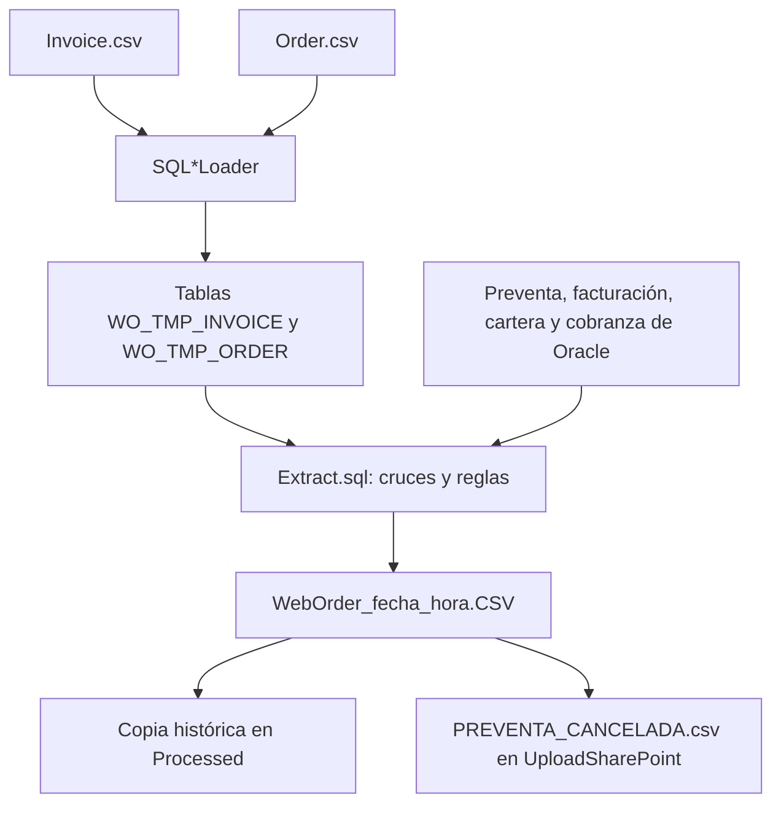

# Análisis del proceso WebOrderTrace

Fecha del análisis: 8 de septiembre de 2026.

## Objetivo y alcance

El proceso carga archivos CSV en Oracle, pero su objetivo completo es producir un reporte de órdenes con entrega fallida, cruzando esos archivos con información de preventa, facturación, cartera y cobranza.

Este análisis se basa en los scripts y archivos existentes en el repositorio. No se ejecutaron las cargas ni se realizó una conexión a Oracle. La evidencia de ejecución descrita corresponde a los logs y CSV disponibles, no a una validación del estado actual de la base de datos.

## Flujo general

El punto de entrada es [Reporte.Bat](Reporte.Bat), que ejecuta en este orden:

1. `LoadSFWO_Invoices.bat`.
2. `LoadSFWO_Orders.bat`.
3. `ExtractWebOrder.bat`.



## 1. Archivos de entrada

| Archivo | Información |
|---|---|
| `Order.csv` | Órdenes: identificador, número móvil, pedido del cliente, fechas, cliente SAP, estados e importe. |
| `Invoice.csv` | Facturas: identificador, número móvil, factura SAP, orden relacionada, cliente, estados de entrega e importe. |

Los nombres de los campos sugieren exportaciones de Salesforce/Ivy. En esta carpeta no aparece el mecanismo que obtiene esos archivos: el proceso presupone que ya están disponibles.

El archivo `extract.csv` también existe, pero los scripts del flujo principal no lo utilizan.

## 2. Carga de los archivos en Oracle

Los archivos `.bat` de carga ejecutan `sqlldr` y utilizan los siguientes controles:

| Control | Archivo de entrada | Tabla de destino |
|---|---|---|
| [LoadSFWO_Invoice.ctl](LoadSFWO_Invoice.ctl) | `Invoice.csv` | `EAI_OWNER.WO_TMP_INVOICE` |
| [LoadSFWO_Order.ctl](LoadSFWO_Order.ctl) | `Order.csv` | `EAI_OWNER.WO_TMP_ORDER` |

Ambos controles declaran `TRUNCATE INTO TABLE`: cada ejecución vacía la tabla correspondiente y vuelve a cargarla. Es una renovación completa de datos de trabajo, no una carga incremental ni una actualización por llave.

Los controles separan los campos por comas y permiten columnas finales faltantes mediante `TRAILING NULLCOLS`. Las cargas generan logs y tienen configurados archivos `.bad` para registros rechazados y `.dsc` para descartados. Los comandos establecen `Errors=1000`.

## 3. Cruces y reglas del reporte

[Extract.sql](Extract.sql) elimina comillas de los valores, convierte el importe de la orden a número y relaciona:

- La orden con su factura mediante el identificador de orden.
- El número móvil de orden con `Factura` de las tablas de T3.
- Una referencia `ZLOB` calculada para entregas fallidas con el documento correspondiente de preventa.
- La entrega de T3 con la asignación de cartera SAP.

### Tablas consultadas

| Tablas | Uso |
|---|---|
| `EAI_OWNER.WO_TMP_ORDER` | Órdenes cargadas desde el CSV. |
| `EAI_OWNER.WO_TMP_INVOICE` | Facturas cargadas desde el CSV. |
| `T3.Preventa_General` y `T3.Preventa_Detalle` | Documentos `C005` sin prefijo `L` y documentos `C006` con prefijo `L`, utilizados como ZLOB. |
| `T3.Factura_General` y `T3.Factura_Detalle` | Facturas `C003` con prefijo `H2`. |
| `EAI.TaO_Cartera_SAP_Ldr` | Documento de cartera relacionado. |
| `T3.CFDI_Cobranza` | Importes aplicados a facturas y notas de crédito, mediante `GET_CLEARING_STATUS`. |

### Periodo consultado

La consulta activa busca documentos de T3 desde `TRUNC(SYSDATE - 35)`.

Existe una variante [Extract 370 dias.sql](<Extract 370 dias.sql>), cuya diferencia con `Extract.sql` es el uso de 370 días en los tres filtros de fecha. Sin embargo, `Header.sql` invoca `Extract.sql`; por tanto, el flujo mostrado utiliza 35 días. Ese límite se aplica a los documentos consultados de T3, no directamente a los CSV.

### Filtro final

El filtro decisivo al final de la consulta es:

```sql
WHERE Info.Inv_Delivery_Status = 'Unsuccessful'
```

El resultado no incluye todas las órdenes ni todas las facturas cargadas: conserva las relacionadas con facturas cuya entrega fue fallida. Tampoco debe interpretarse como una lista de cancelaciones ya completadas.

## 4. Estados de procesamiento y compensación

### ORDEN_STATUS

La columna de salida se llama `ORDEN_STATUS`. El `CASE` de la consulta contempla los siguientes resultados, evaluados en orden:

| Resultado | Condiciones principales |
|---|---|
| `Inv-Procesada` | Factura con entrega `Delivered`, sin referencia ZLOB, procesada en BATMD y sin fecha de cancelación. Esta rama no resulta aplicable a las filas conservadas por el filtro final `Unsuccessful`. |
| `ZLob-Procesada` | Entrega `Unsuccessful`, referencia ZLOB presente, factura y ZLOB procesadas en BATMD y ambas sin fecha de cancelación. |
| `Ord-Procesada` | Orden con entrega `Delivered`, sin referencia ZLOB, factura procesada en BATMD y sin fecha de cancelación. |
| `Ord-Cancelada` | Estado de la orden igual a `Rejected by SAP`, cuando no se cumple una rama previa. |
| Vacío | Ninguna de las reglas anteriores se cumple. |

Las comprobaciones de procesamiento requieren que `Fecha_Proc_BATMD` sea anterior a `SYSDATE`; las fechas nulas no satisfacen esa condición.

### CLEARING_STATUS

La función [GET_CLEARING_STATUS.SQL](../../EAI_OWNER/Functions/GET_CLEARING_STATUS.SQL) recibe el número móvil de factura, la referencia ZLOB y el importe de la orden. Consulta `T3.CFDI_Cobranza` y compara los importes aplicados a la factura y a la nota de crédito.

Utiliza una diferencia absoluta menor de `0.50` como tolerancia. La evaluación de estados requiere que el importe de la orden y el total aplicado a la factura sean positivos.

| Resultado | Interpretación de la regla |
|---|---|
| `Comp-Ok` | El importe aplicado a la factura coincide con el de la orden y no existe una referencia de nota de crédito válida. |
| `Comp-Inv-ZLOB` | El importe aplicado a la factura coincide con el de la orden, y lo aplicado con la nota correspondiente coincide con el total aplicado a la factura. |
| `Inv-Ok-ZLOB-Ok` | Al revisar todas las aplicaciones de la nota de crédito, tanto el total de factura como el de nota coinciden con el importe de la orden. |
| `ZLOB-Ok` | El total de la nota de crédito coincide con el importe de la orden. |
| `Inv-Ok` | El total aplicado a la factura coincide con el importe de la orden. |
| Vacío | No se cumplen las condiciones previstas. |

Estos estados son resultados de consulta. Los scripts revisados no realizan la cancelación ni la compensación de los documentos.

## 5. Generación y distribución del reporte

[Header.sql](Header.sql) configura SQL*Plus y utiliza `SPOOL` para generar un archivo con el patrón:

```text
WebOrder_YYMMDD_HH24MI.CSV
```

El reporte contiene 26 columnas con datos de la orden, factura, estados de entrega, referencia ZLOB, planta, documentos SAP, fechas de procesamiento y cancelación, cartera y compensación.

Después de la consulta, actualiza `EAI.Control_Reporte` para el reporte `AUTO-NOT DELIVERED`, asignando `SYSDATE` a `Inicio` y `Fin`, y realiza `COMMIT`.

[ExtractWebOrder.bat](ExtractWebOrder.bat):

1. Elimina los archivos `WebOrder*.csv` del directorio de trabajo.
2. Ejecuta SQL*Plus con `Header.sql`.
3. Copia el resultado a `Processed`, como histórico.
4. Copia el resultado a `E:\IntegrationToolBox\UploadSharePoint\PREVENTA_CANCELADA.csv`.

La segunda ruta sugiere una integración posterior con SharePoint, pero aquí únicamente se ve la copia local, no la publicación. Tampoco se identifica en esta carpeta la programación o el mecanismo externo que dispara `Reporte.Bat`.

## 6. Evidencia disponible de ejecución

Los logs del 25 de agosto de 2026 reportan:

| Carga | Registros cargados según log | Filas de datos del CSV | Rechazados | Descartados |
|---|---:|---:|---:|---:|
| Facturas | 2,258 | 2,257 | 0 | 0 |
| Órdenes | 2,340 | 2,339 | 0 | 0 |

La diferencia de una fila corresponde al encabezado, que también se carga. Los logs indican cero registros omitidos al inicio de la carga.

El archivo `WebOrder_260825_1409.CSV` contiene 195 filas de datos:

- Todas tienen `INV_DELIVERY_STATUS = Unsuccessful`.
- Las 195 tienen `ORDEN_STATUS` vacío.
- 23 tienen `CLEARING_STATUS = Comp-Inv-ZLOB`.
- 172 tienen `CLEARING_STATUS` vacío.

Un estado vacío, por sí solo, no demuestra un error de carga. La existencia de este reporte tampoco resuelve las discrepancias de formato observadas entre los scripts y los CSV actuales.

## 7. Hallazgos y debilidades

### Falta de control de errores entre etapas

Los `.bat` continúan sin revisar `ERRORLEVEL`, y `Header.sql` no configura una salida por error SQL. Una falla puede dejar que se intente generar o copiar un reporte incompleto. El parámetro `Errors=1000` tampoco garantiza una carga íntegra.

### Discrepancia en el encabezado

El SQL excluye exactamente `"NAME"`, pero los CSV actuales comienzan con `"name"`. Esto puede dejar pasar el encabezado y provocar problemas al convertir el importe a número. Es una discrepancia del material revisado que requiere validación antes de reutilizar el flujo.

### Desplazamiento de las columnas del creador

`Order.csv` tiene 13 columnas frente a 14 del control; `Invoice.csv` tiene 15 frente a 16. Falta la columna separada `CreatedBy` que esperan los controles:

- El nombre del creador se carga en `CreatedBy`.
- El identificador del creador se carga en `CreatedBy_Name`.
- `CreatedById` queda nulo por `TRAILING NULLCOLS`.

Esos campos no intervienen en el reporte actual.

### Tratamiento frágil del CSV

Los controles no declaran delimitación por comillas y la salida concatena valores con comas sin escaparlos. Un valor que contenga comas puede alterar las columnas. El uso de `REPLACE` para eliminar comillas en la consulta no corrige una separación incorrecta ocurrida durante la carga.

### Cargas sin atomicidad conjunta

Las cargas se ejecutan por separado y reemplazan el contenido de sus tablas. Si una termina y la otra falla, las tablas pueden quedar con información de ejecuciones distintas. No existe en estos scripts una validación conjunta previa a la generación del reporte.

### Alcance limitado del registro de control

`Inicio` y `Fin` se asignan juntos al terminar la consulta; no representan la duración real del proceso ni certifican que las copias posteriores hayan funcionado.

## 8. Inventario de objetos y homólogos en SQL Server

El flujo utiliza nueve tablas y una función de negocio. No invoca procedimientos almacenados. Se localizaron las definiciones de los diez objetos en `MSSQL`.

El 8 de septiembre de 2026, el usuario confirmó que los diez objetos existen en la base de datos destino de SQL Server. La existencia en destino queda confirmada por el usuario; no se realizó una comprobación directa mediante conexión a esa base durante este análisis. Esta confirmación cubre la existencia de los objetos, no la validación funcional del proceso migrado.

| Objeto Oracle / homólogo esperado | Tipo | Archivo de definición en SQL Server, relativo a `MSSQL/T3` |
|---|---|---|
| `EAI_OWNER.WO_TMP_ORDER` | Tabla | `EAI_OWNER/Tables/Tablas_EAI_OWNER.sql` |
| `EAI_OWNER.WO_TMP_INVOICE` | Tabla | `EAI_OWNER/Tables/Tablas_EAI_OWNER.sql` |
| `T3.PREVENTA_GENERAL` | Tabla | `T3/Tables/T3.PREVENTA_GENERAL.Table.sql` |
| `T3.PREVENTA_DETALLE` | Tabla | `T3/Tables/T3.PREVENTA_DETALLE.Table.sql` |
| `T3.FACTURA_GENERAL` | Tabla | `T3/Tables/T3.FACTURA_GENERAL.SQL` |
| `T3.FACTURA_DETALLE` | Tabla | `T3/Tables/T3.FACTURA_DETALLE.Table.sql` |
| `EAI.TAO_CARTERA_SAP_LDR` | Tabla | `EAI/Tablas/Tablas_Schema_EAI_T3.sql` |
| `T3.CFDI_COBRANZA` | Tabla | `T3/Tables/T3.CFDI_COBRANZA.Table.sql` |
| `EAI.CONTROL_REPORTE` | Tabla | `EAI/Tablas/Tablas_Schema_EAI_T3.sql` |
| `EAI_OWNER.GET_CLEARING_STATUS` | Función escalar | `EAI_OWNER/Functions/GET_CLEARING_STATUS.SQL` |

La definición de `T3.FACTURA_GENERAL`, agregada y revisada el 8 de septiembre de 2026, contiene las diez columnas físicas que utiliza `Extract.sql`: `FACTURA`, `CTRO`, `FECHA_FACTURA`, `FECHA_TRN`, `TIPO_DOCTO`, `CLIENTE_SAP`, `ENTREGA`, `PEDIDO`, `REFERENCIA` y `FECHA_PROC_BATMD`.

`FECHA_CANCELACION` no se requiere como columna física: la consulta genera `NULL AS Fecha_Cancelacion` para esta tabla. El script de creación incluye `USE [T3QA]`. No se ejecutó el script durante el análisis; su existencia en destino fue confirmada por el usuario junto con los demás objetos. La revisión de esta definición confirma la presencia de las columnas utilizadas, no la equivalencia funcional completa del proceso migrado.

También se utiliza `DUAL`, objeto auxiliar de Oracle que en SQL Server se sustituye por un `SELECT` sin `FROM`. `Extract.sql` y `Header.sql` son scripts, no procedimientos almacenados.

## 9. Alcance funcional para la migración

La migración de este proceso comprende:

1. Las dos cargas de CSV, incluyendo el reemplazo de datos y la validación del formato.
2. La consulta de cruces con preventa, facturación y cartera.
3. La función de compensación y su consulta a cobranza.
4. La generación del CSV de salida.
5. La copia histórica y la entrega al directorio de integración.
6. El registro de control del reporte.
7. La orquestación y el manejo de errores entre etapas.

Convertir únicamente las tablas de destino dejaría fuera buena parte del proceso. La obtención de los CSV, la programación de la ejecución y la publicación posterior a SharePoint deben localizarse en los componentes externos correspondientes.
